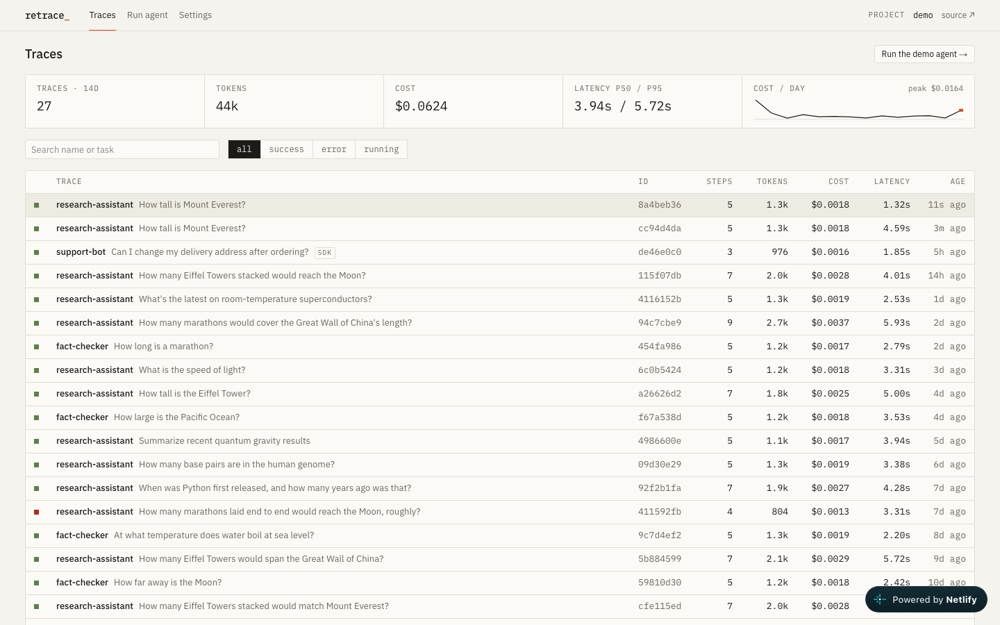
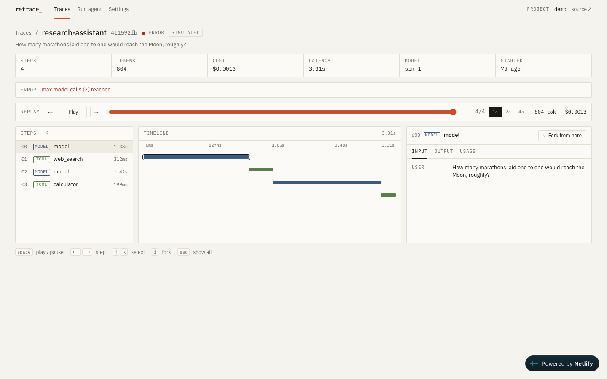
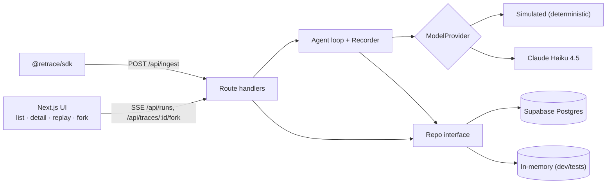

# retrace

Trace every step of an LLM agent — model calls, tool calls, tokens and cost — then **replay** it step by step or **fork it from any step** with edited input and watch the new branch run live.

**Live demo:** https://retrace-neel.netlify.app · no sign-up, seeded with 25 traces.




## What it does

- **Tracing** — every model and tool call becomes a step with input, output, tokens, cost (priced server-side) and timing.
- **Replay** — scrub or play a trace step by step; token and cost counters accumulate as you go.
- **Fork from step N** — copy steps `0..N-1` into a new trace, edit the message or tool result at step N, and resume the agent. Forks link to their parent and get a side-by-side compare view.
- **Ingestion API + TypeScript SDK** — batched, idempotent `/api/ingest` with project keys; `@retrace/sdk` buffers, retries, and never throws into your code.
- **Simulated or live** — a deterministic simulated model by default; set `ANTHROPIC_API_KEY` to run Claude Haiku 4.5 with per-IP rate limits and a daily cost cap.

## Architecture



- `apps/web` — Next.js 15 App Router, React 19, Tailwind v4. Server code talks to a `Repo` interface; `MemoryRepo` and `SupabaseRepo` pass the same contract test suite.
- The agent loop records each step through a `Recorder`, which writes it, prices it, and streams it to the browser over SSE.
- Fork rebuilds the agent's message state from the copied steps, applies the edit, and resumes the same loop.
- `packages/sdk` — dependency-free TypeScript client.

## Run locally

Requires Node 22+ and pnpm.

```bash
pnpm install
pnpm dev            # http://localhost:3000 — seeded in-memory data, no setup
pnpm test           # unit + API tests (Vitest)
pnpm e2e            # Playwright smoke test
```

To use Postgres: create a Supabase project, apply `supabase/migrations/*.sql`, copy `apps/web/.env.example` to `apps/web/.env.local`, fill it in, then `pnpm seed`.

## Send a trace

```ts
import { Retrace } from "@retrace/sdk";

const rt = new Retrace({ apiKey: "rt_demo_public_9f4c2a7e", baseUrl: "https://retrace-neel.netlify.app" });
const trace = rt.trace({ name: "support-bot", input: { question } });
const gen = trace.generation({ name: "answer", model: "claude-haiku-4-5", input: { question } });
gen.end({ output: answer, usage: { promptTokens: 812, completionTokens: 164 } });
await trace.end({ output: answer });
```

## Stack

Next.js 15 · React 19 · TypeScript · Tailwind CSS v4 · Zod · Supabase Postgres · Vitest · Playwright · Netlify
