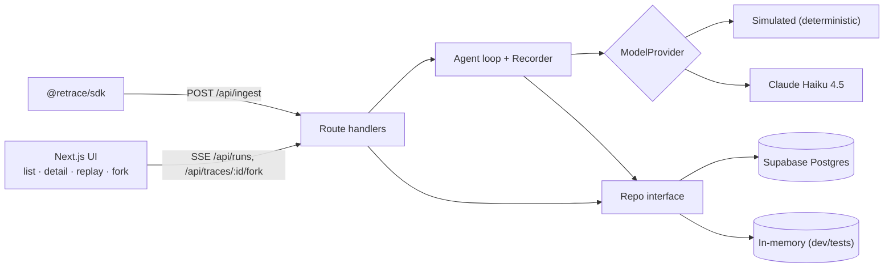

# Retrace Implementation Plan

> **For agentic workers:** REQUIRED SUB-SKILL: Use superpowers:subagent-driven-development (recommended) or superpowers:executing-plans to implement this plan task-by-task. Steps use checkbox (`- [ ]`) syntax for tracking.

**Goal:** Build Retrace — a Langfuse-style agent observability app (traces, steps, tokens, cost, replay, fork-from-step-N) with a TS ingestion SDK — and ship it to GitHub + Netlify backed by Supabase.

**Architecture:** pnpm monorepo. `apps/web` is a Next.js 15 App Router app whose server code talks to a `Repo` interface; `MemoryRepo` (seeded, used for tests/e2e/local without creds) and `SupabaseRepo` (production) both pass one shared contract test suite. A deterministic demo agent (`SimulatedProvider`, optional `AnthropicProvider`) records every model/tool call through a `Recorder` that writes steps and streams SSE events; forking replays a trace's message state up to step N and resumes the same loop. `packages/sdk` is a dependency-free client that posts batched events to `/api/ingest`.

**Tech Stack:** Node 20, pnpm 10 workspaces, Next.js 15, React 19, TypeScript (strict), Tailwind CSS v4, Zod 3, @supabase/supabase-js 2, Vitest 3, Playwright, Netlify (OpenNext runtime), Supabase Postgres.

**Spec:** `docs/superpowers/specs/2026-10-20-retrace-design.md`

## Global Constraints

- Node 20.x; package manager pnpm (workspace root `pnpm-workspace.yaml`), packages `apps/web` (name `web`) and `packages/sdk` (name `@retrace/sdk`).
- Next.js 15 App Router + React 19; route-handler/page `params` and `searchParams` are `Promise`s and must be awaited.
- Database access is server-only. Never prefix secrets with `NEXT_PUBLIC_`. Env vars: `SUPABASE_URL`, `SUPABASE_SERVICE_ROLE_KEY`, `RETRACE_DEMO_PROJECT_ID` (optional, defaults to the constant), `ANTHROPIC_API_KEY` (optional), `IP_HASH_SALT`.
- With no `SUPABASE_URL`, the app runs on a seeded in-memory repo (local dev, unit tests, e2e).
- Demo project id `00000000-0000-4000-8000-000000000001`; public demo API key `rt_demo_public_9f4c2a7e`.
- Live model `claude-haiku-4-5-20251001`; simulated model name `sim-1`. Both priced $1 / $5 per MTok in `model_pricing`.
- Max **8 model calls** per agent run (copied steps in a fork count).
- Live limits: 5 runs/hour per IP hash; $1.00/day global cap; on either, fall back to Simulated and emit a `notice` SSE event.
- Cost is computed server-side from `model_pricing`; unknown model → cost 0 and `metadata.unpriced_model = true`.
- Step indices are 0-based and displayed zero-padded to 2 digits (`#00`).
- Visual rules (spec §7): no purple/indigo gradients, glassmorphism, glowing blobs, emoji, sparkle icons, soft drop-shadows, hero/landing sections, or "AI-powered" copy. IBM Plex Sans for UI, IBM Plex Mono for all numbers/IDs/JSON (tabular nums). Light palette paper `#F5F3EE`, surface `#FBFAF7`, ink `#1C1B18`, muted `#6B675E`, hairline `#E2DED4`, accent `#D9481E`, llm `#3D5A80`, tool `#5B7F4A`, span `#8A7A5C`, error `#B3261E`. Dark: bg `#141412`, surface `#1B1A17`, ink `#ECE8DF`, hairline `#2C2A25`, same accent. 1px hairlines not shadows; radii 2–4px; 4px grid; square status dots; 120ms fades max.
- Every commit message ends with `Co-Authored-By: Claude Opus 5.5 <noreply@anthropic.com>`.

**Small, deliberate refinements of the spec made by this plan** (consistent with it, listed so reviewers aren't surprised): `steps.metadata jsonb` column (spec §4 stores `copied_from` in step metadata); `traces.step_count` column (list shows step counts); copied fork steps are re-based in time so the fork's waterfall is contiguous (originals kept in `metadata.copied_from`); search matches trace name **or** task text; a fork that edits step `#00` stores the edited task as the fork's `input.task`.

## Review Focus

1. **Forking a running trace, an SDK trace, a span, or past a failed model step** — user expects a clear 4xx message in the fork sheet, never a 500 or a half-written trace. Pinned in Task 6 (`prepareFork`/`planFork` tests).
2. **Ingest events out of order or for another project's trace** (`step.end` before `step.create`, unknown `traceId`) — expect that event to fail with a reason while the rest of the batch succeeds (207). Pinned in Task 7.
3. **A fork edit that makes a tool output invalid JSON** (user types prose into a `web_search` result) — expect the agent to treat it as "no results" and answer gracefully, not crash. Pinned in Task 4 (`parseSearch`) and Task 6.
4. **Search box input containing `%`, `,`, `(`, `"`** — expect plain filtering, not a PostgREST syntax error. Pinned in Task 16 (`sanitizeSearch`).
5. **Malformed trace id in a URL** (`/traces/nope`, `/api/traces/nope`) — expect a 404, not a Postgres uuid cast error (500). Pinned in Task 9.

---

## File Structure

```
retrace/
  package.json                    root scripts (workspace)
  pnpm-workspace.yaml
  .gitignore  .env.example  README.md
  supabase/migrations/20261020000000_init.sql
  packages/sdk/
    package.json  tsconfig.json  vitest.config.ts
    src/index.ts                  Retrace, TraceHandle, StepHandle
    src/index.test.ts
    examples/node-agent.ts
  apps/web/
    package.json  tsconfig.json  next.config.ts  postcss.config.mjs  vitest.config.ts
    playwright.config.ts  netlify.toml  .env.example
    app/
      globals.css  layout.tsx  page.tsx  not-found.tsx
      traces/[id]/page.tsx
      traces/[id]/compare/[otherId]/page.tsx
      run/page.tsx  settings/page.tsx
      api/ingest/route.ts  api/traces/route.ts  api/traces/[id]/route.ts
      api/traces/[id]/fork/route.ts  api/runs/route.ts  api/stats/route.ts
    components/
      shell/Header.tsx  shell/NavLink.tsx
      ui/StatusDot.tsx  ui/TypeTag.tsx  ui/JsonView.tsx  ui/CodeBlock.tsx  ui/KeyHints.tsx
      traces/StatsStrip.tsx  traces/Sparkline.tsx  traces/Filters.tsx  traces/TraceTable.tsx
      trace/TraceView.tsx  trace/StepList.tsx  trace/Waterfall.tsx  trace/Inspector.tsx
      trace/MessageList.tsx  trace/ReplayBar.tsx  trace/ForkSheet.tsx  trace/LineDiff.tsx
      compare/CompareView.tsx
      run/RunConsole.tsx
    lib/
      types.ts        rows + agent message types (shared, no runtime deps)
      format.ts       cost/token/duration/age/id formatting
      hash.ts         sha256Hex
      ids.ts          isUuid
      demo.ts         demo project constants
      pricing.ts      DEFAULT_PRICING, computeCost
      traces.ts       newTraceRow, summarizeSteps, finalizeTrace, getTraceDetail
      status.ts       displayStatus (stalled detection)
      stats.ts        computeStats
      queries.ts      parseListParams
      preview.ts      inputPreview, outputPreview
      sparkline.ts  waterfall.ts  replay.ts  diff.ts  compare.ts  json-highlight.ts
      sse.ts          server SSE response
      sse-client.ts   browser SSE parsing + streamEvents
      limits.ts       IP hashing, rate limit, daily cap
      seed.ts         seedDemo + PRESET_TASKS
      db/repo.ts  db/memory.ts  db/supabase.ts  db/index.ts  db/repo-contract.testkit.ts
      ingest/schemas.ts  ingest/auth.ts  ingest/process.ts
      agent/types.ts  agent/hash.ts  agent/clock.ts  agent/calculator.ts  agent/corpus.ts
      agent/tools.ts  agent/policy.ts  agent/simulated.ts  agent/anthropic.ts  agent/select.ts
      agent/recorder.ts  agent/loop.ts  agent/fork-plan.ts  agent/fork.ts
    scripts/seed.ts
    e2e/smoke.spec.ts
```

Tests live next to the code as `*.test.ts`.

---

### Task 1: Monorepo scaffold, design tokens, app shell, formatting utils

**Files:**
- Create: `package.json`, `pnpm-workspace.yaml`, `.gitignore`
- Create: `apps/web/package.json`, `apps/web/tsconfig.json`, `apps/web/next.config.ts`, `apps/web/postcss.config.mjs`, `apps/web/vitest.config.ts`
- Create: `apps/web/lib/format.ts`, `apps/web/lib/format.test.ts`
- Create: `apps/web/app/globals.css`, `apps/web/app/layout.tsx`, `apps/web/app/page.tsx`
- Create: `apps/web/components/shell/Header.tsx`, `apps/web/components/shell/NavLink.tsx`

**Interfaces:**
- Produces: `formatCost(usd: number): string`, `formatTokens(n: number): string`, `formatDuration(ms: number): string`, `relativeAge(iso: string, now: number): string`, `shortId(id: string): string`, `pad2(n: number | null): string`; CSS classes `.label .num .kbd .btn .btn-accent .field .panel`; Tailwind colors `paper surface ink muted hairline wash accent llm tool span error ok`; `@/` path alias → `apps/web/`.

- [ ] **Step 1: Root workspace files**

`package.json`:
```json
{
  "name": "retrace",
  "private": true,
  "engines": { "node": ">=20" },
  "scripts": {
    "dev": "pnpm --filter web dev",
    "build": "pnpm --filter @retrace/sdk build && pnpm --filter web build",
    "test": "pnpm -r test",
    "seed": "pnpm --filter web seed",
    "e2e": "pnpm --filter web e2e"
  }
}
```

`pnpm-workspace.yaml`:
```yaml
packages:
  - "apps/*"
  - "packages/*"
onlyBuiltDependencies:
  - esbuild
  - sharp
  - "@tailwindcss/oxide"
  - unrs-resolver
```

`.gitignore`:
```
node_modules
.next
dist
.env
.env*.local
.netlify
test-results
playwright-report
*.tsbuildinfo
next-env.d.ts
.DS_Store
```

- [ ] **Step 2: Web package and dependencies**

`apps/web/package.json`:
```json
{
  "name": "web",
  "private": true,
  "scripts": {
    "dev": "next dev -p 3000",
    "build": "next build",
    "start": "next start",
    "test": "vitest run",
    "typecheck": "tsc --noEmit",
    "seed": "tsx scripts/seed.ts",
    "e2e": "playwright test"
  }
}
```

Run:
```bash
cd apps/web
pnpm add next@15 react@19 react-dom@19 @supabase/supabase-js@2 zod@3
pnpm add -D typescript@5 @types/node@20 @types/react@19 @types/react-dom@19 tailwindcss@4 @tailwindcss/postcss@4 vitest@3 vite-tsconfig-paths@5 tsx@4 @playwright/test
```
Expected: installs without peer errors (warnings OK).

- [ ] **Step 3: Config files**

`apps/web/tsconfig.json`:
```json
{
  "compilerOptions": {
    "target": "ES2022",
    "lib": ["dom", "dom.iterable", "es2023"],
    "skipLibCheck": true,
    "strict": true,
    "noEmit": true,
    "esModuleInterop": true,
    "module": "esnext",
    "moduleResolution": "bundler",
    "resolveJsonModule": true,
    "isolatedModules": true,
    "jsx": "preserve",
    "incremental": true,
    "plugins": [{ "name": "next" }],
    "paths": { "@/*": ["./*"] }
  },
  "include": ["next-env.d.ts", "**/*.ts", "**/*.tsx", ".next/types/**/*.ts"],
  "exclude": ["node_modules"]
}
```

`apps/web/next.config.ts`:
```ts
import type { NextConfig } from "next";

const nextConfig: NextConfig = { reactStrictMode: true };

export default nextConfig;
```

`apps/web/postcss.config.mjs`:
```js
export default { plugins: { "@tailwindcss/postcss": {} } };
```

`apps/web/vitest.config.ts`:
```ts
import { defineConfig } from "vitest/config";
import tsconfigPaths from "vite-tsconfig-paths";

export default defineConfig({
  plugins: [tsconfigPaths()],
  test: {
    include: ["**/*.test.ts"],
    exclude: ["node_modules", ".next", "e2e"],
    testTimeout: 20_000,
  },
});
```

- [ ] **Step 4: Write the failing test** — `apps/web/lib/format.test.ts`

```ts
import { describe, expect, it } from "vitest";
import { formatCost, formatDuration, formatTokens, pad2, relativeAge, shortId } from "./format";

describe("format", () => {
  it("formats cost by magnitude", () => {
    expect(formatCost(0)).toBe("$0");
    expect(formatCost(0.00004)).toBe("<$0.0001");
    expect(formatCost(0.00123)).toBe("$0.0012");
    expect(formatCost(3.456)).toBe("$3.46");
  });
  it("formats tokens compactly", () => {
    expect(formatTokens(812)).toBe("812");
    expect(formatTokens(1234)).toBe("1.2k");
    expect(formatTokens(12345)).toBe("12k");
    expect(formatTokens(2_500_000)).toBe("2.5M");
  });
  it("formats durations", () => {
    expect(formatDuration(950)).toBe("950ms");
    expect(formatDuration(1234)).toBe("1.23s");
    expect(formatDuration(12_340)).toBe("12.3s");
    expect(formatDuration(75_000)).toBe("1m15s");
  });
  it("formats relative age against an explicit now", () => {
    const now = Date.parse("2026-10-20T12:00:00Z");
    expect(relativeAge("2026-10-20T11:59:30Z", now)).toBe("30s ago");
    expect(relativeAge("2026-10-20T11:15:00Z", now)).toBe("45m ago");
    expect(relativeAge("2026-10-20T07:00:00Z", now)).toBe("5h ago");
    expect(relativeAge("2026-10-17T12:00:00Z", now)).toBe("3d ago");
  });
  it("shortens ids and pads indices", () => {
    expect(shortId("1a2b3c4d-0000-4000-8000-000000000000")).toBe("1a2b3c4d");
    expect(pad2(3)).toBe("03");
    expect(pad2(null)).toBe("--");
  });
});
```

- [ ] **Step 5: Run test to verify it fails**

Run: `cd apps/web && pnpm test lib/format.test.ts`
Expected: FAIL — cannot resolve `./format`.

- [ ] **Step 6: Implement** — `apps/web/lib/format.ts`

```ts
export function formatCost(usd: number): string {
  if (usd === 0) return "$0";
  if (usd < 0.0001) return "<$0.0001";
  if (usd < 1) return `$${usd.toFixed(4)}`;
  return `$${usd.toFixed(2)}`;
}

export function formatTokens(n: number): string {
  if (n < 1000) return String(n);
  if (n < 1_000_000) return `${(n / 1000).toFixed(n < 10_000 ? 1 : 0)}k`;
  return `${(n / 1_000_000).toFixed(1)}M`;
}

export function formatDuration(ms: number): string {
  if (ms < 1000) return `${Math.round(ms)}ms`;
  if (ms < 60_000) return `${(ms / 1000).toFixed(ms < 10_000 ? 2 : 1)}s`;
  const m = Math.floor(ms / 60_000);
  const s = Math.round((ms % 60_000) / 1000);
  return `${m}m${String(s).padStart(2, "0")}s`;
}

export function relativeAge(iso: string, now: number): string {
  const s = Math.max(0, Math.round((now - Date.parse(iso)) / 1000));
  if (s < 60) return `${s}s ago`;
  const m = Math.floor(s / 60);
  if (m < 60) return `${m}m ago`;
  const h = Math.floor(m / 60);
  if (h < 24) return `${h}h ago`;
  return `${Math.floor(h / 24)}d ago`;
}

export function shortId(id: string): string {
  return id.slice(0, 8);
}

export function pad2(n: number | null): string {
  return n == null ? "--" : String(n).padStart(2, "0");
}
```

- [ ] **Step 7: Run test to verify it passes**

Run: `cd apps/web && pnpm test lib/format.test.ts`
Expected: PASS (5 tests).

- [ ] **Step 8: Design tokens** — `apps/web/app/globals.css`

```css
@import "tailwindcss";

@theme inline {
  --color-paper: var(--paper);
  --color-surface: var(--surface);
  --color-ink: var(--ink);
  --color-muted: var(--muted);
  --color-hairline: var(--hairline);
  --color-wash: var(--wash);
  --color-accent: var(--accent);
  --color-llm: var(--llm);
  --color-tool: var(--tool);
  --color-span: var(--span);
  --color-error: var(--error);
  --color-ok: var(--ok);
  --font-sans: var(--font-plex-sans), ui-sans-serif, system-ui, sans-serif;
  --font-mono: var(--font-plex-mono), ui-monospace, SFMono-Regular, monospace;
}

:root {
  --paper: #f5f3ee;
  --surface: #fbfaf7;
  --ink: #1c1b18;
  --muted: #6b675e;
  --hairline: #e2ded4;
  --wash: #eeebe3;
  --accent: #d9481e;
  --llm: #3d5a80;
  --tool: #5b7f4a;
  --span: #8a7a5c;
  --error: #b3261e;
  --ok: #5b7f4a;
  color-scheme: light;
}

@media (prefers-color-scheme: dark) {
  :root {
    --paper: #141412;
    --surface: #1b1a17;
    --ink: #ece8df;
    --muted: #9a958a;
    --hairline: #2c2a25;
    --wash: #23221e;
    --llm: #86a7cf;
    --tool: #93b57f;
    --span: #c2b28f;
    --error: #e2665c;
    --ok: #93b57f;
    color-scheme: dark;
  }
}

html,
body {
  background: var(--paper);
  color: var(--ink);
}

body {
  font-size: 13px;
  line-height: 1.45;
  -webkit-font-smoothing: antialiased;
}

::selection {
  background: color-mix(in srgb, var(--accent) 25%, transparent);
}

@layer components {
  .label {
    font-family: var(--font-mono);
    font-size: 11px;
    letter-spacing: 0.08em;
    text-transform: uppercase;
    color: var(--muted);
  }
  .num {
    font-family: var(--font-mono);
    font-variant-numeric: tabular-nums;
  }
  .kbd {
    font-family: var(--font-mono);
    font-size: 10.5px;
    line-height: 1.4;
    border: 1px solid var(--hairline);
    border-bottom-width: 2px;
    border-radius: 3px;
    padding: 0 4px;
    color: var(--muted);
    background: var(--surface);
  }
  .btn {
    display: inline-flex;
    align-items: center;
    gap: 6px;
    height: 26px;
    padding: 0 10px;
    border: 1px solid var(--hairline);
    border-radius: 3px;
    background: var(--surface);
    font-size: 12px;
    transition: border-color 120ms;
  }
  .btn:hover:not(:disabled) {
    border-color: var(--muted);
  }
  .btn:disabled {
    opacity: 0.45;
    cursor: not-allowed;
  }
  .btn-accent {
    background: var(--accent);
    border-color: var(--accent);
    color: #fff;
  }
  .btn-accent:hover:not(:disabled) {
    border-color: var(--ink);
  }
  .field {
    border: 1px solid var(--hairline);
    background: var(--surface);
    border-radius: 3px;
    padding: 4px 8px;
    outline: none;
  }
  .field:focus {
    border-color: var(--ink);
  }
  .panel {
    background: var(--surface);
    border: 1px solid var(--hairline);
    border-radius: 2px;
  }
}
```

- [ ] **Step 9: Shell** — layout, header, placeholder home

`apps/web/components/shell/NavLink.tsx`:
```tsx
"use client";

import Link from "next/link";
import { usePathname } from "next/navigation";

export function NavLink({ href, children }: { href: string; children: React.ReactNode }) {
  const pathname = usePathname();
  const active = href === "/" ? pathname === "/" || pathname.startsWith("/traces") : pathname.startsWith(href);
  return (
    <Link
      href={href}
      className={`relative px-2 py-3 text-[13px] ${active ? "text-ink" : "text-muted hover:text-ink"}`}
    >
      {children}
      {active && <span className="absolute inset-x-2 -bottom-px h-px bg-accent" />}
    </Link>
  );
}
```

`apps/web/components/shell/Header.tsx`:
```tsx
import Link from "next/link";
import { NavLink } from "./NavLink";

export function Header() {
  return (
    <header className="border-b border-hairline">
      <div className="mx-auto flex h-11 max-w-[1400px] items-center gap-5 px-4">
        <Link href="/" className="num text-[14px] font-medium tracking-tight">
          retrace<span className="text-accent">_</span>
        </Link>
        <nav className="flex items-center">
          <NavLink href="/">Traces</NavLink>
          <NavLink href="/run">Run agent</NavLink>
          <NavLink href="/settings">Settings</NavLink>
        </nav>
        <div className="ml-auto flex items-center gap-3 text-[12px]">
          <span className="label hidden sm:inline">project</span>
          <span className="num hidden sm:inline">demo</span>
          <a href="https://github.com/NeelParihar/retrace" className="text-muted hover:text-ink">
            source ↗
          </a>
        </div>
      </div>
    </header>
  );
}
```

`apps/web/app/layout.tsx`:
```tsx
import type { Metadata } from "next";
import { IBM_Plex_Mono, IBM_Plex_Sans } from "next/font/google";
import { Header } from "@/components/shell/Header";
import "./globals.css";

const sans = IBM_Plex_Sans({ subsets: ["latin"], weight: ["400", "500", "600"], variable: "--font-plex-sans" });
const mono = IBM_Plex_Mono({ subsets: ["latin"], weight: ["400", "500"], variable: "--font-plex-mono" });

export const metadata: Metadata = {
  title: "retrace — agent traces & replay",
  description: "Trace every step, tool call, token and dollar of an LLM agent. Replay it. Fork it from any step.",
};

export default function RootLayout({ children }: { children: React.ReactNode }) {
  return (
    <html lang="en" className={`${sans.variable} ${mono.variable}`}>
      <body className="min-h-screen font-sans">
        <Header />
        <main className="mx-auto max-w-[1400px] px-4 py-5">{children}</main>
      </body>
    </html>
  );
}
```

`apps/web/app/page.tsx` (placeholder, replaced in Task 12):
```tsx
export default function TracesPage() {
  return <p className="text-muted">No traces yet.</p>;
}
```

- [ ] **Step 10: Verify the app builds**

Run: `cd apps/web && pnpm build`
Expected: `✓ Compiled successfully`, route `/` listed.

- [ ] **Step 11: Commit**

```bash
git add -A
git commit -m "chore: scaffold monorepo, Next.js app shell and design tokens

Co-Authored-By: Claude Opus 5.5 <noreply@anthropic.com>"
```

---

### Task 2: Domain types, pricing, Repo interface, MemoryRepo + contract suite

**Files:**
- Create: `apps/web/lib/types.ts`, `apps/web/lib/hash.ts`, `apps/web/lib/ids.ts`, `apps/web/lib/demo.ts`, `apps/web/lib/pricing.ts`, `apps/web/lib/traces.ts`
- Create: `apps/web/lib/db/repo.ts`, `apps/web/lib/db/memory.ts`, `apps/web/lib/db/index.ts`, `apps/web/lib/db/repo-contract.testkit.ts`
- Test: `apps/web/lib/pricing.test.ts`, `apps/web/lib/traces.test.ts`, `apps/web/lib/db/memory.test.ts`

**Interfaces:**
- Produces (types, `lib/types.ts`): `StepType`, `TraceStatus`, `Provider`, `TraceRow`, `StepRow`, `ModelPrice`, `Project`, `Msg`, `ToolCall`, `LlmInput`, `LlmOutput`, `ToolInput`, `ToolOutput`, `Usage`.
- Produces: `sha256Hex(s: string): string`; `isUuid(s: string): boolean`; `DEMO_PROJECT_ID`, `DEMO_API_KEY`, `DEMO_API_KEY_HASH`; `DEFAULT_PRICING: ModelPrice[]`; `computeCost(prices, model, promptTokens, completionTokens): { cost: number; known: boolean }`; `newTraceRow(p): TraceRow`; `summarizeSteps(steps): { step_count; total_tokens; total_cost }`; `finalizeTrace(repo, traceId, status, output, endedAtMs): Promise<TraceRow>`.
- Produces: `interface Repo` (below), `class MemoryRepo`, `getRepo(): Promise<Repo>`, `setRepoForTests(repo: Repo | null): void`, `createMemoryRepo(): MemoryRepo`, `projectId(): string`, `runRepoContract(label, setup)`, `makeStep(traceId, idx, extra?)`.

- [ ] **Step 1: Types and small helpers**

`apps/web/lib/types.ts`:
```ts
export type StepType = "llm" | "tool" | "span";
export type TraceStatus = "running" | "success" | "error";
export type Provider = "simulated" | "live" | "sdk";

export interface TraceRow {
  id: string;
  project_id: string;
  name: string;
  status: TraceStatus;
  input: unknown;
  output: unknown;
  metadata: Record<string, unknown>;
  step_count: number;
  total_tokens: number;
  total_cost: number;
  latency_ms: number | null;
  parent_trace_id: string | null;
  forked_from_step_index: number | null;
  provider: Provider;
  created_at: string;
  ended_at: string | null;
}

export interface StepRow {
  id: string;
  trace_id: string;
  parent_step_id: string | null;
  idx: number;
  type: StepType;
  name: string;
  input: unknown;
  output: unknown;
  model: string | null;
  prompt_tokens: number;
  completion_tokens: number;
  cost: number;
  started_at: string;
  ended_at: string | null;
  error: string | null;
  metadata: Record<string, unknown>;
}

export interface ModelPrice {
  model: string;
  input_per_mtok: number;
  output_per_mtok: number;
}

export interface Project {
  id: string;
  name: string;
  api_key_hash: string;
}

export interface ToolCall {
  id: string;
  name: string;
  input: Record<string, unknown>;
}

export type Msg =
  | { role: "user"; content: string }
  | { role: "assistant"; text: string | null; toolCalls: ToolCall[] }
  | { role: "tool"; toolCallId: string; name: string; content: string; isError: boolean };

export interface Usage {
  promptTokens: number;
  completionTokens: number;
}

export interface LlmInput {
  messages: Msg[];
}
export interface LlmOutput {
  text: string | null;
  toolCalls: ToolCall[];
}
export interface ToolInput {
  toolCallId: string;
  args: Record<string, unknown>;
}
export interface ToolOutput {
  content: string;
  isError: boolean;
}
```

`apps/web/lib/hash.ts`:
```ts
import { createHash } from "node:crypto";

export function sha256Hex(s: string): string {
  return createHash("sha256").update(s).digest("hex");
}
```

`apps/web/lib/ids.ts`:
```ts
const UUID = /^[0-9a-f]{8}-[0-9a-f]{4}-[0-9a-f]{4}-[0-9a-f]{4}-[0-9a-f]{12}$/i;

export function isUuid(s: string): boolean {
  return UUID.test(s);
}
```

`apps/web/lib/demo.ts`:
```ts
import { sha256Hex } from "./hash";

export const DEMO_PROJECT_ID = "00000000-0000-4000-8000-000000000001";
/** Public by design: anyone may ingest into the demo project. */
export const DEMO_API_KEY = "rt_demo_public_9f4c2a7e";
export const DEMO_API_KEY_HASH = sha256Hex(DEMO_API_KEY);
```

- [ ] **Step 2: Write failing tests for pricing and trace summaries**

`apps/web/lib/pricing.test.ts`:
```ts
import { describe, expect, it } from "vitest";
import { computeCost, DEFAULT_PRICING } from "./pricing";

describe("computeCost", () => {
  it("prices prompt and completion tokens per million", () => {
    expect(computeCost(DEFAULT_PRICING, "sim-1", 1000, 200)).toEqual({ cost: 0.002, known: true });
  });
  it("returns zero and unknown for unpriced models", () => {
    expect(computeCost(DEFAULT_PRICING, "mystery-9", 1000, 200)).toEqual({ cost: 0, known: false });
  });
  it("treats steps without a model and without tokens as known zero", () => {
    expect(computeCost(DEFAULT_PRICING, null, 0, 0)).toEqual({ cost: 0, known: true });
  });
  it("rounds to 6 decimal places", () => {
    expect(computeCost(DEFAULT_PRICING, "gpt-4o-mini", 7, 3).cost).toBe(0.000003);
  });
});
```

`apps/web/lib/traces.test.ts`:
```ts
import { describe, expect, it } from "vitest";
import { MemoryRepo } from "./db/memory";
import { makeStep } from "./db/repo-contract.testkit";
import { finalizeTrace, newTraceRow, summarizeSteps } from "./traces";

const P = "00000000-0000-4000-8000-0000000000aa";

describe("traces", () => {
  it("summarizes tokens, cost and count", () => {
    const steps = [
      makeStep("t", 0, { prompt_tokens: 100, completion_tokens: 20, cost: 0.0002 }),
      makeStep("t", 1, { prompt_tokens: 50, completion_tokens: 5, cost: 0.000075 }),
    ];
    expect(summarizeSteps(steps)).toEqual({ step_count: 2, total_tokens: 175, total_cost: 0.000275 });
  });

  it("finalizes a trace with totals, status and latency", async () => {
    const repo = new MemoryRepo({ projects: [{ id: P, name: "p", api_key_hash: "h" }] });
    const t = newTraceRow({
      id: "11111111-1111-4111-8111-111111111111",
      project_id: P,
      name: "x",
      input: { task: "t" },
      provider: "simulated",
      created_at: "2026-01-01T00:00:00.000Z",
    });
    await repo.insertTrace(t);
    await repo.insertStep(makeStep(t.id, 0, { prompt_tokens: 10, completion_tokens: 2, cost: 0.00002 }));
    const done = await finalizeTrace(repo, t.id, "success", { answer: "a" }, Date.parse("2026-01-01T00:00:01.500Z"));
    expect(done).toMatchObject({
      status: "success",
      output: { answer: "a" },
      step_count: 1,
      total_tokens: 12,
      total_cost: 0.00002,
      latency_ms: 1500,
      ended_at: "2026-01-01T00:00:01.500Z",
    });
    expect(await repo.getTrace(t.id)).toMatchObject({ status: "success", latency_ms: 1500 });
  });
});
```

`apps/web/lib/db/memory.test.ts`:
```ts
import { DEFAULT_PRICING } from "../pricing";
import { MemoryRepo } from "./memory";
import { runRepoContract } from "./repo-contract.testkit";

const P = "00000000-0000-4000-8000-0000000000bb";

runRepoContract("memory", async () => ({
  repo: new MemoryRepo({ projects: [{ id: P, name: "test", api_key_hash: "known-hash" }], pricing: DEFAULT_PRICING }),
  projectId: P,
  knownKeyHash: "known-hash",
}));
```

`apps/web/lib/db/repo-contract.testkit.ts`:
```ts
import { randomUUID } from "node:crypto";
import { beforeAll, describe, expect, it } from "vitest";
import { newTraceRow } from "../traces";
import type { StepRow, TraceRow } from "../types";
import type { Repo } from "./repo";

export interface ContractEnv {
  repo: Repo;
  projectId: string;
  knownKeyHash: string;
}

export function makeStep(traceId: string, idx: number, extra: Partial<StepRow> = {}): StepRow {
  return {
    id: randomUUID(),
    trace_id: traceId,
    parent_step_id: null,
    idx,
    type: "tool",
    name: `step-${idx}`,
    input: { i: idx },
    output: null,
    model: null,
    prompt_tokens: 0,
    completion_tokens: 0,
    cost: 0,
    started_at: new Date(Date.UTC(2026, 0, 1, 0, 0, idx)).toISOString(),
    ended_at: null,
    error: null,
    metadata: {},
    ...extra,
  };
}

/** Shared behaviour every Repo implementation must satisfy. Names are tagged so it can run against a live DB. */
export function runRepoContract(label: string, setup: () => Promise<ContractEnv>) {
  describe(`Repo contract: ${label}`, () => {
    let env: ContractEnv;
    const tag = `contract-${randomUUID().slice(0, 8)}`;
    const trace = (minute: number, extra: Partial<TraceRow> = {}): TraceRow => ({
      ...newTraceRow({
        id: randomUUID(),
        project_id: env.projectId,
        name: `${tag}-${minute}`,
        input: { task: `task for ${tag}` },
        provider: "simulated",
        created_at: new Date(Date.UTC(2026, 0, 1, 0, minute)).toISOString(),
      }),
      ...extra,
    });

    beforeAll(async () => {
      env = await setup();
    });

    it("inserts a trace once and reads it back", async () => {
      const t = trace(1);
      expect(await env.repo.insertTrace(t)).toBe(true);
      expect(await env.repo.insertTrace(t)).toBe(false);
      expect(await env.repo.getTrace(t.id)).toEqual(t);
      expect(await env.repo.getTrace(randomUUID())).toBeNull();
    });

    it("merges updates", async () => {
      const t = trace(2);
      await env.repo.insertTrace(t);
      await env.repo.updateTrace(t.id, { status: "error", total_cost: 0.5, output: { error: "x" } });
      expect(await env.repo.getTrace(t.id)).toMatchObject({ status: "error", total_cost: 0.5, output: { error: "x" }, name: t.name });
    });

    it("lists newest first with search, status filter and cursor paging", async () => {
      const q = `${tag}-page`;
      const a = trace(10, { name: `${q}-a` });
      const b = trace(11, { name: `${q}-b`, status: "error" });
      const c = trace(12, { name: `${q}-c` });
      for (const t of [a, b, c]) await env.repo.insertTrace(t);

      const p1 = await env.repo.listTraces({ projectId: env.projectId, q, limit: 2 });
      expect(p1.items.map((t) => t.id)).toEqual([c.id, b.id]);
      expect(p1.nextCursor).toBe(b.created_at);

      const p2 = await env.repo.listTraces({ projectId: env.projectId, q, limit: 2, cursor: p1.nextCursor });
      expect(p2.items.map((t) => t.id)).toEqual([a.id]);
      expect(p2.nextCursor).toBeNull();

      const errors = await env.repo.listTraces({ projectId: env.projectId, q, status: "error", limit: 10 });
      expect(errors.items.map((t) => t.id)).toEqual([b.id]);
    });

    it("search also matches the task text, case-insensitively", async () => {
      const needle = `Zebra${randomUUID().slice(0, 6)}`;
      const t = trace(20, { input: { task: `find the ${needle} please` } });
      await env.repo.insertTrace(t);
      const res = await env.repo.listTraces({ projectId: env.projectId, q: needle.toLowerCase(), limit: 10 });
      expect(res.items.map((x) => x.id)).toEqual([t.id]);
    });

    it("lists traces since a timestamp", async () => {
      const old = trace(30, { created_at: "2001-01-01T00:00:00.000Z" });
      const recent = trace(31);
      await env.repo.insertTrace(old);
      await env.repo.insertTrace(recent);
      const ids = (await env.repo.listTracesSince(env.projectId, "2025-12-31T00:00:00.000Z")).map((t) => t.id);
      expect(ids).toContain(recent.id);
      expect(ids).not.toContain(old.id);
    });

    it("stores steps idempotently, updates them and returns them by idx", async () => {
      const t = trace(40);
      await env.repo.insertTrace(t);
      const s1 = makeStep(t.id, 1);
      const s0 = makeStep(t.id, 0, { type: "llm", model: "sim-1" });
      expect(await env.repo.insertStep(s1)).toBe(true);
      expect(await env.repo.insertStep(s0)).toBe(true);
      expect(await env.repo.insertStep(s0)).toBe(false);
      await env.repo.updateStep(s1.id, { output: { ok: 1 }, ended_at: "2026-01-01T00:00:05.000Z" });
      const steps = await env.repo.getSteps(t.id);
      expect(steps.map((s) => s.idx)).toEqual([0, 1]);
      expect(steps[1]).toMatchObject({ output: { ok: 1 }, ended_at: "2026-01-01T00:00:05.000Z" });
      expect(await env.repo.getStep(s0.id)).toEqual(s0);
    });

    it("returns forks of a trace", async () => {
      const parent = trace(50);
      const fork = trace(51, { parent_trace_id: parent.id, forked_from_step_index: 2 });
      await env.repo.insertTrace(parent);
      await env.repo.insertTrace(fork);
      expect((await env.repo.getForks(parent.id)).map((t) => t.id)).toEqual([fork.id]);
    });

    it("rate limits per window", async () => {
      const ip = `ip-${randomUUID()}`;
      const w = "2026-01-01T10:00:00.000Z";
      expect(await env.repo.hitRateLimit(ip, w, 2)).toBe(true);
      expect(await env.repo.hitRateLimit(ip, w, 2)).toBe(true);
      expect(await env.repo.hitRateLimit(ip, w, 2)).toBe(false);
      expect(await env.repo.hitRateLimit(ip, "2026-01-01T11:00:00.000Z", 2)).toBe(true);
    });

    it("accumulates live usage per day", async () => {
      const day = `1990-01-${String(1 + Math.floor(Math.random() * 28)).padStart(2, "0")}`;
      const before = await env.repo.getLiveUsage(day);
      await env.repo.addLiveUsage(day, 0.25);
      await env.repo.addLiveUsage(day, 0.5);
      const after = await env.repo.getLiveUsage(day);
      expect(after.live_runs - before.live_runs).toBe(2);
      expect(after.live_cost - before.live_cost).toBeCloseTo(0.75, 6);
    });

    it("exposes pricing and finds projects by key hash", async () => {
      expect((await env.repo.getPricing()).map((p) => p.model)).toContain("sim-1");
      expect(await env.repo.findProjectByKeyHash(env.knownKeyHash)).toMatchObject({ id: env.projectId });
      expect(await env.repo.findProjectByKeyHash("nope")).toBeNull();
    });
  });
}
```

- [ ] **Step 3: Run tests to verify they fail**

Run: `cd apps/web && pnpm test lib/pricing.test.ts lib/traces.test.ts lib/db/memory.test.ts`
Expected: FAIL — modules `./pricing`, `./traces`, `./memory` not found.

- [ ] **Step 4: Implement pricing, traces, Repo, MemoryRepo, getRepo**

`apps/web/lib/pricing.ts`:
```ts
import type { ModelPrice } from "./types";

export const DEFAULT_PRICING: ModelPrice[] = [
  { model: "sim-1", input_per_mtok: 1, output_per_mtok: 5 },
  { model: "claude-haiku-4-5", input_per_mtok: 1, output_per_mtok: 5 },
  { model: "claude-haiku-4-5-20251001", input_per_mtok: 1, output_per_mtok: 5 },
  { model: "gpt-4o-mini", input_per_mtok: 0.15, output_per_mtok: 0.6 },
];

export function computeCost(
  prices: ModelPrice[],
  model: string | null,
  promptTokens: number,
  completionTokens: number,
): { cost: number; known: boolean } {
  if (!model) return { cost: 0, known: promptTokens + completionTokens === 0 };
  const p = prices.find((x) => x.model === model);
  if (!p) return { cost: 0, known: false };
  const cost = (promptTokens * p.input_per_mtok + completionTokens * p.output_per_mtok) / 1_000_000;
  return { cost: Math.round(cost * 1e6) / 1e6, known: true };
}
```

`apps/web/lib/db/repo.ts`:
```ts
import type { ModelPrice, StepRow, TraceRow, TraceStatus } from "../types";

export interface ListQuery {
  projectId: string;
  q?: string;
  status?: TraceStatus;
  cursor?: string | null;
  limit: number;
}

export interface Repo {
  getPricing(): Promise<ModelPrice[]>;
  findProjectByKeyHash(hash: string): Promise<{ id: string; name: string } | null>;
  /** Returns false when a trace with this id already exists. */
  insertTrace(t: TraceRow): Promise<boolean>;
  updateTrace(id: string, patch: Partial<TraceRow>): Promise<void>;
  getTrace(id: string): Promise<TraceRow | null>;
  /** Newest first. `cursor` is the created_at of the last item of the previous page. */
  listTraces(q: ListQuery): Promise<{ items: TraceRow[]; nextCursor: string | null }>;
  listTracesSince(projectId: string, sinceIso: string): Promise<TraceRow[]>;
  getForks(traceId: string): Promise<TraceRow[]>;
  /** Returns false when a step with this id already exists. */
  insertStep(s: StepRow): Promise<boolean>;
  updateStep(id: string, patch: Partial<StepRow>): Promise<void>;
  getStep(id: string): Promise<StepRow | null>;
  /** Ordered by idx ascending. */
  getSteps(traceId: string): Promise<StepRow[]>;
  /** Increments the counter for (ipHash, window) and returns true while it is <= max. */
  hitRateLimit(ipHash: string, windowStartIso: string, max: number): Promise<boolean>;
  getLiveUsage(day: string): Promise<{ live_cost: number; live_runs: number }>;
  addLiveUsage(day: string, cost: number): Promise<void>;
}
```

`apps/web/lib/db/memory.ts`:
```ts
import { DEFAULT_PRICING } from "../pricing";
import type { ModelPrice, Project, StepRow, TraceRow } from "../types";
import type { ListQuery, Repo } from "./repo";

const clone = <T>(v: T): T => structuredClone(v);

function taskText(t: TraceRow): string {
  const input = t.input as { task?: unknown } | null;
  return typeof input?.task === "string" ? input.task : "";
}

export class MemoryRepo implements Repo {
  private traces = new Map<string, TraceRow>();
  private steps = new Map<string, StepRow>();
  private rate = new Map<string, number>();
  private usage = new Map<string, { live_cost: number; live_runs: number }>();
  private projects: Project[];
  private pricing: ModelPrice[];

  constructor(init: { projects?: Project[]; pricing?: ModelPrice[] } = {}) {
    this.projects = init.projects ?? [];
    this.pricing = init.pricing ?? DEFAULT_PRICING;
  }

  async getPricing() {
    return clone(this.pricing);
  }

  async findProjectByKeyHash(hash: string) {
    const p = this.projects.find((x) => x.api_key_hash === hash);
    return p ? { id: p.id, name: p.name } : null;
  }

  async insertTrace(t: TraceRow) {
    if (this.traces.has(t.id)) return false;
    this.traces.set(t.id, clone(t));
    return true;
  }

  async updateTrace(id: string, patch: Partial<TraceRow>) {
    const t = this.traces.get(id);
    if (!t) throw new Error(`trace ${id} not found`);
    this.traces.set(id, { ...t, ...clone(patch) });
  }

  async getTrace(id: string) {
    const t = this.traces.get(id);
    return t ? clone(t) : null;
  }

  async listTraces({ projectId, q, status, cursor, limit }: ListQuery) {
    const needle = q?.trim().toLowerCase();
    const rows = [...this.traces.values()]
      .filter((t) => t.project_id === projectId)
      .filter((t) => !status || t.status === status)
      .filter((t) => !needle || t.name.toLowerCase().includes(needle) || taskText(t).toLowerCase().includes(needle))
      .filter((t) => !cursor || t.created_at < cursor)
      .sort((a, b) => b.created_at.localeCompare(a.created_at) || b.id.localeCompare(a.id));
    const items = rows.slice(0, limit).map(clone);
    return { items, nextCursor: rows.length > limit ? items[items.length - 1].created_at : null };
  }

  async listTracesSince(projectId: string, sinceIso: string) {
    return [...this.traces.values()]
      .filter((t) => t.project_id === projectId && t.created_at >= sinceIso)
      .map(clone);
  }

  async getForks(traceId: string) {
    return [...this.traces.values()]
      .filter((t) => t.parent_trace_id === traceId)
      .sort((a, b) => a.created_at.localeCompare(b.created_at))
      .map(clone);
  }

  async insertStep(s: StepRow) {
    if (this.steps.has(s.id)) return false;
    this.steps.set(s.id, clone(s));
    return true;
  }

  async updateStep(id: string, patch: Partial<StepRow>) {
    const s = this.steps.get(id);
    if (!s) throw new Error(`step ${id} not found`);
    this.steps.set(id, { ...s, ...clone(patch) });
  }

  async getStep(id: string) {
    const s = this.steps.get(id);
    return s ? clone(s) : null;
  }

  async getSteps(traceId: string) {
    return [...this.steps.values()]
      .filter((s) => s.trace_id === traceId)
      .sort((a, b) => a.idx - b.idx)
      .map(clone);
  }

  async hitRateLimit(ipHash: string, windowStartIso: string, max: number) {
    const key = `${ipHash}|${windowStartIso}`;
    const n = (this.rate.get(key) ?? 0) + 1;
    this.rate.set(key, n);
    return n <= max;
  }

  async getLiveUsage(day: string) {
    return { ...(this.usage.get(day) ?? { live_cost: 0, live_runs: 0 }) };
  }

  async addLiveUsage(day: string, cost: number) {
    const u = this.usage.get(day) ?? { live_cost: 0, live_runs: 0 };
    this.usage.set(day, { live_cost: u.live_cost + cost, live_runs: u.live_runs + 1 });
  }
}
```

`apps/web/lib/traces.ts`:
```ts
import type { Repo } from "./db/repo";
import type { Provider, StepRow, TraceRow, TraceStatus } from "./types";

export function newTraceRow(p: {
  id: string;
  project_id: string;
  name: string;
  input: unknown;
  provider: Provider;
  created_at: string;
  metadata?: Record<string, unknown>;
  parent_trace_id?: string | null;
  forked_from_step_index?: number | null;
}): TraceRow {
  return {
    id: p.id,
    project_id: p.project_id,
    name: p.name,
    status: "running",
    input: p.input ?? null,
    output: null,
    metadata: p.metadata ?? {},
    step_count: 0,
    total_tokens: 0,
    total_cost: 0,
    latency_ms: null,
    parent_trace_id: p.parent_trace_id ?? null,
    forked_from_step_index: p.forked_from_step_index ?? null,
    provider: p.provider,
    created_at: p.created_at,
    ended_at: null,
  };
}

export function summarizeSteps(steps: StepRow[]) {
  let total_tokens = 0;
  let total_cost = 0;
  for (const s of steps) {
    total_tokens += s.prompt_tokens + s.completion_tokens;
    total_cost += s.cost;
  }
  return { step_count: steps.length, total_tokens, total_cost: Math.round(total_cost * 1e6) / 1e6 };
}

export async function finalizeTrace(
  repo: Repo,
  traceId: string,
  status: TraceStatus,
  output: unknown,
  endedAtMs: number,
): Promise<TraceRow> {
  const trace = await repo.getTrace(traceId);
  if (!trace) throw new Error(`trace ${traceId} not found`);
  const steps = await repo.getSteps(traceId);
  const patch: Partial<TraceRow> = {
    ...summarizeSteps(steps),
    status,
    output: output ?? null,
    ended_at: new Date(endedAtMs).toISOString(),
    latency_ms: Math.max(0, Math.round(endedAtMs - Date.parse(trace.created_at))),
  };
  await repo.updateTrace(traceId, patch);
  return { ...trace, ...patch };
}
```

`apps/web/lib/db/index.ts`:
```ts
import { DEMO_API_KEY_HASH, DEMO_PROJECT_ID } from "../demo";
import { DEFAULT_PRICING } from "../pricing";
import { MemoryRepo } from "./memory";
import type { Repo } from "./repo";

type G = { __retraceRepo?: Promise<Repo> };

export function projectId(): string {
  return process.env.RETRACE_DEMO_PROJECT_ID || DEMO_PROJECT_ID;
}

export function createMemoryRepo(): MemoryRepo {
  return new MemoryRepo({
    projects: [{ id: DEMO_PROJECT_ID, name: "Demo project", api_key_hash: DEMO_API_KEY_HASH }],
    pricing: DEFAULT_PRICING,
  });
}

async function createRepo(): Promise<Repo> {
  return createMemoryRepo();
}

/** One repo per server process (survives dev HMR via globalThis). */
export function getRepo(): Promise<Repo> {
  const g = globalThis as G;
  g.__retraceRepo ??= createRepo();
  return g.__retraceRepo;
}

export function setRepoForTests(repo: Repo | null): void {
  (globalThis as G).__retraceRepo = repo ? Promise.resolve(repo) : undefined;
}
```

- [ ] **Step 5: Run tests to verify they pass**

Run: `cd apps/web && pnpm test lib/pricing.test.ts lib/traces.test.ts lib/db/memory.test.ts`
Expected: PASS (4 + 2 + 10 tests).

- [ ] **Step 6: Commit**

```bash
git add -A
git commit -m "feat: domain types, pricing, Repo interface and in-memory repo with contract tests

Co-Authored-By: Claude Opus 5.5 <noreply@anthropic.com>"
```

---

### Task 3: Agent tools — calculator, search corpus, notes

**Files:**
- Create: `apps/web/lib/agent/types.ts`, `apps/web/lib/agent/hash.ts`, `apps/web/lib/agent/calculator.ts`, `apps/web/lib/agent/corpus.ts`, `apps/web/lib/agent/tools.ts`
- Test: `apps/web/lib/agent/calculator.test.ts`, `apps/web/lib/agent/tools.test.ts`

**Interfaces:**
- Consumes: `Msg`, `ToolCall`, `ToolOutput`, `Usage`, `TraceRow`, `StepRow` from `@/lib/types`.
- Produces (`agent/types.ts`): `ToolDef { name; description; input_schema }`, `Completion { text: string | null; toolCalls: ToolCall[]; usage: Usage; simulatedLatencyMs?: number }`, `ModelProvider { kind: "simulated" | "live"; model: string; complete(req: { system: string; messages: Msg[]; tools: ToolDef[] }): Promise<Completion> }`, `AgentEvent` union.
- Produces: `hashString(s: string): number` (FNV-1a, unsigned 32-bit); `evaluate(expr: string): number`, `CalcError`, `formatNumber(v: number): string`; `CORPUS: Doc[]`, `search(query: string, k?: number): ScoredDoc[]`; `TOOL_DEFS: ToolDef[]`, `runTool(name: string, input: Record<string, unknown>, ctx: { history: Msg[]; failFirst: number }): Promise<ToolOutput>`.

- [ ] **Step 1: Agent types and hash**

`apps/web/lib/agent/types.ts`:
```ts
import type { Msg, StepRow, ToolCall, TraceRow, Usage } from "../types";

export interface ToolDef {
  name: string;
  description: string;
  input_schema: Record<string, unknown>;
}

export interface Completion {
  text: string | null;
  toolCalls: ToolCall[];
  usage: Usage;
  /** Simulated providers report latency instead of spending it; the loop sleeps on the run's clock. */
  simulatedLatencyMs?: number;
}

export interface ModelProvider {
  kind: "simulated" | "live";
  model: string;
  complete(req: { system: string; messages: Msg[]; tools: ToolDef[] }): Promise<Completion>;
}

export type AgentEvent =
  | { type: "trace"; data: TraceRow }
  | { type: "step.start"; data: StepRow }
  | { type: "step.end"; data: StepRow }
  | { type: "done"; data: TraceRow }
  | { type: "error"; data: { message: string } }
  | { type: "notice"; data: { message: string } };
```

`apps/web/lib/agent/hash.ts`:
```ts
/** FNV-1a 32-bit. Deterministic, fast, good enough for jitter and ids. */
export function hashString(s: string): number {
  let h = 0x811c9dc5;
  for (let i = 0; i < s.length; i++) {
    h ^= s.charCodeAt(i);
    h = Math.imul(h, 0x01000193);
  }
  return h >>> 0;
}
```

- [ ] **Step 2: Write failing tests**

`apps/web/lib/agent/calculator.test.ts`:
```ts
import { describe, expect, it } from "vitest";
import { CalcError, evaluate, formatNumber } from "./calculator";

describe("calculator", () => {
  it("respects precedence and parentheses", () => {
    expect(evaluate("2 + 3 * 4")).toBe(14);
    expect(evaluate("(2 + 3) * 4")).toBe(20);
    expect(evaluate("2 ^ 3 ^ 2")).toBe(512);
    expect(evaluate("-3 + 5")).toBe(2);
  });
  it("accepts ×, ÷, thousands separators and decimals", () => {
    expect(evaluate("1,000 × 2.5 ÷ 5")).toBe(500);
    expect(evaluate("384400000 / 42195")).toBeCloseTo(9110.084, 3);
  });
  it("rejects garbage and division by zero", () => {
    expect(() => evaluate("2 +")).toThrow(CalcError);
    expect(() => evaluate("2 $ 3")).toThrow(/unexpected token/);
    expect(() => evaluate("1 / 0")).toThrow(/division by zero/);
    expect(() => evaluate("")).toThrow(CalcError);
  });
  it("formats with 12 significant digits", () => {
    expect(formatNumber(1 / 3)).toBe("0.333333333333");
    expect(formatNumber(35)).toBe("35");
  });
});
```

`apps/web/lib/agent/tools.test.ts`:
```ts
import { describe, expect, it } from "vitest";
import type { Msg } from "../types";
import { search } from "./corpus";
import { runTool, TOOL_DEFS } from "./tools";

const ctx = (history: Msg[] = [], failFirst = 0) => ({ history, failFirst });

describe("search", () => {
  it("ranks documents by keyword overlap", () => {
    const ids = search("How many marathons laid end to end would reach the Moon?").map((d) => d.id);
    expect(ids.slice(0, 2)).toEqual(["moon", "marathon"]);
  });
  it("returns nothing for unrelated queries", () => {
    expect(search("Summarize recent quantum gravity results")).toEqual([]);
  });
});

describe("runTool", () => {
  it("declares three tools", () => {
    expect(TOOL_DEFS.map((t) => t.name)).toEqual(["web_search", "calculator", "notes"]);
  });

  it("calculator returns JSON with the result", async () => {
    const r = await runTool("calculator", { expression: "8849 / 330" }, ctx());
    expect(r.isError).toBe(false);
    expect(JSON.parse(r.content)).toEqual({ expression: "8849 / 330", result: "26.8151515152" });
  });

  it("calculator reports parse errors as tool errors", async () => {
    const r = await runTool("calculator", { expression: "2 +" }, ctx());
    expect(r).toEqual({ isError: true, content: expect.stringMatching(/unexpected token/) });
  });

  it("web_search returns ranked results", async () => {
    const r = await runTool("web_search", { query: "How tall is Mount Everest?" }, ctx());
    const body = JSON.parse(r.content);
    expect(body.results[0]).toMatchObject({ title: "Mount Everest", value: 8849, unit: "m" });
  });

  it("web_search fails the first N calls when failFirst is set", async () => {
    const failed: Msg = { role: "tool", toolCallId: "c1", name: "web_search", content: "x", isError: true };
    expect((await runTool("web_search", { query: "moon" }, ctx([], 1))).isError).toBe(true);
    expect((await runTool("web_search", { query: "moon" }, ctx([failed], 1))).isError).toBe(false);
  });

  it("notes numbers saved notes from history", async () => {
    const saved: Msg = { role: "tool", toolCallId: "c1", name: "notes", content: "{}", isError: false };
    const r = await runTool("notes", { action: "append", text: "hi" }, ctx([saved]));
    expect(JSON.parse(r.content)).toEqual({ saved: true, note: 2 });
  });

  it("unknown tools are errors", async () => {
    expect(await runTool("rm_rf", {}, ctx())).toEqual({ isError: true, content: "unknown tool: rm_rf" });
  });
});
```

- [ ] **Step 3: Run tests to verify they fail**

Run: `cd apps/web && pnpm test lib/agent`
Expected: FAIL — modules not found.

- [ ] **Step 4: Implement**

`apps/web/lib/agent/calculator.ts`:
```ts
export class CalcError extends Error {}

const NUMBER = /^(\d+(\.\d+)?|\.\d+)([eE][-+]?\d+)?/;

/** Small recursive-descent arithmetic parser: + - * / ^ ( ), unary minus. Never uses eval. */
export function evaluate(expression: string): number {
  const src = expression.replace(/×/g, "*").replace(/÷/g, "/").replace(/(\d),(?=\d{3})/g, "$1");
  let pos = 0;

  const skip = () => {
    while (pos < src.length && /\s/.test(src[pos])) pos++;
  };
  const unexpected = () => new CalcError(`unexpected token at ${pos}: '${src[pos] ?? "end of input"}'`);

  function expr(): number {
    let v = term();
    for (;;) {
      skip();
      if (src[pos] === "+") {
        pos++;
        v += term();
      } else if (src[pos] === "-") {
        pos++;
        v -= term();
      } else return v;
    }
  }
  function term(): number {
    let v = power();
    for (;;) {
      skip();
      if (src[pos] === "*") {
        pos++;
        v *= power();
      } else if (src[pos] === "/") {
        pos++;
        const d = power();
        if (d === 0) throw new CalcError("division by zero");
        v /= d;
      } else return v;
    }
  }
  function power(): number {
    const base = unary();
    skip();
    if (src[pos] === "^") {
      pos++;
      return Math.pow(base, power());
    }
    return base;
  }
  function unary(): number {
    skip();
    if (src[pos] === "-") {
      pos++;
      return -unary();
    }
    if (src[pos] === "+") {
      pos++;
      return unary();
    }
    return primary();
  }
  function primary(): number {
    skip();
    if (src[pos] === "(") {
      pos++;
      const v = expr();
      skip();
      if (src[pos] !== ")") throw unexpected();
      pos++;
      return v;
    }
    const m = NUMBER.exec(src.slice(pos));
    if (!m) throw unexpected();
    pos += m[0].length;
    return parseFloat(m[0]);
  }

  const v = expr();
  skip();
  if (pos < src.length) throw unexpected();
  if (!Number.isFinite(v)) throw new CalcError("result is not finite");
  return v;
}

export function formatNumber(v: number): string {
  return Number(v.toPrecision(12)).toString();
}
```

`apps/web/lib/agent/corpus.ts`:
```ts
/** A canned, offline "search index" for the demo agent. Values are in SI-ish base units. */
export interface Doc {
  id: string;
  title: string;
  url: string;
  snippet: string;
  keywords: string[];
  value: number | null;
  unit: string | null;
}

export type ScoredDoc = Doc & { score: number };

const kb = (slug: string) => `https://kb.retrace.dev/${slug}`;

export const CORPUS: Doc[] = [
  { id: "moon", title: "Earth–Moon distance", url: kb("moon-distance"), snippet: "The average distance from Earth to the Moon is about 384,400 km.", keywords: ["moon", "lunar", "distance", "far", "reach"], value: 384_400_000, unit: "m" },
  { id: "marathon", title: "Marathon distance", url: kb("marathon"), snippet: "An official marathon is 42.195 km long.", keywords: ["marathon", "marathons", "race", "run"], value: 42_195, unit: "m" },
  { id: "everest", title: "Mount Everest", url: kb("everest"), snippet: "Mount Everest's summit is 8,849 m above sea level.", keywords: ["everest", "mountain", "tallest", "tall", "height"], value: 8_849, unit: "m" },
  { id: "eiffel", title: "Eiffel Tower", url: kb("eiffel-tower"), snippet: "The Eiffel Tower is about 330 m tall including its antennas.", keywords: ["eiffel", "tower", "towers", "paris", "tall"], value: 330, unit: "m" },
  { id: "light", title: "Speed of light", url: kb("speed-of-light"), snippet: "Light travels at 299,792,458 metres per second in a vacuum.", keywords: ["light", "speed", "seconds"], value: 299_792_458, unit: "m/s" },
  { id: "python", title: "Python (programming language)", url: kb("python"), snippet: "Python was first released by Guido van Rossum in 1991.", keywords: ["python", "programming", "released", "language"], value: 1991, unit: "year" },
  { id: "greatwall", title: "Great Wall of China", url: kb("great-wall"), snippet: "A 2012 survey measured all sections of the Great Wall at about 21,196 km.", keywords: ["great", "wall", "china", "length"], value: 21_196_000, unit: "m" },
  { id: "water", title: "Boiling point of water", url: kb("boiling-point"), snippet: "At sea level, water boils at 100 °C.", keywords: ["water", "boil", "boiling", "temperature"], value: 100, unit: "°C" },
  { id: "genome", title: "Human genome", url: kb("human-genome"), snippet: "The human genome contains roughly 3.1 billion base pairs.", keywords: ["genome", "human", "dna", "base", "pairs"], value: 3_100_000_000, unit: "bp" },
  { id: "pacific", title: "Pacific Ocean", url: kb("pacific"), snippet: "The Pacific Ocean covers about 165 million square kilometres.", keywords: ["pacific", "ocean", "area", "large"], value: 165_000_000, unit: "km²" },
];

export function search(query: string, k = 3): ScoredDoc[] {
  const words = new Set(query.toLowerCase().match(/[a-z]+/g) ?? []);
  return CORPUS.map((d) => ({ ...d, score: d.keywords.filter((w) => words.has(w)).length }))
    .filter((d) => d.score > 0)
    .sort((a, b) => b.score - a.score || a.id.localeCompare(b.id))
    .slice(0, k);
}
```

`apps/web/lib/agent/tools.ts`:
```ts
import type { Msg, ToolOutput } from "../types";
import { evaluate, formatNumber } from "./calculator";
import { search } from "./corpus";
import type { ToolDef } from "./types";

export const TOOL_DEFS: ToolDef[] = [
  {
    name: "web_search",
    description: "Search the knowledge base. Returns up to 3 results with title, url, snippet and a numeric value with unit when available.",
    input_schema: { type: "object", properties: { query: { type: "string" } }, required: ["query"] },
  },
  {
    name: "calculator",
    description: "Evaluate an arithmetic expression using + - * / ^ and parentheses.",
    input_schema: { type: "object", properties: { expression: { type: "string" } }, required: ["expression"] },
  },
  {
    name: "notes",
    description: "Append a note to the run's scratchpad.",
    input_schema: {
      type: "object",
      properties: { action: { type: "string", enum: ["append"] }, text: { type: "string" } },
      required: ["action", "text"],
    },
  },
];

export interface ToolContext {
  history: Msg[];
  /** Make web_search fail this many times per run (deterministic flakiness for demos). */
  failFirst: number;
}

const ok = (content: string): ToolOutput => ({ content, isError: false });
const err = (content: string): ToolOutput => ({ content, isError: true });

function priorToolMsgs(history: Msg[], name: string, isError: boolean): number {
  return history.filter((m) => m.role === "tool" && m.name === name && m.isError === isError).length;
}

export async function runTool(name: string, input: Record<string, unknown>, ctx: ToolContext): Promise<ToolOutput> {
  switch (name) {
    case "calculator": {
      const expression = String(input.expression ?? "");
      try {
        return ok(JSON.stringify({ expression, result: formatNumber(evaluate(expression)) }));
      } catch (e) {
        return err(e instanceof Error ? e.message : String(e));
      }
    }
    case "web_search": {
      if (priorToolMsgs(ctx.history, "web_search", true) < ctx.failFirst) {
        return err("upstream timeout after 5000ms (503)");
      }
      const query = String(input.query ?? "");
      const results = search(query).map(({ title, url, snippet, value, unit, score }) => ({ title, url, snippet, value, unit, score }));
      return ok(JSON.stringify({ query, results }));
    }
    case "notes": {
      const note = priorToolMsgs(ctx.history, "notes", false) + 1;
      return ok(JSON.stringify({ saved: true, note }));
    }
    default:
      return err(`unknown tool: ${name}`);
  }
}
```

- [ ] **Step 5: Run tests to verify they pass**

Run: `cd apps/web && pnpm test lib/agent`
Expected: PASS.

- [ ] **Step 6: Commit**

```bash
git add -A
git commit -m "feat(agent): calculator, canned search corpus and notes tools

Co-Authored-By: Claude Opus 5.5 <noreply@anthropic.com>"
```

---

### Task 4: Simulated model — deterministic policy, clock, provider

**Files:**
- Create: `apps/web/lib/agent/clock.ts`, `apps/web/lib/agent/policy.ts`, `apps/web/lib/agent/simulated.ts`
- Test: `apps/web/lib/agent/policy.test.ts`, `apps/web/lib/agent/simulated.test.ts`

**Interfaces:**
- Consumes: `Msg`, `ToolCall` (types); `hashString`; `ModelProvider`, `Completion`.
- Produces: `Clock { now(): number; sleep(ms: number): Promise<void> }`, `realClock(scale?: number): Clock`, `virtualClock(startMs: number): Clock`; `REFERENCE_YEAR = 2026`; `Fact`, `parseSearch(content: string): Fact[]`, `deriveCalc(task: string, facts: Fact[]): { expression: string; suffix: string } | null`, `decide(messages: Msg[]): { text: string | null; toolCalls: { name: string; input: Record<string, unknown> }[] }`; `SIM_MODEL = "sim-1"`, `class SimulatedProvider implements ModelProvider`, `estimateTokens(s: string): number`.

- [ ] **Step 1: Write failing tests**

`apps/web/lib/agent/policy.test.ts`:
```ts
import { describe, expect, it } from "vitest";
import type { Msg } from "../types";
import { decide, deriveCalc, parseSearch } from "./policy";

const user = (content: string): Msg => ({ role: "user", content });
const tool = (name: string, content: string, isError = false): Msg => ({ role: "tool", toolCallId: `c-${name}`, name, content, isError });
const searchOf = (...facts: { title: string; value: number; unit: string }[]) =>
  JSON.stringify({ query: "q", results: facts.map((f) => ({ ...f, url: "u", snippet: `${f.title} snippet`, score: 1 })) });

describe("parseSearch", () => {
  it("extracts facts with numeric values", () => {
    expect(parseSearch(searchOf({ title: "A", value: 1, unit: "m" }))).toEqual([{ title: "A", snippet: "A snippet", value: 1, unit: "m" }]);
  });
  it("treats invalid JSON or shapes as no facts", () => {
    expect(parseSearch("the moon is very far")).toEqual([]);
    expect(parseSearch('{"results": "nope"}')).toEqual([]);
    expect(parseSearch('{"results": [{"title": 3}]}')).toEqual([]);
  });
});

describe("deriveCalc", () => {
  const moon = { title: "Moon", snippet: "", value: 384_400_000, unit: "m" };
  const marathon = { title: "Marathon", snippet: "", value: 42_195, unit: "m" };
  const light = { title: "Light", snippet: "", value: 299_792_458, unit: "m/s" };
  const python = { title: "Python", snippet: "", value: 1991, unit: "year" };
  it("divides same-unit facts for ratio questions", () => {
    expect(deriveCalc("How many marathons reach the Moon?", [moon, marathon])).toEqual({ expression: "384400000 / 42195", suffix: "" });
  });
  it("divides distance by speed for time questions", () => {
    expect(deriveCalc("How long does light take to reach the Moon?", [light, moon])).toEqual({ expression: "384400000 / 299792458", suffix: " seconds" });
  });
  it("subtracts from the reference year for 'years ago'", () => {
    expect(deriveCalc("When was Python released and how many years ago was that?", [python])).toEqual({ expression: "2026 - 1991", suffix: " years" });
  });
  it("returns null without a compute intent", () => {
    expect(deriveCalc("How tall is Mount Everest?", [moon, marathon])).toBeNull();
  });
});

describe("decide", () => {
  const task = "How many marathons laid end to end would reach the Moon?";
  it("searches first", () => {
    expect(decide([user(task)]).toolCalls).toEqual([{ name: "web_search", input: { query: task } }]);
  });
  it("retries a failed search once, then gives up", () => {
    const f = tool("web_search", "upstream timeout", true);
    expect(decide([user(task), f]).toolCalls[0].name).toBe("web_search");
    const giveUp = decide([user(task), f, f]);
    expect(giveUp.toolCalls).toEqual([]);
    expect(giveUp.text).toMatch(/web_search failed twice/);
  });
  it("computes, saves a note, then answers", () => {
    const s = tool("web_search", searchOf({ title: "Moon", value: 384_400_000, unit: "m" }, { title: "Marathon", value: 42_195, unit: "m" }));
    expect(decide([user(task), s]).toolCalls).toEqual([{ name: "calculator", input: { expression: "384400000 / 42195" } }]);
    const c = tool("calculator", JSON.stringify({ expression: "x", result: "9110.08413319" }));
    const n = decide([user(task), s, c]);
    expect(n.toolCalls[0]).toMatchObject({ name: "notes", input: { action: "append" } });
    const final = decide([user(task), s, c, tool("notes", '{"saved":true,"note":1}')]);
    expect(final.toolCalls).toEqual([]);
    expect(final.text).toBe("Roughly 9,110.08. Based on: Moon, Marathon.");
  });
  it("answers from a snippet when no calculation is needed", () => {
    const s = tool("web_search", searchOf({ title: "Mount Everest", value: 8849, unit: "m" }));
    const final = decide([user("How tall is Mount Everest?"), s, tool("notes", "{}")]);
    expect(final.text).toBe("Mount Everest snippet (source: Mount Everest)");
  });
  it("says so when nothing was found or the tool output is prose", () => {
    const s = tool("web_search", "I edited this into prose");
    const final = decide([user(task), s, tool("notes", "{}")]);
    expect(final.text).toBe("I couldn't find anything relevant to that in the search index.");
  });
  it("reports calculator errors in the answer", () => {
    const s = tool("web_search", searchOf({ title: "Moon", value: 1, unit: "m" }, { title: "Marathon", value: 2, unit: "m" }));
    const c = tool("calculator", "division by zero", true);
    const n = decide([user(task), s, c]);
    expect((n.toolCalls[0].input as { text: string }).text).toContain("I couldn't compute the result: division by zero.");
  });
});
```

`apps/web/lib/agent/simulated.test.ts`:
```ts
import { describe, expect, it } from "vitest";
import { realClock, virtualClock } from "./clock";
import { SimulatedProvider } from "./simulated";
import { TOOL_DEFS } from "./tools";

describe("SimulatedProvider", () => {
  const req = { system: "sys", messages: [{ role: "user" as const, content: "How tall is Mount Everest?" }], tools: TOOL_DEFS };
  it("is deterministic for the same messages", async () => {
    const p = new SimulatedProvider();
    expect(await p.complete(req)).toEqual(await p.complete(req));
  });
  it("reports usage, latency and stable tool call ids", async () => {
    const c = await new SimulatedProvider().complete(req);
    expect(c.toolCalls).toEqual([{ id: "call_1_0", name: "web_search", input: { query: "How tall is Mount Everest?" } }]);
    expect(c.usage.promptTokens).toBeGreaterThan(5);
    expect(c.usage.completionTokens).toBeGreaterThan(8);
    expect(c.simulatedLatencyMs).toBeGreaterThanOrEqual(350);
    expect(c.simulatedLatencyMs).toBeLessThan(1550);
  });
});

describe("clocks", () => {
  it("virtual clock advances only when sleeping", async () => {
    const c = virtualClock(1000);
    await c.sleep(250);
    expect(c.now()).toBe(1250);
  });
  it("real clock scales sleeps", async () => {
    const c = realClock(0.01);
    const t = Date.now();
    await c.sleep(1000);
    expect(Date.now() - t).toBeLessThan(200);
  });
});
```

- [ ] **Step 2: Run tests to verify they fail**

Run: `cd apps/web && pnpm test lib/agent/policy.test.ts lib/agent/simulated.test.ts`
Expected: FAIL — modules not found.

- [ ] **Step 3: Implement**

`apps/web/lib/agent/clock.ts`:
```ts
export interface Clock {
  now(): number;
  sleep(ms: number): Promise<void>;
}

/** Wall clock. `scale` < 1 compresses simulated waits so demo runs feel live but quick. */
export function realClock(scale = 1): Clock {
  return {
    now: () => Date.now(),
    sleep: (ms) => new Promise((resolve) => setTimeout(resolve, Math.round(ms * scale))),
  };
}

/** Deterministic clock for tests and seeding: sleeping advances time instantly. */
export function virtualClock(startMs: number): Clock {
  let t = startMs;
  return {
    now: () => t,
    sleep: async (ms) => {
      t += Math.round(ms);
    },
  };
}
```

`apps/web/lib/agent/policy.ts`:
```ts
import type { Msg } from "../types";

/** The simulated model's brain: a deterministic function of the conversation so far. */

export const REFERENCE_YEAR = 2026;

export interface Fact {
  title: string;
  snippet: string;
  value: number;
  unit: string;
}

type Decision = { text: string | null; toolCalls: { name: string; input: Record<string, unknown> }[] };
type ToolMsg = Extract<Msg, { role: "tool" }>;

export function parseSearch(content: string): Fact[] {
  let body: unknown;
  try {
    body = JSON.parse(content);
  } catch {
    return [];
  }
  const results = (body as { results?: unknown })?.results;
  if (!Array.isArray(results)) return [];
  return results.flatMap((r): Fact[] => {
    const x = r as Record<string, unknown>;
    if (typeof x?.title !== "string" || typeof x.value !== "number" || typeof x.unit !== "string") return [];
    return [{ title: x.title, snippet: typeof x.snippet === "string" ? x.snippet : "", value: x.value, unit: x.unit }];
  });
}

export function deriveCalc(task: string, facts: Fact[]): { expression: string; suffix: string } | null {
  if (/years? ago|years since/i.test(task)) {
    const year = facts.find((f) => f.unit === "year");
    return year ? { expression: `${REFERENCE_YEAR} - ${year.value}`, suffix: " years" } : null;
  }
  if (!/how many|how long (does|would)|ratio|times/i.test(task) || facts.length < 2) return null;
  const [a, b] = facts;
  if (a.unit === b.unit) {
    const [big, small] = a.value >= b.value ? [a, b] : [b, a];
    return { expression: `${big.value} / ${small.value}`, suffix: "" };
  }
  if (b.unit === `${a.unit}/s`) return { expression: `${a.value} / ${b.value}`, suffix: " seconds" };
  if (a.unit === `${b.unit}/s`) return { expression: `${b.value} / ${a.value}`, suffix: " seconds" };
  return null;
}

const call = (text: string, name: string, input: Record<string, unknown>): Decision => ({ text, toolCalls: [{ name, input }] });
const final = (text: string): Decision => ({ text, toolCalls: [] });

function fmt(result: string): string {
  const n = Number(result);
  return Number.isFinite(n) ? n.toLocaleString("en-US", { maximumFractionDigits: 2 }) : result;
}

function composeAnswer(facts: Fact[], calc: { suffix: string } | null, calcMsg: ToolMsg | undefined): string {
  if (calc && calcMsg) {
    if (calcMsg.isError) return `I couldn't compute the result: ${calcMsg.content}.`;
    let result = calcMsg.content;
    try {
      result = String((JSON.parse(calcMsg.content) as { result?: unknown }).result ?? calcMsg.content);
    } catch {
      /* edited into plain text — use as-is */
    }
    return `Roughly ${fmt(result)}${calc.suffix}. Based on: ${facts.slice(0, 2).map((f) => f.title).join(", ")}.`;
  }
  if (facts.length > 0) return `${facts[0].snippet} (source: ${facts[0].title})`;
  return "I couldn't find anything relevant to that in the search index.";
}

export function decide(messages: Msg[]): Decision {
  const first = messages[0];
  const task = first?.role === "user" ? first.content : "";
  const tools = messages.filter((m): m is ToolMsg => m.role === "tool");
  const searches = tools.filter((m) => m.name === "web_search");
  const last = tools[tools.length - 1];

  if (last?.name === "web_search" && last.isError) {
    if (searches.filter((s) => s.isError).length < 2) {
      return call("The search failed; retrying once.", "web_search", { query: task });
    }
    return final(`I couldn't complete this: web_search failed twice (${last.content}).`);
  }
  if (searches.length === 0) return call(`Searching for background on "${task}".`, "web_search", { query: task });

  const okSearch = [...searches].reverse().find((s) => !s.isError);
  const facts = okSearch ? parseSearch(okSearch.content) : [];
  const calc = deriveCalc(task, facts);
  const calcMsg = tools.find((m) => m.name === "calculator");
  if (calc && !calcMsg) {
    const names = facts.slice(0, 2).map((f) => f.title).join(" and ");
    return call(`I have ${names}; computing ${calc.expression}.`, "calculator", { expression: calc.expression });
  }

  const answer = composeAnswer(facts, calc, calcMsg);
  if (!tools.some((m) => m.name === "notes")) {
    return call("Saving the result to notes before answering.", "notes", { action: "append", text: `Q: ${task}\nA: ${answer}` });
  }
  return final(answer);
}
```

`apps/web/lib/agent/simulated.ts`:
```ts
import { hashString } from "./hash";
import { decide } from "./policy";
import type { Completion, ModelProvider, ToolDef } from "./types";
import type { Msg } from "../types";

export const SIM_MODEL = "sim-1";

export function estimateTokens(s: string): number {
  return Math.ceil(s.length / 4);
}

export class SimulatedProvider implements ModelProvider {
  readonly kind = "simulated" as const;
  readonly model = SIM_MODEL;

  async complete(req: { system: string; messages: Msg[]; tools: ToolDef[] }): Promise<Completion> {
    const d = decide(req.messages);
    const toolCalls = d.toolCalls.map((c, i) => ({ id: `call_${req.messages.length}_${i}`, ...c }));
    const transcript = JSON.stringify(req.messages);
    return {
      text: d.text,
      toolCalls,
      usage: {
        promptTokens: estimateTokens(req.system + JSON.stringify(req.tools) + transcript),
        completionTokens: estimateTokens((d.text ?? "") + JSON.stringify(toolCalls)) + 8,
      },
      simulatedLatencyMs: 350 + (hashString(transcript) % 1200),
    };
  }
}
```

- [ ] **Step 4: Run tests to verify they pass**

Run: `cd apps/web && pnpm test lib/agent`
Expected: PASS.

- [ ] **Step 5: Commit**

```bash
git add -A
git commit -m "feat(agent): deterministic simulated model and clocks

Co-Authored-By: Claude Opus 5.5 <noreply@anthropic.com>"
```

---

### Task 5: Recorder and agent loop

**Files:**
- Create: `apps/web/lib/agent/recorder.ts`, `apps/web/lib/agent/loop.ts`
- Test: `apps/web/lib/agent/loop.test.ts`

**Interfaces:**
- Consumes: `Repo`, `computeCost`, `newTraceRow`, `finalizeTrace`, `runTool`, `TOOL_DEFS`, `Clock`, `ModelProvider`, `AgentEvent`, `hashString`.
- Produces:
  - `class Recorder(repo: Repo, prices: ModelPrice[], clock: Clock, emit: (e: AgentEvent) => void, traceId: string)` with `llmCount: number`, `record(spec: { type: StepType; name: string; input: unknown; model?: string | null; metadata?: Record<string, unknown> }, fn: () => Promise<{ output: unknown; usage?: Usage; error?: string | null }>): Promise<StepRow>`, `copy(src: StepRow, offsetMs: number): Promise<StepRow>`.
  - `SYSTEM_PROMPT: string`, `MAX_LLM_CALLS = 8`
  - `interface RunDeps { repo: Repo; provider: ModelProvider; clock: Clock; emit: (e: AgentEvent) => void; failFirst?: number; maxLlmCalls?: number }`
  - `interface AgentState { messages: Msg[]; pending: ToolCall[] }`
  - `createRunTrace(deps, p: { projectId: string; name: string; input: unknown; metadata?: Record<string, unknown>; parentTraceId?: string | null; forkedFromStepIndex?: number | null; createdAtMs?: number }): Promise<{ trace: TraceRow; recorder: Recorder }>`
  - `startRun(deps, p: { projectId: string; task: string; name?: string }): Promise<TraceRow>`
  - `drive(deps, rec: Recorder, state: AgentState): Promise<TraceRow>`

- [ ] **Step 1: Write the failing test** — `apps/web/lib/agent/loop.test.ts`

```ts
import { describe, expect, it } from "vitest";
import { createMemoryRepo } from "../db";
import { DEMO_PROJECT_ID } from "../demo";
import type { LlmInput, LlmOutput, ToolOutput } from "../types";
import { virtualClock } from "./clock";
import { startRun, type RunDeps } from "./loop";
import { SimulatedProvider } from "./simulated";
import type { AgentEvent, ModelProvider } from "./types";

function deps(over: Partial<RunDeps> = {}) {
  const events: AgentEvent[] = [];
  const d: RunDeps = {
    repo: createMemoryRepo(),
    provider: new SimulatedProvider(),
    clock: virtualClock(Date.parse("2026-10-01T10:00:00Z")),
    emit: (e) => events.push(e),
    ...over,
  };
  return { d, events };
}

describe("agent loop", () => {
  it("runs search → calculator → notes → answer and records 7 steps", async () => {
    const { d, events } = deps();
    const trace = await startRun(d, { projectId: DEMO_PROJECT_ID, task: "How many marathons laid end to end would reach the Moon?" });
    const steps = await d.repo.getSteps(trace.id);
    expect(steps.map((s) => `${s.type}:${s.name}`)).toEqual([
      "llm:model", "tool:web_search", "llm:model", "tool:calculator", "llm:model", "tool:notes", "llm:model",
    ]);
    expect(trace).toMatchObject({ status: "success", provider: "simulated", step_count: 7, output: { answer: "Roughly 9,110.08. Based on: Earth–Moon distance, Marathon distance." } });
    expect(trace.total_tokens).toBe(steps.reduce((n, s) => n + s.prompt_tokens + s.completion_tokens, 0));
    expect(trace.total_cost).toBeGreaterThan(0);
    expect(trace.latency_ms).toBeGreaterThan(0);
    expect(steps[0].model).toBe("sim-1");
    expect((steps[2].input as LlmInput).messages.map((m) => m.role)).toEqual(["user", "assistant", "tool"]);
    expect(events[0].type).toBe("trace");
    expect(events.filter((e) => e.type === "step.start")).toHaveLength(7);
    expect(events.filter((e) => e.type === "step.end")).toHaveLength(7);
    expect(events.at(-1)).toMatchObject({ type: "done", data: { id: trace.id, status: "success" } });
  });

  it("records tool failures and recovers with one retry", async () => {
    const { d } = deps({ failFirst: 1 });
    const trace = await startRun(d, { projectId: DEMO_PROJECT_ID, task: "How tall is Mount Everest?" });
    const steps = await d.repo.getSteps(trace.id);
    expect(steps[1]).toMatchObject({ name: "web_search", error: "upstream timeout after 5000ms (503)" });
    expect((steps[1].output as ToolOutput).isError).toBe(true);
    expect(steps[3]).toMatchObject({ name: "web_search", error: null });
    expect(trace.status).toBe("success");
  });

  it("stops with an error after the model-call budget", async () => {
    const { d } = deps({ maxLlmCalls: 2 });
    const trace = await startRun(d, { projectId: DEMO_PROJECT_ID, task: "How many marathons laid end to end would reach the Moon?" });
    expect(trace).toMatchObject({ status: "error", output: { error: "max model calls (2) reached" }, step_count: 4 });
  });

  it("marks the trace failed when the model throws", async () => {
    const broken: ModelProvider = { kind: "live", model: "claude-haiku-4-5-20251001", complete: async () => { throw new Error("Anthropic API 529: overloaded"); } };
    const { d, events } = deps({ provider: broken });
    const trace = await startRun(d, { projectId: DEMO_PROJECT_ID, task: "hi" });
    const [step] = await d.repo.getSteps(trace.id);
    expect(step.error).toBe("Anthropic API 529: overloaded");
    expect(trace).toMatchObject({ status: "error", provider: "live", output: { error: "Anthropic API 529: overloaded" } });
    expect(events.at(-1)?.type).toBe("done");
  });

  it("stores the assistant output on each model step", async () => {
    const { d } = deps();
    const trace = await startRun(d, { projectId: DEMO_PROJECT_ID, task: "How tall is Mount Everest?" });
    const steps = await d.repo.getSteps(trace.id);
    expect((steps[0].output as LlmOutput).toolCalls[0].name).toBe("web_search");
    expect((steps.at(-1)!.output as LlmOutput).toolCalls).toEqual([]);
  });
});
```

- [ ] **Step 2: Run test to verify it fails**

Run: `cd apps/web && pnpm test lib/agent/loop.test.ts`
Expected: FAIL — `./loop` not found.

- [ ] **Step 3: Implement**

`apps/web/lib/agent/recorder.ts`:
```ts
import { randomUUID } from "node:crypto";
import type { Repo } from "../db/repo";
import { computeCost } from "../pricing";
import type { ModelPrice, StepRow, StepType, Usage } from "../types";
import type { Clock } from "./clock";
import type { AgentEvent } from "./types";

const iso = (ms: number) => new Date(ms).toISOString();

/** Writes steps for one trace, prices them, and emits step events. */
export class Recorder {
  private idx = 0;
  llmCount = 0;

  constructor(
    private repo: Repo,
    private prices: ModelPrice[],
    private clock: Clock,
    private emit: (e: AgentEvent) => void,
    readonly traceId: string,
  ) {}

  async record(
    spec: { type: StepType; name: string; input: unknown; model?: string | null; metadata?: Record<string, unknown> },
    fn: () => Promise<{ output: unknown; usage?: Usage; error?: string | null }>,
  ): Promise<StepRow> {
    const step: StepRow = {
      id: randomUUID(),
      trace_id: this.traceId,
      parent_step_id: null,
      idx: this.idx++,
      type: spec.type,
      name: spec.name,
      input: spec.input,
      output: null,
      model: spec.model ?? null,
      prompt_tokens: 0,
      completion_tokens: 0,
      cost: 0,
      started_at: iso(this.clock.now()),
      ended_at: null,
      error: null,
      metadata: spec.metadata ?? {},
    };
    if (spec.type === "llm") this.llmCount++;
    await this.repo.insertStep(step);
    this.emit({ type: "step.start", data: step });

    let result: { output: unknown; usage?: Usage; error?: string | null };
    try {
      result = await fn();
    } catch (e) {
      result = { output: null, error: e instanceof Error ? e.message : String(e) };
    }
    const prompt_tokens = result.usage?.promptTokens ?? 0;
    const completion_tokens = result.usage?.completionTokens ?? 0;
    const priced = computeCost(this.prices, step.model, prompt_tokens, completion_tokens);
    const patch: Partial<StepRow> = {
      output: result.output ?? null,
      prompt_tokens,
      completion_tokens,
      cost: priced.cost,
      ended_at: iso(this.clock.now()),
      error: result.error ?? null,
      metadata: priced.known ? step.metadata : { ...step.metadata, unpriced_model: true },
    };
    await this.repo.updateStep(step.id, patch);
    const done = { ...step, ...patch };
    this.emit({ type: "step.end", data: done });
    return done;
  }

  /** Copies a step from another trace, shifting its timestamps by offsetMs. */
  async copy(src: StepRow, offsetMs: number): Promise<StepRow> {
    const shift = (v: string | null) => (v == null ? null : iso(Date.parse(v) + offsetMs));
    const step: StepRow = {
      ...structuredClone(src),
      id: randomUUID(),
      trace_id: this.traceId,
      parent_step_id: null,
      started_at: shift(src.started_at)!,
      ended_at: shift(src.ended_at),
      metadata: {
        ...src.metadata,
        copied_from: { step_id: src.id, trace_id: src.trace_id, started_at: src.started_at, ended_at: src.ended_at },
      },
    };
    await this.repo.insertStep(step);
    this.idx = src.idx + 1;
    if (src.type === "llm") this.llmCount++;
    this.emit({ type: "step.end", data: step });
    return step;
  }
}
```

`apps/web/lib/agent/loop.ts`:
```ts
import { randomUUID } from "node:crypto";
import type { Repo } from "../db/repo";
import { finalizeTrace, newTraceRow } from "../traces";
import type { LlmOutput, Msg, ToolCall, ToolInput, ToolOutput, TraceRow, TraceStatus } from "../types";
import type { Clock } from "./clock";
import { hashString } from "./hash";
import { Recorder } from "./recorder";
import { runTool, TOOL_DEFS } from "./tools";
import type { AgentEvent, ModelProvider } from "./types";

export const SYSTEM_PROMPT =
  "You are a concise research assistant. Use web_search to find facts, calculator for any arithmetic, " +
  "and notes to save your final answer before replying. Reply in one or two sentences.";

export const MAX_LLM_CALLS = 8;

export interface RunDeps {
  repo: Repo;
  provider: ModelProvider;
  clock: Clock;
  emit: (e: AgentEvent) => void;
  failFirst?: number;
  maxLlmCalls?: number;
}

export interface AgentState {
  messages: Msg[];
  pending: ToolCall[];
}

export async function createRunTrace(
  deps: RunDeps,
  p: {
    projectId: string;
    name: string;
    input: unknown;
    metadata?: Record<string, unknown>;
    parentTraceId?: string | null;
    forkedFromStepIndex?: number | null;
    createdAtMs?: number;
  },
): Promise<{ trace: TraceRow; recorder: Recorder }> {
  const prices = await deps.repo.getPricing();
  const trace = newTraceRow({
    id: randomUUID(),
    project_id: p.projectId,
    name: p.name,
    input: p.input,
    provider: deps.provider.kind,
    metadata: { model: deps.provider.model, ...p.metadata },
    parent_trace_id: p.parentTraceId ?? null,
    forked_from_step_index: p.forkedFromStepIndex ?? null,
    created_at: new Date(p.createdAtMs ?? deps.clock.now()).toISOString(),
  });
  await deps.repo.insertTrace(trace);
  deps.emit({ type: "trace", data: trace });
  return { trace, recorder: new Recorder(deps.repo, prices, deps.clock, deps.emit, trace.id) };
}

export async function startRun(deps: RunDeps, p: { projectId: string; task: string; name?: string }): Promise<TraceRow> {
  const { recorder } = await createRunTrace(deps, {
    projectId: p.projectId,
    name: p.name ?? "research-assistant",
    input: { task: p.task },
  });
  return drive(deps, recorder, { messages: [{ role: "user", content: p.task }], pending: [] });
}

/** Runs the loop to completion and finalizes the trace. Never throws for agent failures. */
export async function drive(deps: RunDeps, rec: Recorder, state: AgentState): Promise<TraceRow> {
  let result: { status: TraceStatus; output: unknown };
  try {
    result = await continueRun(deps, rec, state);
  } catch (e) {
    const message = e instanceof Error ? e.message : String(e);
    deps.emit({ type: "error", data: { message } });
    result = { status: "error", output: { error: message } };
  }
  const done = await finalizeTrace(deps.repo, rec.traceId, result.status, result.output, deps.clock.now());
  deps.emit({ type: "done", data: done });
  return done;
}

async function continueRun(deps: RunDeps, rec: Recorder, state: AgentState): Promise<{ status: TraceStatus; output: unknown }> {
  const max = deps.maxLlmCalls ?? MAX_LLM_CALLS;
  for (;;) {
    const next = state.pending.shift();
    if (next) {
      await executeTool(deps, rec, state, next);
      continue;
    }
    if (rec.llmCount >= max) return { status: "error", output: { error: `max model calls (${max}) reached` } };

    const step = await rec.record(
      { type: "llm", name: "model", model: deps.provider.model, input: { messages: structuredClone(state.messages) } },
      async () => {
        const c = await deps.provider.complete({ system: SYSTEM_PROMPT, messages: state.messages, tools: TOOL_DEFS });
        if (c.simulatedLatencyMs) await deps.clock.sleep(c.simulatedLatencyMs);
        const output: LlmOutput = { text: c.text, toolCalls: c.toolCalls };
        return { output, usage: c.usage };
      },
    );
    if (step.error) return { status: "error", output: { error: step.error } };

    const out = step.output as LlmOutput;
    state.messages.push({ role: "assistant", text: out.text, toolCalls: out.toolCalls });
    if (out.toolCalls.length === 0) return { status: "success", output: { answer: out.text } };
    state.pending = [...out.toolCalls];
  }
}

export async function executeTool(deps: RunDeps, rec: Recorder, state: AgentState, call: ToolCall): Promise<void> {
  const input: ToolInput = { toolCallId: call.id, args: call.input };
  const step = await rec.record({ type: "tool", name: call.name, input }, async () => {
    const r = await runTool(call.name, call.input, { history: state.messages, failFirst: deps.failFirst ?? 0 });
    await deps.clock.sleep(60 + (hashString(r.content) % 340));
    return { output: r, error: r.isError ? r.content : null };
  });
  const out = (step.output as ToolOutput | null) ?? { content: step.error ?? "tool failed", isError: true };
  state.messages.push({ role: "tool", toolCallId: call.id, name: call.name, content: out.content, isError: out.isError });
}
```

- [ ] **Step 4: Run test to verify it passes**

Run: `cd apps/web && pnpm test lib/agent/loop.test.ts`
Expected: PASS (5 tests).

- [ ] **Step 5: Commit**

```bash
git add -A
git commit -m "feat(agent): recorder and traced agent loop

Co-Authored-By: Claude Opus 5.5 <noreply@anthropic.com>"
```

---

### Task 6: Fork from step N

**Files:**
- Create: `apps/web/lib/agent/fork-plan.ts` (pure, client-safe), `apps/web/lib/agent/fork.ts` (server)
- Test: `apps/web/lib/agent/fork.test.ts`

**Interfaces:**
- Consumes: `createRunTrace`, `drive`, `RunDeps`, `AgentState`, `Recorder`, `Repo`.
- Produces (`fork-plan.ts`): `class ForkError extends Error { status: number }`; `interface ForkPlan { copy: StepRow[]; target: StepRow; state: AgentState; editedToolOutput: string | null; edited: boolean }`; `planFork(steps: StepRow[], stepIndex: number, editedInput: string | null): ForkPlan`; `editableTextFor(step: StepRow): string | null`; `forkDisabledReason(trace: Pick<TraceRow, "provider" | "status">, step: Pick<StepRow, "type"> | undefined): string | null`.
- Produces (`fork.ts`): `prepareFork(repo: Repo, projectId: string, sourceId: string, stepIndex: number, editedInput: string | null): Promise<{ source: TraceRow; plan: ForkPlan }>`; `executeFork(deps: RunDeps, projectId: string, prepared: { source: TraceRow; plan: ForkPlan }): Promise<TraceRow>`.
- Note: `AgentState` is re-declared structurally in `fork-plan.ts` as `{ messages: Msg[]; pending: ToolCall[] }` so the client bundle never imports `loop.ts`.

- [ ] **Step 1: Write the failing test** — `apps/web/lib/agent/fork.test.ts`

```ts
import { beforeEach, describe, expect, it } from "vitest";
import { createMemoryRepo } from "../db";
import type { MemoryRepo } from "../db/memory";
import { DEMO_PROJECT_ID } from "../demo";
import { newTraceRow } from "../traces";
import type { LlmInput, TraceRow } from "../types";
import { virtualClock } from "./clock";
import { executeFork, prepareFork } from "./fork";
import { editableTextFor, forkDisabledReason, ForkError, planFork } from "./fork-plan";
import { startRun, type RunDeps } from "./loop";
import { SimulatedProvider } from "./simulated";

const MOON = "How many marathons laid end to end would reach the Moon?";
let repo: MemoryRepo;
let deps: RunDeps;
let source: TraceRow;

beforeEach(async () => {
  repo = createMemoryRepo();
  deps = { repo, provider: new SimulatedProvider(), clock: virtualClock(Date.parse("2026-10-01T10:00:00Z")), emit: () => {} };
  source = await startRun(deps, { projectId: DEMO_PROJECT_ID, task: MOON });
});

const fork = async (stepIndex: number, edited: string | null = null) =>
  executeFork(deps, DEMO_PROJECT_ID, await prepareFork(repo, DEMO_PROJECT_ID, source.id, stepIndex, edited));

describe("planFork", () => {
  it("rebuilds message state from the copied prefix", async () => {
    const steps = await repo.getSteps(source.id);
    const plan = planFork(steps, 3, null);
    expect(plan.copy.map((s) => s.idx)).toEqual([0, 1, 2]);
    expect(plan.target.name).toBe("calculator");
    expect(plan.state.messages.map((m) => m.role)).toEqual(["user", "assistant", "tool", "assistant"]);
    expect(plan.state.pending.map((c) => c.name)).toEqual(["calculator"]);
  });

  it("rejects out-of-range indices and span steps", async () => {
    const steps = await repo.getSteps(source.id);
    expect(() => planFork(steps, 99, null)).toThrow(ForkError);
    expect(() => planFork(steps, -1, null)).toThrow(/out of range/);
    expect(() => planFork([{ ...steps[0], type: "span" }], 0, null)).toThrow(/span/i);
  });

  it("refuses to fork past a failed model step", async () => {
    const steps = await repo.getSteps(source.id);
    const broken = steps.map((s) => (s.idx === 0 ? { ...s, output: null, error: "boom" } : s));
    expect(() => planFork(broken, 2, null)).toThrow(/failed model step/);
  });

  it("exposes editable text per step type", async () => {
    const steps = await repo.getSteps(source.id);
    expect(editableTextFor(steps[0])).toBe(MOON);
    expect(editableTextFor(steps[1])).toContain('"results"');
    expect(editableTextFor(steps[1])).toContain("\n"); // pretty-printed JSON
  });

  it("explains why fork is disabled", () => {
    expect(forkDisabledReason({ provider: "sdk", status: "success" }, { type: "llm" })).toMatch(/replayable agent/);
    expect(forkDisabledReason({ provider: "simulated", status: "running" }, { type: "llm" })).toMatch(/finish/);
    expect(forkDisabledReason({ provider: "simulated", status: "success" }, { type: "span" })).toMatch(/Span/);
    expect(forkDisabledReason({ provider: "simulated", status: "success" }, { type: "tool" })).toBeNull();
  });
});

describe("prepareFork", () => {
  it("returns 404, 422 and 409 for missing, SDK and running traces", async () => {
    await expect(prepareFork(repo, DEMO_PROJECT_ID, "00000000-0000-4000-8000-00000000dead", 0, null)).rejects.toMatchObject({ status: 404 });
    const sdk = newTraceRow({ id: "00000000-0000-4000-8000-0000000000c1", project_id: DEMO_PROJECT_ID, name: "sdk", input: null, provider: "sdk", created_at: "2026-10-01T00:00:00.000Z" });
    await repo.insertTrace({ ...sdk, status: "success" });
    await expect(prepareFork(repo, DEMO_PROJECT_ID, sdk.id, 0, null)).rejects.toMatchObject({ status: 422 });
    const running = { ...sdk, id: "00000000-0000-4000-8000-0000000000c2", provider: "simulated" as const, status: "running" as const };
    await repo.insertTrace(running);
    await expect(prepareFork(repo, DEMO_PROJECT_ID, running.id, 0, null)).rejects.toMatchObject({ status: 409 });
    await expect(prepareFork(repo, "00000000-0000-4000-8000-0000000000ff", source.id, 0, null)).rejects.toMatchObject({ status: 404 });
  });
});

describe("executeFork", () => {
  it("copies the prefix, links lineage and re-runs from the step", async () => {
    const f = await fork(3);
    const steps = await repo.getSteps(f.id);
    expect(f).toMatchObject({ parent_trace_id: source.id, forked_from_step_index: 3, status: "success", step_count: 7 });
    expect(steps.slice(0, 3).every((s) => (s.metadata.copied_from as { trace_id: string }).trace_id === source.id)).toBe(true);
    expect(steps[3].metadata.copied_from).toBeUndefined();
    expect(f.output).toEqual(source.output);
    expect(await repo.getForks(source.id)).toHaveLength(1);
  });

  it("re-bases copied steps so the fork's timeline is contiguous", async () => {
    const f = await fork(3);
    const steps = await repo.getSteps(f.id);
    expect(Date.parse(steps[0].started_at)).toBe(Date.parse(f.created_at));
    expect(Date.parse(steps[2].ended_at!)).toBeLessThanOrEqual(Date.parse(steps[3].started_at));
  });

  it("applies an edited user message at step #00 and stores the new task", async () => {
    const f = await fork(0, "How tall is Mount Everest?");
    expect(f.input).toEqual({ task: "How tall is Mount Everest?" });
    expect((f.output as { answer: string }).answer).toContain("8,849");
    const [first] = await repo.getSteps(f.id);
    expect((first.input as LlmInput).messages[0]).toEqual({ role: "user", content: "How tall is Mount Everest?" });
    expect(f.metadata).toMatchObject({ edited: true, forked_from: source.id });
  });

  it("applies an edited tool output without executing the tool", async () => {
    const edited = JSON.stringify({ query: "q", results: [
      { title: "Moon (hypothetical)", snippet: "", value: 1_000_000_000, unit: "m" },
      { title: "Marathon distance", snippet: "", value: 42_195, unit: "m" },
    ] });
    const f = await fork(1, edited);
    const steps = await repo.getSteps(f.id);
    expect(steps[1]).toMatchObject({ name: "web_search", output: { content: edited, isError: false }, metadata: { edited: true } });
    expect((f.output as { answer: string }).answer).toBe("Roughly 23,699.49. Based on: Moon (hypothetical), Marathon distance.");
  });

  it("survives a tool output edited into prose", async () => {
    const f = await fork(1, "the moon is really far away");
    expect(f.status).toBe("success");
    expect((f.output as { answer: string }).answer).toBe("I couldn't find anything relevant to that in the search index.");
  });
});
```

- [ ] **Step 2: Run test to verify it fails**

Run: `cd apps/web && pnpm test lib/agent/fork.test.ts`
Expected: FAIL — modules not found.

- [ ] **Step 3: Implement**

`apps/web/lib/agent/fork-plan.ts`:
```ts
import type { LlmInput, LlmOutput, Msg, StepRow, ToolCall, ToolInput, ToolOutput, TraceRow } from "../types";

export class ForkError extends Error {
  constructor(message: string, readonly status: number) {
    super(message);
  }
}

export interface ForkPlan {
  copy: StepRow[];
  target: StepRow;
  state: { messages: Msg[]; pending: ToolCall[] };
  editedToolOutput: string | null;
  edited: boolean;
}

export function planFork(steps: StepRow[], stepIndex: number, editedInput: string | null): ForkPlan {
  const sorted = [...steps].sort((a, b) => a.idx - b.idx);
  if (!Number.isInteger(stepIndex) || stepIndex < 0 || stepIndex >= sorted.length) {
    throw new ForkError(`stepIndex ${stepIndex} is out of range (0–${sorted.length - 1})`, 400);
  }
  const target = sorted[stepIndex];
  if (target.type === "span") throw new ForkError("Span steps can't be forked", 400);

  let messages: Msg[] = [];
  let pending: ToolCall[] = [];
  const copy = sorted.slice(0, stepIndex);
  for (const s of copy) {
    if (s.type === "llm") {
      const out = s.output as LlmOutput | null;
      if (!out) throw new ForkError(`Can't fork past a failed model step (#${s.idx})`, 400);
      messages = [...structuredClone((s.input as LlmInput).messages), { role: "assistant", text: out.text, toolCalls: out.toolCalls }];
      pending = [...out.toolCalls];
    } else if (s.type === "tool") {
      const inp = s.input as ToolInput;
      const out = s.output as ToolOutput | null;
      messages.push({ role: "tool", toolCallId: inp.toolCallId, name: s.name, content: out?.content ?? s.error ?? "", isError: out?.isError ?? true });
      pending = pending.filter((c) => c.id !== inp.toolCallId);
    }
  }

  if (target.type === "llm") {
    messages = structuredClone((target.input as LlmInput).messages);
    if (editedInput != null) {
      const last = messages[messages.length - 1];
      if (!last || last.role === "assistant") throw new ForkError("The last message before this step isn't editable", 400);
      last.content = editedInput;
    }
    return { copy, target, state: { messages, pending: [] }, editedToolOutput: null, edited: editedInput != null };
  }
  return { copy, target, state: { messages, pending }, editedToolOutput: editedInput, edited: editedInput != null };
}

/** The text a user edits when forking from this step. */
export function editableTextFor(step: StepRow): string | null {
  if (step.type === "llm") {
    const last = (step.input as LlmInput | null)?.messages?.at(-1);
    return last && last.role !== "assistant" ? last.content : null;
  }
  if (step.type === "tool") {
    const content = (step.output as ToolOutput | null)?.content ?? step.error ?? "";
    try {
      return JSON.stringify(JSON.parse(content), null, 2);
    } catch {
      return content;
    }
  }
  return null;
}

export function forkDisabledReason(
  trace: Pick<TraceRow, "provider" | "status">,
  step: Pick<StepRow, "type"> | undefined,
): string | null {
  if (!step) return "Select a step";
  if (trace.provider === "sdk") return "Fork requires a replayable agent — this trace was ingested through the SDK";
  if (trace.status === "running") return "Wait for the trace to finish";
  if (step.type === "span") return "Span steps can't be forked";
  return null;
}
```

`apps/web/lib/agent/fork.ts`:
```ts
import type { Repo } from "../db/repo";
import type { ToolInput, ToolOutput, TraceRow } from "../types";
import { ForkError, planFork, type ForkPlan } from "./fork-plan";
import { createRunTrace, drive, type RunDeps } from "./loop";

export async function prepareFork(
  repo: Repo,
  projectId: string,
  sourceId: string,
  stepIndex: number,
  editedInput: string | null,
): Promise<{ source: TraceRow; plan: ForkPlan }> {
  const source = await repo.getTrace(sourceId);
  if (!source || source.project_id !== projectId) throw new ForkError("trace not found", 404);
  if (source.provider === "sdk") throw new ForkError("Fork requires a replayable agent", 422);
  if (source.status === "running") throw new ForkError("trace is still running", 409);
  const plan = planFork(await repo.getSteps(sourceId), stepIndex, editedInput);
  return { source, plan };
}

export async function executeFork(
  deps: RunDeps,
  projectId: string,
  { source, plan }: { source: TraceRow; plan: ForkPlan },
): Promise<TraceRow> {
  // Lay the copied prefix out so it ends "now", preserving its original spacing.
  const now = deps.clock.now();
  const firstStart = plan.copy.length ? Date.parse(plan.copy[0].started_at) : now;
  const lastEnd = plan.copy.reduce((m, s) => Math.max(m, Date.parse(s.ended_at ?? s.started_at)), firstStart);
  const forkStart = now - (lastEnd - firstStart);
  const offset = forkStart - firstStart;

  const editsTask = plan.target.idx === 0 && plan.target.type === "llm" && plan.edited;
  const { recorder } = await createRunTrace(deps, {
    projectId,
    name: source.name,
    input: editsTask ? { task: plan.state.messages[0].role === "user" ? plan.state.messages[0].content : "" } : source.input,
    metadata: { forked_from: source.id, edited: plan.edited },
    parentTraceId: source.id,
    forkedFromStepIndex: plan.target.idx,
    createdAtMs: forkStart,
  });
  for (const s of plan.copy) await recorder.copy(s, offset);

  const state = structuredClone(plan.state);
  if (plan.editedToolOutput !== null) {
    const callId = (plan.target.input as ToolInput).toolCallId;
    const call = state.pending.find((c) => c.id === callId);
    if (!call) throw new ForkError("tool call for this step was not found", 400);
    state.pending = state.pending.filter((c) => c.id !== callId);
    const out: ToolOutput = { content: plan.editedToolOutput, isError: false };
    const input: ToolInput = { toolCallId: call.id, args: call.input };
    await recorder.record({ type: "tool", name: call.name, input, metadata: { edited: true } }, async () => ({ output: out }));
    state.messages.push({ role: "tool", toolCallId: call.id, name: call.name, content: out.content, isError: false });
  }
  return drive(deps, recorder, state);
}
```

- [ ] **Step 4: Run test to verify it passes**

Run: `cd apps/web && pnpm test lib/agent/fork.test.ts`
Expected: PASS. (Sanity on the hypothetical-Moon number: 1,000,000,000 / 42,195 = 23,699.49.)

- [ ] **Step 5: Commit**

```bash
git add -A
git commit -m "feat(agent): fork a trace from any step with optional edited input

Co-Authored-By: Claude Opus 5.5 <noreply@anthropic.com>"
```

---

### Task 7: Ingestion — schemas, auth, event processing, `/api/ingest`

**Files:**
- Create: `apps/web/lib/ingest/schemas.ts`, `apps/web/lib/ingest/auth.ts`, `apps/web/lib/ingest/process.ts`, `apps/web/app/api/ingest/route.ts`
- Test: `apps/web/lib/ingest/process.test.ts`, `apps/web/app/api/ingest/route.test.ts`

**Interfaces:**
- Consumes: `Repo`, `computeCost`, `newTraceRow`, `finalizeTrace`, `sha256Hex`, `getRepo`, `setRepoForTests`, `createMemoryRepo`, `DEMO_API_KEY`.
- Produces: `ingestEvent` (zod discriminated union on `type`: `trace.create | trace.end | step.create | step.end`), `ingestBody = { batch: unknown[] (1..100) }`, `type IngestEvent`; `authenticate(repo, authorizationHeader: string | null): Promise<{ id: string; name: string } | null>`; `processEvents(repo, projectId, raw: unknown[]): Promise<{ results: { id: string | null; ok: boolean; error?: string }[] }>`.

Event wire format (also used by the SDK in Task 11):
```jsonc
{ "type": "trace.create", "id": "<uuid>", "timestamp": "<iso>", "name": "support-bot", "input": {...}, "metadata": {...} }
{ "type": "step.create", "id": "<uuid>", "traceId": "<uuid>", "parentStepId": "<uuid>|null", "timestamp": "<iso>", "stepType": "llm|tool|span", "name": "answer", "model": "claude-haiku-4-5", "input": {...} }
{ "type": "step.end", "id": "<uuid>", "traceId": "<uuid>", "timestamp": "<iso>", "output": {...}, "usage": { "promptTokens": 812, "completionTokens": 164 }, "error": null }
{ "type": "trace.end", "id": "<uuid>", "timestamp": "<iso>", "status": "success|error", "output": {...} }
```

- [ ] **Step 1: Write the failing tests**

`apps/web/lib/ingest/process.test.ts`:
```ts
import { randomUUID } from "node:crypto";
import { beforeEach, describe, expect, it } from "vitest";
import { createMemoryRepo } from "../db";
import type { MemoryRepo } from "../db/memory";
import { DEMO_API_KEY, DEMO_PROJECT_ID } from "../demo";
import { authenticate } from "./auth";
import { processEvents } from "./process";

let repo: MemoryRepo;
beforeEach(() => {
  repo = createMemoryRepo();
});

const ts = (s: number) => new Date(Date.UTC(2026, 9, 1, 12, 0, s)).toISOString();

function fullTrace() {
  const traceId = randomUUID();
  const span = randomUUID();
  const gen = randomUUID();
  return {
    traceId, span, gen,
    events: [
      { type: "trace.create", id: traceId, timestamp: ts(0), name: "support-bot", input: { question: "q" } },
      { type: "step.create", id: span, traceId, timestamp: ts(0), stepType: "span", name: "retrieve", input: {} },
      { type: "step.end", id: span, traceId, timestamp: ts(1) },
      { type: "step.create", id: gen, traceId, parentStepId: span, timestamp: ts(1), stepType: "llm", name: "answer", model: "claude-haiku-4-5", input: { prompt: "p" } },
      { type: "step.end", id: gen, traceId, timestamp: ts(3), output: { text: "a" }, usage: { promptTokens: 1000, completionTokens: 200 } },
      { type: "trace.end", id: traceId, timestamp: ts(4), status: "success", output: { answer: "a" } },
    ],
  };
}

describe("authenticate", () => {
  it("accepts the demo key and rejects others", async () => {
    expect(await authenticate(repo, `Bearer ${DEMO_API_KEY}`)).toMatchObject({ id: DEMO_PROJECT_ID });
    expect(await authenticate(repo, "Bearer nope")).toBeNull();
    expect(await authenticate(repo, null)).toBeNull();
  });
});

describe("processEvents", () => {
  it("ingests a full trace and prices steps server-side", async () => {
    const { traceId, gen, span, events } = fullTrace();
    const { results } = await processEvents(repo, DEMO_PROJECT_ID, events);
    expect(results.every((r) => r.ok)).toBe(true);
    const trace = await repo.getTrace(traceId);
    expect(trace).toMatchObject({ provider: "sdk", status: "success", step_count: 2, total_tokens: 1200, total_cost: 0.002, latency_ms: 4000 });
    const steps = await repo.getSteps(traceId);
    expect(steps.map((s) => s.id)).toEqual([span, gen]);
    expect(steps[1]).toMatchObject({ idx: 1, parent_step_id: span, cost: 0.002, ended_at: ts(3) });
  });

  it("is idempotent on ids", async () => {
    const { traceId, events } = fullTrace();
    await processEvents(repo, DEMO_PROJECT_ID, events);
    const again = await processEvents(repo, DEMO_PROJECT_ID, events);
    expect(again.results.every((r) => r.ok)).toBe(true);
    expect(await repo.getSteps(traceId)).toHaveLength(2);
  });

  it("flags unpriced models", async () => {
    const { traceId, gen, events } = fullTrace();
    (events[3] as { model: string }).model = "mystery-9";
    await processEvents(repo, DEMO_PROJECT_ID, events);
    expect(await repo.getStep(gen)).toMatchObject({ cost: 0, metadata: { unpriced_model: true } });
    expect((await repo.getTrace(traceId))?.total_cost).toBe(0);
  });

  it("fails bad events individually and keeps the rest", async () => {
    const { traceId, events } = fullTrace();
    const orphanStep = randomUUID();
    const batch = [
      ...events.slice(0, 1),
      { type: "step.end", id: orphanStep, traceId, timestamp: ts(1) },
      { type: "step.create", id: randomUUID(), traceId: randomUUID(), timestamp: ts(1), stepType: "tool", name: "x", input: {} },
      { type: "nonsense" },
      ...events.slice(1),
    ];
    const { results } = await processEvents(repo, DEMO_PROJECT_ID, batch);
    expect(results[1]).toMatchObject({ id: orphanStep, ok: false, error: "unknown step" });
    expect(results[2]).toMatchObject({ ok: false, error: "unknown trace" });
    expect(results[3]).toMatchObject({ id: null, ok: false });
    expect(results.filter((r) => r.ok)).toHaveLength(6);
    expect((await repo.getTrace(traceId))?.status).toBe("success");
  });

  it("will not touch another project's trace", async () => {
    const { events } = fullTrace();
    await processEvents(repo, DEMO_PROJECT_ID, events.slice(0, 1));
    const other = await processEvents(repo, "00000000-0000-4000-8000-0000000000ff", events.slice(1, 2));
    expect(other.results[0]).toMatchObject({ ok: false, error: "unknown trace" });
  });
});
```

`apps/web/app/api/ingest/route.test.ts`:
```ts
import { randomUUID } from "node:crypto";
import { afterEach, beforeEach, describe, expect, it } from "vitest";
import { createMemoryRepo, setRepoForTests } from "@/lib/db";
import { DEMO_API_KEY } from "@/lib/demo";
import { POST } from "./route";

const req = (body: unknown, key: string | null = DEMO_API_KEY) =>
  new Request("http://localhost/api/ingest", {
    method: "POST",
    headers: { "content-type": "application/json", ...(key ? { authorization: `Bearer ${key}` } : {}) },
    body: typeof body === "string" ? body : JSON.stringify(body),
  });

beforeEach(() => setRepoForTests(createMemoryRepo()));
afterEach(() => setRepoForTests(null));

describe("POST /api/ingest", () => {
  it("401s without a valid key", async () => {
    expect((await POST(req({ batch: [] }, null))).status).toBe(401);
    expect((await POST(req({ batch: [] }, "wrong"))).status).toBe(401);
  });
  it("400s on malformed bodies", async () => {
    expect((await POST(req("{not json"))).status).toBe(400);
    expect((await POST(req({ batch: [] }))).status).toBe(400);
  });
  it("200s when every event succeeds and 207s otherwise", async () => {
    const id = randomUUID();
    const ok = await POST(req({ batch: [{ type: "trace.create", id, timestamp: new Date().toISOString(), name: "t" }] }));
    expect(ok.status).toBe(200);
    expect(await ok.json()).toEqual({ results: [{ id, ok: true }] });
    const mixed = await POST(req({ batch: [{ type: "trace.end", id: randomUUID(), timestamp: new Date().toISOString() }] }));
    expect(mixed.status).toBe(207);
  });
});
```

- [ ] **Step 2: Run tests to verify they fail**

Run: `cd apps/web && pnpm test lib/ingest app/api/ingest`
Expected: FAIL — modules not found.

- [ ] **Step 3: Implement**

`apps/web/lib/ingest/schemas.ts`:
```ts
import { z } from "zod";

const uuid = z.string().uuid();
const timestamp = z.string().datetime({ offset: true });
const name = z.string().min(1).max(200);

export const ingestEvent = z.discriminatedUnion("type", [
  z.object({
    type: z.literal("trace.create"),
    id: uuid,
    timestamp,
    name,
    input: z.unknown().optional(),
    metadata: z.record(z.unknown()).optional(),
  }),
  z.object({
    type: z.literal("trace.end"),
    id: uuid,
    timestamp,
    status: z.enum(["success", "error"]).default("success"),
    output: z.unknown().optional(),
  }),
  z.object({
    type: z.literal("step.create"),
    id: uuid,
    traceId: uuid,
    parentStepId: uuid.nullable().optional(),
    timestamp,
    stepType: z.enum(["llm", "tool", "span"]),
    name,
    model: z.string().max(100).nullable().optional(),
    input: z.unknown().optional(),
  }),
  z.object({
    type: z.literal("step.end"),
    id: uuid,
    traceId: uuid,
    timestamp,
    output: z.unknown().optional(),
    usage: z
      .object({ promptTokens: z.number().int().min(0), completionTokens: z.number().int().min(0) })
      .optional(),
    error: z.string().max(4000).nullable().optional(),
  }),
]);

export type IngestEvent = z.infer<typeof ingestEvent>;

export const ingestBody = z.object({ batch: z.array(z.unknown()).min(1).max(100) });
```

`apps/web/lib/ingest/auth.ts`:
```ts
import type { Repo } from "../db/repo";
import { sha256Hex } from "../hash";

export async function authenticate(repo: Repo, authorization: string | null) {
  const key = authorization?.match(/^Bearer\s+(\S+)$/i)?.[1];
  if (!key) return null;
  return repo.findProjectByKeyHash(sha256Hex(key));
}
```

`apps/web/lib/ingest/process.ts`:
```ts
import type { Repo } from "../db/repo";
import { computeCost } from "../pricing";
import { finalizeTrace, newTraceRow } from "../traces";
import type { ModelPrice } from "../types";
import { ingestEvent, type IngestEvent } from "./schemas";

export interface EventResult {
  id: string | null;
  ok: boolean;
  error?: string;
}

class EventError extends Error {}

export async function processEvents(repo: Repo, projectId: string, raw: unknown[]): Promise<{ results: EventResult[] }> {
  const prices = await repo.getPricing();
  const results: EventResult[] = [];
  for (const item of raw) {
    const parsed = ingestEvent.safeParse(item);
    if (!parsed.success) {
      const id = typeof (item as { id?: unknown })?.id === "string" ? (item as { id: string }).id : null;
      results.push({ id, ok: false, error: parsed.error.issues.map((i) => `${i.path.join(".") || "event"}: ${i.message}`).join("; ") });
      continue;
    }
    try {
      await apply(repo, projectId, prices, parsed.data);
      results.push({ id: parsed.data.id, ok: true });
    } catch (e) {
      if (!(e instanceof EventError)) throw e;
      results.push({ id: parsed.data.id, ok: false, error: e.message });
    }
  }
  return { results };
}

async function ownedTrace(repo: Repo, projectId: string, traceId: string) {
  const t = await repo.getTrace(traceId);
  if (!t || t.project_id !== projectId) throw new EventError("unknown trace");
  return t;
}

async function apply(repo: Repo, projectId: string, prices: ModelPrice[], e: IngestEvent): Promise<void> {
  switch (e.type) {
    case "trace.create": {
      const existing = await repo.getTrace(e.id);
      if (existing) {
        if (existing.project_id !== projectId) throw new EventError("unknown trace");
        return;
      }
      await repo.insertTrace(
        newTraceRow({ id: e.id, project_id: projectId, name: e.name, input: e.input ?? null, metadata: e.metadata ?? {}, provider: "sdk", created_at: new Date(e.timestamp).toISOString() }),
      );
      return;
    }
    case "step.create": {
      await ownedTrace(repo, projectId, e.traceId);
      if (await repo.getStep(e.id)) return;
      const idx = (await repo.getSteps(e.traceId)).length;
      await repo.insertStep({
        id: e.id,
        trace_id: e.traceId,
        parent_step_id: e.parentStepId ?? null,
        idx,
        type: e.stepType,
        name: e.name,
        input: e.input ?? null,
        output: null,
        model: e.model ?? null,
        prompt_tokens: 0,
        completion_tokens: 0,
        cost: 0,
        started_at: new Date(e.timestamp).toISOString(),
        ended_at: null,
        error: null,
        metadata: {},
      });
      return;
    }
    case "step.end": {
      await ownedTrace(repo, projectId, e.traceId);
      const step = await repo.getStep(e.id);
      if (!step || step.trace_id !== e.traceId) throw new EventError("unknown step");
      const pt = e.usage?.promptTokens ?? 0;
      const ct = e.usage?.completionTokens ?? 0;
      const priced = computeCost(prices, step.model, pt, ct);
      await repo.updateStep(e.id, {
        output: e.output ?? null,
        prompt_tokens: pt,
        completion_tokens: ct,
        cost: priced.cost,
        ended_at: new Date(e.timestamp).toISOString(),
        error: e.error ?? null,
        metadata: priced.known ? step.metadata : { ...step.metadata, unpriced_model: true },
      });
      return;
    }
    case "trace.end": {
      await ownedTrace(repo, projectId, e.id);
      await finalizeTrace(repo, e.id, e.status, e.output ?? null, Date.parse(e.timestamp));
      return;
    }
  }
}
```

`apps/web/app/api/ingest/route.ts`:
```ts
import { getRepo } from "@/lib/db";
import { authenticate } from "@/lib/ingest/auth";
import { processEvents } from "@/lib/ingest/process";
import { ingestBody } from "@/lib/ingest/schemas";

export const dynamic = "force-dynamic";

export async function POST(req: Request) {
  const repo = await getRepo();
  const project = await authenticate(repo, req.headers.get("authorization"));
  if (!project) return Response.json({ error: "invalid api key" }, { status: 401 });

  let json: unknown;
  try {
    json = await req.json();
  } catch {
    return Response.json({ error: "body must be JSON" }, { status: 400 });
  }
  const body = ingestBody.safeParse(json);
  if (!body.success) return Response.json({ error: "expected { batch: [1..100 events] }" }, { status: 400 });

  const { results } = await processEvents(repo, project.id, body.data.batch);
  return Response.json({ results }, { status: results.every((r) => r.ok) ? 200 : 207 });
}
```

- [ ] **Step 4: Run tests to verify they pass**

Run: `cd apps/web && pnpm test lib/ingest app/api/ingest`
Expected: PASS.

- [ ] **Step 5: Commit**

```bash
git add -A
git commit -m "feat(ingest): batched, idempotent event ingestion API with project keys

Co-Authored-By: Claude Opus 5.5 <noreply@anthropic.com>"
```

---

### Task 8: Demo seed data (and seeded in-memory repo)

**Files:**
- Create: `apps/web/lib/seed.ts`
- Modify: `apps/web/lib/db/index.ts` (`createRepo` seeds the memory repo)
- Test: `apps/web/lib/seed.test.ts`

**Interfaces:**
- Consumes: `startRun`, `prepareFork`, `executeFork`, `SimulatedProvider`, `virtualClock`, `processEvents`, `Repo`, `DEMO_PROJECT_ID`.
- Produces: `PRESET_TASKS: string[]` (4), `seedDemo(repo: Repo, opts: { now: number; projectId?: string }): Promise<{ traceIds: string[] }>`; `getRepo()` now returns a seeded memory repo when no Supabase env is present.

- [ ] **Step 1: Write the failing test** — `apps/web/lib/seed.test.ts`

```ts
import { beforeAll, describe, expect, it } from "vitest";
import { createMemoryRepo } from "./db";
import type { MemoryRepo } from "./db/memory";
import { DEMO_PROJECT_ID } from "./demo";
import { PRESET_TASKS, seedDemo } from "./seed";
import type { TraceRow } from "./types";

const NOW = Date.parse("2026-10-20T12:00:00Z");

describe("seedDemo", () => {
  let repo: MemoryRepo;
  let traceIds: string[];
  let traces: TraceRow[];
  beforeAll(async () => {
    repo = createMemoryRepo();
    ({ traceIds } = await seedDemo(repo, { now: NOW }));
    traces = await Promise.all(traceIds.map(async (id) => (await repo.getTrace(id))!));
  });

  it("creates 25 traces within the last 14 days", () => {
    expect(traces).toHaveLength(25);
    for (const t of traces) {
      expect(Date.parse(t.created_at)).toBeGreaterThan(NOW - 14 * 86_400_000);
      expect(Date.parse(t.created_at)).toBeLessThan(NOW);
      expect(t.status).not.toBe("running");
    }
  });

  it("includes errors, tool failures, forks and one SDK trace", async () => {
    expect(traces.filter((t) => t.status === "error").length).toBeGreaterThanOrEqual(1);
    expect(traces.filter((t) => t.parent_trace_id)).toHaveLength(5);
    expect(new Set(traces.filter((t) => t.parent_trace_id).map((t) => t.parent_trace_id)).size).toBe(3);
    expect(traces.filter((t) => t.provider === "sdk")).toHaveLength(1);
    const stepLists = await Promise.all(traceIds.map((id) => repo.getSteps(id)));
    expect(stepLists.some((steps) => steps.some((s) => s.error))).toBe(true);
  });

  it("uses each preset task as an original run", () => {
    for (const task of PRESET_TASKS) {
      expect(traces.some((t) => !t.parent_trace_id && (t.input as { task?: string })?.task === task)).toBe(true);
    }
  });

  it("is visible through the list API", async () => {
    const page = await repo.listTraces({ projectId: DEMO_PROJECT_ID, limit: 50 });
    expect(page.items).toHaveLength(25);
  });
});
```

- [ ] **Step 2: Run test to verify it fails**

Run: `cd apps/web && pnpm test lib/seed.test.ts`
Expected: FAIL — `./seed` not found.

- [ ] **Step 3: Implement** — `apps/web/lib/seed.ts`

```ts
import { randomUUID } from "node:crypto";
import { virtualClock } from "./agent/clock";
import { executeFork, prepareFork } from "./agent/fork";
import { startRun, type RunDeps } from "./agent/loop";
import { SimulatedProvider } from "./agent/simulated";
import type { Repo } from "./db/repo";
import { DEMO_PROJECT_ID } from "./demo";
import { processEvents } from "./ingest/process";

export const PRESET_TASKS = [
  "How many marathons laid end to end would reach the Moon?",
  "How many Eiffel Towers stacked would match Mount Everest?",
  "How long does light take to reach the Moon, in seconds?",
  "When was Python first released, and how many years ago was that?",
];

interface SeedRun {
  key?: string;
  task: string;
  name?: string;
  failFirst?: number;
  maxLlmCalls?: number;
}

const SEED_RUNS: SeedRun[] = [
  { key: "marathon", task: PRESET_TASKS[0] },
  { key: "flaky", task: "How many marathons is the Great Wall of China?", failFirst: 2 },
  { key: "light", task: PRESET_TASKS[2] },
  { task: "How tall is Mount Everest?", name: "fact-checker" },
  { task: PRESET_TASKS[1] },
  { task: "How far away is the Moon?", name: "fact-checker" },
  { task: "How many Eiffel Towers would span the Great Wall of China?" },
  { task: "At what temperature does water boil at sea level?", name: "fact-checker" },
  { task: "How many marathons laid end to end would reach the Moon, roughly?", maxLlmCalls: 2 },
  { task: PRESET_TASKS[3] },
  { task: "How many base pairs are in the human genome?" },
  { task: "Summarize recent quantum gravity results" },
  { task: "How large is the Pacific Ocean?", name: "fact-checker" },
  { task: "How tall is the Eiffel Tower?", failFirst: 1 },
  { task: "What is the speed of light?" },
  { task: "How long is a marathon?", name: "fact-checker" },
  { task: "How many marathons would cover the Great Wall of China's length?", failFirst: 1 },
  { task: "What's the latest on room-temperature superconductors?" },
  { task: "How many Eiffel Towers stacked would reach the Moon?" },
];

const MOON_EDIT = JSON.stringify(
  {
    query: PRESET_TASKS[2],
    results: [
      { title: "Speed of light", url: "https://kb.retrace.dev/speed-of-light", snippet: "Light travels at 299,792,458 metres per second in a vacuum.", value: 299_792_458, unit: "m/s", score: 2 },
      { title: "Moon at apogee", url: "https://kb.retrace.dev/moon-apogee", snippet: "At apogee the Moon is about 405,500 km away.", value: 405_500_000, unit: "m", score: 2 },
    ],
  },
  null,
  2,
);

const FORKS: { source: string; stepIndex: number; edited?: string; afterMs: number }[] = [
  { source: "marathon", stepIndex: 0, edited: "How many marathons is the Great Wall of China?", afterMs: 40 * 60_000 },
  { source: "marathon", stepIndex: 0, edited: "How many Eiffel Towers would span the Great Wall of China?", afterMs: 95 * 60_000 },
  { source: "flaky", stepIndex: 1, afterMs: 25 * 60_000 },
  { source: "flaky", stepIndex: 3, afterMs: 70 * 60_000 },
  { source: "light", stepIndex: 1, edited: MOON_EDIT, afterMs: 50 * 60_000 },
];

const DAY = 86_400_000;
const noop = () => {};

export async function seedDemo(repo: Repo, opts: { now: number; projectId?: string }): Promise<{ traceIds: string[] }> {
  const projectId = opts.projectId ?? DEMO_PROJECT_ID;
  const provider = new SimulatedProvider();
  const deps = (start: number, extra: Partial<RunDeps> = {}): RunDeps => ({ repo, provider, clock: virtualClock(start), emit: noop, ...extra });
  const traceIds: string[] = [];
  const byKey: Record<string, string> = {};

  const span = 14 * DAY - 6 * 3_600_000; // leave the last 6h for the SDK trace and slack
  for (let i = 0; i < SEED_RUNS.length; i++) {
    const r = SEED_RUNS[i];
    const start = opts.now - 14 * DAY + Math.round(((i + 0.5) * span) / SEED_RUNS.length);
    const t = await startRun(deps(start, { failFirst: r.failFirst, maxLlmCalls: r.maxLlmCalls }), { projectId, task: r.task, name: r.name });
    traceIds.push(t.id);
    if (r.key) byKey[r.key] = t.id;
  }

  for (const f of FORKS) {
    const src = await repo.getTrace(byKey[f.source]);
    if (!src) throw new Error(`seed source ${f.source} missing`);
    const prepared = await prepareFork(repo, projectId, src.id, f.stepIndex, f.edited ?? null);
    const t = await executeFork(deps(Date.parse(src.created_at) + f.afterMs), projectId, prepared);
    traceIds.push(t.id);
  }

  traceIds.push(await seedSdkTrace(repo, projectId, opts.now - 5 * 3_600_000));
  return { traceIds };
}

async function seedSdkTrace(repo: Repo, projectId: string, start: number): Promise<string> {
  const ts = (ms: number) => new Date(start + ms).toISOString();
  const traceId = randomUUID();
  const span = randomUUID();
  const kb = randomUUID();
  const gen = randomUUID();
  const { results } = await processEvents(repo, projectId, [
    { type: "trace.create", id: traceId, timestamp: ts(0), name: "support-bot", input: { question: "Can I change my delivery address after ordering?" }, metadata: { sdk: "@retrace/sdk", version: "0.1.0" } },
    { type: "step.create", id: span, traceId, timestamp: ts(0), stepType: "span", name: "retrieve-context", input: { k: 3 } },
    { type: "step.create", id: kb, traceId, parentStepId: span, timestamp: ts(12), stepType: "tool", name: "kb.search", input: { query: "change delivery address" } },
    { type: "step.end", id: kb, traceId, timestamp: ts(231), output: { hits: ["orders/editing-an-order", "shipping/address-changes"] } },
    { type: "step.end", id: span, traceId, timestamp: ts(240) },
    { type: "step.create", id: gen, traceId, timestamp: ts(250), stepType: "llm", name: "answer", model: "claude-haiku-4-5", input: { system: "You are a support agent.", question: "Can I change my delivery address after ordering?" } },
    { type: "step.end", id: gen, traceId, timestamp: ts(1840), output: { text: "Yes — until the order ships you can edit the address from Orders → Edit. After it ships, contact the carrier." }, usage: { promptTokens: 812, completionTokens: 164 } },
    { type: "trace.end", id: traceId, timestamp: ts(1850), status: "success", output: { answer: "Yes — until the order ships you can edit the address from Orders → Edit." } },
  ]);
  const failed = results.find((r) => !r.ok);
  if (failed) throw new Error(`seed SDK trace failed: ${failed.error}`);
  return traceId;
}
```

Modify `apps/web/lib/db/index.ts` — replace `createRepo`:
```ts
async function createRepo(): Promise<Repo> {
  const repo = createMemoryRepo();
  const { seedDemo } = await import("../seed");
  await seedDemo(repo, { now: Date.now() });
  return repo;
}
```
(Dynamic import avoids a static `db/index → seed → agent → …` import cycle.)

- [ ] **Step 4: Run tests to verify they pass**

Run: `cd apps/web && pnpm test`
Expected: all tests PASS (including earlier tasks).

- [ ] **Step 5: Commit**

```bash
git add -A
git commit -m "feat: seed 25 demo traces incl. tool failures, fork families and an SDK trace

Co-Authored-By: Claude Opus 5.5 <noreply@anthropic.com>"
```

---

### Task 9: Stats, list params, trace detail, read-only APIs

**Files:**
- Create: `apps/web/lib/stats.ts`, `apps/web/lib/queries.ts`, `apps/web/lib/status.ts`
- Modify: `apps/web/lib/traces.ts` (add `getTraceDetail`, `TraceDetail`)
- Create: `apps/web/app/api/traces/route.ts`, `apps/web/app/api/traces/[id]/route.ts`, `apps/web/app/api/stats/route.ts`
- Test: `apps/web/lib/stats.test.ts`, `apps/web/lib/queries.test.ts`, `apps/web/app/api/traces/route.test.ts`

**Interfaces:**
- Produces: `interface Stats { traces: number; tokens: number; cost: number; p50LatencyMs: number | null; p95LatencyMs: number | null; costByDay: { day: string; cost: number }[] }`; `computeStats(traces: TraceRow[], now: number, days?: number): Stats`; `parseListParams(sp: Record<string, string | string[] | undefined>): { q?: string; status?: TraceStatus; cursor?: string | null; limit: number }`; `STALL_MS = 120_000`, `type DisplayStatus = TraceStatus | "stalled"`, `displayStatus(t: Pick<TraceRow, "status" | "created_at">, now: number): DisplayStatus`; `interface TraceDetail { trace; steps; parent: TraceRow | null; forks: TraceRow[] }`, `getTraceDetail(repo, projectId, id): Promise<TraceDetail | null>`.

- [ ] **Step 1: Write the failing tests**

`apps/web/lib/stats.test.ts`:
```ts
import { describe, expect, it } from "vitest";
import { computeStats } from "./stats";
import { displayStatus } from "./status";
import { newTraceRow } from "./traces";
import type { TraceRow } from "./types";

const NOW = Date.parse("2026-10-20T12:00:00Z");
const t = (daysAgo: number, latency: number | null, cost: number, tokens = 100): TraceRow => ({
  ...newTraceRow({ id: `${daysAgo}-${latency}`, project_id: "p", name: "n", input: null, provider: "simulated", created_at: new Date(NOW - daysAgo * 86_400_000).toISOString() }),
  status: latency == null ? "running" : "success",
  latency_ms: latency,
  total_cost: cost,
  total_tokens: tokens,
});

describe("computeStats", () => {
  it("totals, percentiles and a zero-filled daily series", () => {
    const s = computeStats([t(0, 1000, 0.01), t(0, 3000, 0.02), t(2, 2000, 0.005), t(1, null, 0)], NOW, 14);
    expect(s).toMatchObject({ traces: 4, tokens: 400, cost: 0.035, p50LatencyMs: 2000, p95LatencyMs: 3000 });
    expect(s.costByDay).toHaveLength(14);
    expect(s.costByDay.at(-1)).toEqual({ day: "2026-10-20", cost: 0.03 });
    expect(s.costByDay.at(-3)).toEqual({ day: "2026-10-18", cost: 0.005 });
    expect(s.costByDay[0]).toEqual({ day: "2026-10-07", cost: 0 });
  });
  it("handles no data", () => {
    expect(computeStats([], NOW)).toMatchObject({ traces: 0, p50LatencyMs: null, p95LatencyMs: null });
  });
});

describe("displayStatus", () => {
  it("marks long-running traces as stalled", () => {
    expect(displayStatus({ status: "running", created_at: new Date(NOW - 30_000).toISOString() }, NOW)).toBe("running");
    expect(displayStatus({ status: "running", created_at: new Date(NOW - 600_000).toISOString() }, NOW)).toBe("stalled");
    expect(displayStatus({ status: "error", created_at: new Date(NOW - 600_000).toISOString() }, NOW)).toBe("error");
  });
});
```

`apps/web/lib/queries.test.ts`:
```ts
import { describe, expect, it } from "vitest";
import { parseListParams } from "./queries";

describe("parseListParams", () => {
  it("applies defaults", () => {
    expect(parseListParams({})).toEqual({ limit: 25 });
  });
  it("parses and clamps", () => {
    expect(parseListParams({ q: "  moon ", status: "error", limit: "500", cursor: "2026-10-01T00:00:00.000Z" })).toEqual({
      q: "moon", status: "error", limit: 50, cursor: "2026-10-01T00:00:00.000Z",
    });
  });
  it("drops invalid values instead of failing", () => {
    expect(parseListParams({ status: "weird", limit: "-3", cursor: "yesterday", q: "" })).toEqual({ limit: 25 });
  });
});
```

`apps/web/app/api/traces/route.test.ts`:
```ts
import { beforeAll, describe, expect, it } from "vitest";
import { createMemoryRepo, setRepoForTests } from "@/lib/db";
import { seedDemo } from "@/lib/seed";
import type { TraceRow } from "@/lib/types";
import { GET as getDetail } from "./[id]/route";
import { GET as list } from "./route";
import { GET as stats } from "../stats/route";

let ids: string[];
beforeAll(async () => {
  const repo = createMemoryRepo();
  ids = (await seedDemo(repo, { now: Date.now() })).traceIds;
  setRepoForTests(repo);
});

const params = (id: string) => ({ params: Promise.resolve({ id }) });

describe("read APIs", () => {
  it("lists traces with filters", async () => {
    const res = await list(new Request("http://x/api/traces?status=error&limit=5"));
    const body = (await res.json()) as { items: TraceRow[]; nextCursor: string | null };
    expect(body.items.length).toBeGreaterThan(0);
    expect(body.items.every((t) => t.status === "error")).toBe(true);
  });
  it("returns trace detail with steps and lineage", async () => {
    const forkId = ids[19]; // first fork
    const res = await getDetail(new Request("http://x"), params(forkId));
    const body = await res.json();
    expect(body.trace.id).toBe(forkId);
    expect(body.parent.id).toBe(ids[0]);
    expect(body.steps.length).toBeGreaterThan(0);
  });
  it("404s for malformed and unknown ids", async () => {
    expect((await getDetail(new Request("http://x"), params("nope"))).status).toBe(404);
    expect((await getDetail(new Request("http://x"), params("00000000-0000-4000-8000-00000000dead"))).status).toBe(404);
  });
  it("serves stats", async () => {
    const body = await (await stats()).json();
    expect(body.traces).toBe(25);
    expect(body.costByDay).toHaveLength(14);
  });
});
```

- [ ] **Step 2: Run tests to verify they fail**

Run: `cd apps/web && pnpm test lib/stats.test.ts lib/queries.test.ts app/api/traces`
Expected: FAIL — modules not found.

- [ ] **Step 3: Implement**

`apps/web/lib/stats.ts`:
```ts
import type { TraceRow } from "./types";

export interface Stats {
  traces: number;
  tokens: number;
  cost: number;
  p50LatencyMs: number | null;
  p95LatencyMs: number | null;
  costByDay: { day: string; cost: number }[];
}

function percentile(sorted: number[], p: number): number | null {
  if (sorted.length === 0) return null;
  return sorted[Math.min(sorted.length - 1, Math.max(0, Math.ceil(p * sorted.length) - 1))];
}

const round6 = (n: number) => Math.round(n * 1e6) / 1e6;

export function computeStats(traces: TraceRow[], now: number, days = 14): Stats {
  const latencies = traces.flatMap((t) => (t.latency_ms == null ? [] : [t.latency_ms])).sort((a, b) => a - b);
  const byDay = new Map<string, number>();
  for (const t of traces) {
    const day = t.created_at.slice(0, 10);
    byDay.set(day, (byDay.get(day) ?? 0) + t.total_cost);
  }
  const costByDay = Array.from({ length: days }, (_, i) => {
    const day = new Date(now - (days - 1 - i) * 86_400_000).toISOString().slice(0, 10);
    return { day, cost: round6(byDay.get(day) ?? 0) };
  });
  return {
    traces: traces.length,
    tokens: traces.reduce((n, t) => n + t.total_tokens, 0),
    cost: round6(traces.reduce((n, t) => n + t.total_cost, 0)),
    p50LatencyMs: percentile(latencies, 0.5),
    p95LatencyMs: percentile(latencies, 0.95),
    costByDay,
  };
}
```

`apps/web/lib/status.ts`:
```ts
import type { TraceRow, TraceStatus } from "./types";

export const STALL_MS = 120_000;
export type DisplayStatus = TraceStatus | "stalled";

/** A run whose stream died (e.g. a function timeout) stays "running" in the DB; show it as stalled. */
export function displayStatus(t: Pick<TraceRow, "status" | "created_at">, now: number): DisplayStatus {
  return t.status === "running" && now - Date.parse(t.created_at) > STALL_MS ? "stalled" : t.status;
}
```

`apps/web/lib/queries.ts`:
```ts
import { z } from "zod";
import type { TraceStatus } from "./types";

const first = (v: string | string[] | undefined) => (Array.isArray(v) ? v[0] : v);

export function parseListParams(sp: Record<string, string | string[] | undefined>): {
  q?: string;
  status?: TraceStatus;
  cursor?: string | null;
  limit: number;
} {
  const out: { q?: string; status?: TraceStatus; cursor?: string | null; limit: number } = { limit: 25 };
  const q = first(sp.q)?.trim().slice(0, 100);
  if (q) out.q = q;
  const status = z.enum(["running", "success", "error"]).safeParse(first(sp.status));
  if (status.success) out.status = status.data;
  const cursor = z.string().datetime({ offset: true }).safeParse(first(sp.cursor));
  if (cursor.success) out.cursor = cursor.data;
  const limit = Number(first(sp.limit));
  if (Number.isInteger(limit) && limit > 0) out.limit = Math.min(limit, 50);
  return out;
}
```

Append to `apps/web/lib/traces.ts`:
```ts
import { isUuid } from "./ids";

export interface TraceDetail {
  trace: TraceRow;
  steps: StepRow[];
  parent: TraceRow | null;
  forks: TraceRow[];
}

export async function getTraceDetail(repo: Repo, projectId: string, id: string): Promise<TraceDetail | null> {
  if (!isUuid(id)) return null;
  const trace = await repo.getTrace(id);
  if (!trace || trace.project_id !== projectId) return null;
  const [steps, parent, forks] = await Promise.all([
    repo.getSteps(id),
    trace.parent_trace_id ? repo.getTrace(trace.parent_trace_id) : Promise.resolve(null),
    repo.getForks(id),
  ]);
  return { trace, steps, parent, forks };
}
```
(Move the `isUuid` import to the top of the file with the other imports.)

`apps/web/app/api/traces/route.ts`:
```ts
import { getRepo, projectId } from "@/lib/db";
import { parseListParams } from "@/lib/queries";

export const dynamic = "force-dynamic";

export async function GET(req: Request) {
  const sp = Object.fromEntries(new URL(req.url).searchParams);
  const repo = await getRepo();
  return Response.json(await repo.listTraces({ projectId: projectId(), ...parseListParams(sp) }));
}
```

`apps/web/app/api/traces/[id]/route.ts`:
```ts
import { getRepo, projectId } from "@/lib/db";
import { getTraceDetail } from "@/lib/traces";

export const dynamic = "force-dynamic";

export async function GET(_req: Request, { params }: { params: Promise<{ id: string }> }) {
  const { id } = await params;
  const detail = await getTraceDetail(await getRepo(), projectId(), id);
  if (!detail) return Response.json({ error: "trace not found" }, { status: 404 });
  return Response.json(detail);
}
```

`apps/web/app/api/stats/route.ts`:
```ts
import { getRepo, projectId } from "@/lib/db";
import { computeStats } from "@/lib/stats";

export const dynamic = "force-dynamic";

export async function GET() {
  const now = Date.now();
  const traces = await (await getRepo()).listTracesSince(projectId(), new Date(now - 14 * 86_400_000).toISOString());
  return Response.json(computeStats(traces, now));
}
```

- [ ] **Step 4: Run tests to verify they pass**

Run: `cd apps/web && pnpm test`
Expected: all PASS.

- [ ] **Step 5: Commit**

```bash
git add -A
git commit -m "feat(api): trace list, detail and stats endpoints

Co-Authored-By: Claude Opus 5.5 <noreply@anthropic.com>"
```

---

### Task 10: Live mode, limits, SSE, `/api/runs` and `/api/traces/:id/fork`

**Files:**
- Create: `apps/web/lib/limits.ts`, `apps/web/lib/agent/anthropic.ts`, `apps/web/lib/agent/select.ts`, `apps/web/lib/sse.ts`, `apps/web/lib/sse-client.ts`
- Create: `apps/web/app/api/runs/route.ts`, `apps/web/app/api/traces/[id]/fork/route.ts`
- Test: `apps/web/lib/limits.test.ts`, `apps/web/lib/agent/anthropic.test.ts`, `apps/web/lib/sse-client.test.ts`, `apps/web/app/api/runs/route.test.ts`

**Interfaces:**
- Produces: `LIVE_RUNS_PER_HOUR = 5`, `LIVE_DAILY_CAP_USD = 1`, `clientIpHash(req: Request): string`, `checkLiveAllowed(repo, ipHash, now): Promise<{ ok: true } | { ok: false; reason: string }>`, `recordLiveUsage(repo, now, cost): Promise<void>`; `LIVE_MODEL`, `toAnthropicMessages(messages: Msg[]): AnthropicMessage[]`, `fromAnthropicResponse(json): Completion`, `class AnthropicProvider(apiKey: string, fetchImpl?: typeof fetch)`; `SIM_TIME_SCALE = 0.25`, `liveAvailable(env?): boolean`, `selectProvider({ mode, repo, ipHash, now, env? }): Promise<{ provider: ModelProvider; notice: string | null }>`, `clockFor(provider): Clock`; `sseStream(run: (emit: (e: AgentEvent) => void) => Promise<void>): Response`; `parseSseChunk(buffer: string): { events: AgentEvent[]; rest: string }`, `streamEvents(url, body, onEvent, signal?): Promise<void>`.

- [ ] **Step 1: Write the failing tests**

`apps/web/lib/limits.test.ts`:
```ts
import { describe, expect, it } from "vitest";
import { selectProvider } from "./agent/select";
import { createMemoryRepo } from "./db";
import { checkLiveAllowed, clientIpHash, recordLiveUsage } from "./limits";

const NOW = Date.parse("2026-10-20T12:34:00Z");

describe("live limits", () => {
  it("allows 5 live runs per IP per hour", async () => {
    const repo = createMemoryRepo();
    for (let i = 0; i < 5; i++) expect(await checkLiveAllowed(repo, "ip-a", NOW)).toEqual({ ok: true });
    expect(await checkLiveAllowed(repo, "ip-a", NOW)).toMatchObject({ ok: false, reason: expect.stringMatching(/5 runs per hour/) });
    expect(await checkLiveAllowed(repo, "ip-b", NOW)).toEqual({ ok: true });
    expect(await checkLiveAllowed(repo, "ip-a", NOW + 3_600_000)).toEqual({ ok: true });
  });
  it("stops at the daily cost cap", async () => {
    const repo = createMemoryRepo();
    await recordLiveUsage(repo, NOW, 1.01);
    expect(await checkLiveAllowed(repo, "ip-c", NOW)).toMatchObject({ ok: false, reason: expect.stringMatching(/daily budget/) });
  });
  it("hashes client IPs from Netlify/forwarded headers", () => {
    const a = clientIpHash(new Request("http://x", { headers: { "x-nf-client-connection-ip": "1.2.3.4" } }));
    const b = clientIpHash(new Request("http://x", { headers: { "x-forwarded-for": "1.2.3.4, 10.0.0.1" } }));
    expect(a).toBe(b);
    expect(a).not.toContain("1.2.3.4");
  });
});

describe("selectProvider", () => {
  it("uses simulated when asked", async () => {
    const r = await selectProvider({ mode: "simulated", repo: createMemoryRepo(), ipHash: "i", now: NOW, env: { ANTHROPIC_API_KEY: "k" } });
    expect(r).toMatchObject({ provider: { kind: "simulated" }, notice: null });
  });
  it("falls back with a notice when live is not configured", async () => {
    const r = await selectProvider({ mode: "live", repo: createMemoryRepo(), ipHash: "i", now: NOW, env: {} });
    expect(r.provider.kind).toBe("simulated");
    expect(r.notice).toMatch(/isn't configured/);
  });
  it("falls back with a notice when limited", async () => {
    const repo = createMemoryRepo();
    await recordLiveUsage(repo, NOW, 5);
    const r = await selectProvider({ mode: "live", repo, ipHash: "i", now: NOW, env: { ANTHROPIC_API_KEY: "k" } });
    expect(r.provider.kind).toBe("simulated");
    expect(r.notice).toMatch(/daily budget/);
  });
  it("returns the live provider when allowed", async () => {
    const r = await selectProvider({ mode: "live", repo: createMemoryRepo(), ipHash: "i", now: NOW, env: { ANTHROPIC_API_KEY: "k" } });
    expect(r).toMatchObject({ provider: { kind: "live", model: "claude-haiku-4-5-20251001" }, notice: null });
  });
});
```

`apps/web/lib/agent/anthropic.test.ts`:
```ts
import { describe, expect, it, vi } from "vitest";
import type { Msg } from "../types";
import { AnthropicProvider, fromAnthropicResponse, toAnthropicMessages } from "./anthropic";
import { TOOL_DEFS } from "./tools";

describe("anthropic mapping", () => {
  it("maps tool calls and merges consecutive tool results into one user turn", () => {
    const msgs: Msg[] = [
      { role: "user", content: "q" },
      { role: "assistant", text: "thinking", toolCalls: [{ id: "a", name: "web_search", input: { query: "q" } }, { id: "b", name: "notes", input: {} }] },
      { role: "tool", toolCallId: "a", name: "web_search", content: "r1", isError: false },
      { role: "tool", toolCallId: "b", name: "notes", content: "r2", isError: true },
    ];
    expect(toAnthropicMessages(msgs)).toEqual([
      { role: "user", content: "q" },
      { role: "assistant", content: [
        { type: "text", text: "thinking" },
        { type: "tool_use", id: "a", name: "web_search", input: { query: "q" } },
        { type: "tool_use", id: "b", name: "notes", input: {} },
      ] },
      { role: "user", content: [
        { type: "tool_result", tool_use_id: "a", content: "r1", is_error: false },
        { type: "tool_result", tool_use_id: "b", content: "r2", is_error: true },
      ] },
    ]);
  });
  it("parses text, tool_use and usage", () => {
    expect(fromAnthropicResponse({
      content: [{ type: "text", text: "Let me search." }, { type: "tool_use", id: "t1", name: "web_search", input: { query: "x" } }],
      usage: { input_tokens: 321, output_tokens: 45 },
    })).toEqual({ text: "Let me search.", toolCalls: [{ id: "t1", name: "web_search", input: { query: "x" } }], usage: { promptTokens: 321, completionTokens: 45 } });
  });
  it("throws a readable error on non-2xx", async () => {
    const fetchImpl = vi.fn(async () => new Response("overloaded", { status: 529 }));
    const p = new AnthropicProvider("k", fetchImpl as unknown as typeof fetch);
    await expect(p.complete({ system: "s", messages: [{ role: "user", content: "q" }], tools: TOOL_DEFS })).rejects.toThrow("Anthropic API 529: overloaded");
  });
});
```

`apps/web/lib/sse-client.test.ts`:
```ts
import { describe, expect, it } from "vitest";
import { parseSseChunk } from "./sse-client";

describe("parseSseChunk", () => {
  it("parses complete events and keeps the partial tail", () => {
    const buf = `data: {"type":"notice","data":{"message":"a"}}\n\ndata: {"type":"err`;
    const { events, rest } = parseSseChunk(buf);
    expect(events).toEqual([{ type: "notice", data: { message: "a" } }]);
    expect(rest).toBe(`data: {"type":"err`);
  });
});
```

`apps/web/app/api/runs/route.test.ts`:
```ts
import { beforeAll, describe, expect, it } from "vitest";
import { createMemoryRepo, setRepoForTests } from "@/lib/db";
import { parseSseChunk } from "@/lib/sse-client";
import { seedDemo } from "@/lib/seed";
import { POST as fork } from "../traces/[id]/fork/route";
import { POST as run } from "./route";

let ids: string[];
beforeAll(async () => {
  const repo = createMemoryRepo();
  ids = (await seedDemo(repo, { now: Date.now() })).traceIds;
  setRepoForTests(repo);
});

const json = (body: unknown) => new Request("http://x", { method: "POST", headers: { "content-type": "application/json" }, body: JSON.stringify(body) });

async function readAll(res: Response) {
  const text = await res.text();
  return parseSseChunk(text + "\n\n").events;
}

describe("POST /api/runs", () => {
  it("rejects empty tasks", async () => {
    expect((await run(json({ task: "  " }))).status).toBe(400);
  });
  it("streams a full simulated run", async () => {
    const res = await run(json({ task: "How tall is Mount Everest?" }));
    expect(res.headers.get("content-type")).toBe("text/event-stream");
    const events = await readAll(res);
    expect(events[0].type).toBe("trace");
    expect(events.at(-1)).toMatchObject({ type: "done", data: { status: "success" } });
  });
  it("tells the user when live mode is unavailable", async () => {
    delete process.env.ANTHROPIC_API_KEY;
    const events = await readAll(await run(json({ task: "How tall is Mount Everest?", mode: "live" })));
    expect(events[0]).toMatchObject({ type: "notice" });
  });
});

describe("POST /api/traces/:id/fork", () => {
  const params = (id: string) => ({ params: Promise.resolve({ id }) });
  it("returns JSON errors before streaming", async () => {
    expect((await fork(json({ stepIndex: 0 }), params("nope"))).status).toBe(404);
    expect((await fork(json({ stepIndex: 99 }), params(ids[0]))).status).toBe(400);
    expect((await fork(json({ stepIndex: 0 }), params(ids[24]))).status).toBe(422); // SDK trace
    expect((await fork(json({ stepIndex: "x" }), params(ids[0]))).status).toBe(400);
  });
  it("streams a fork", async () => {
    const events = await readAll(await fork(json({ stepIndex: 0, editedInput: "How tall is Mount Everest?" }), params(ids[0])));
    expect(events.at(-1)).toMatchObject({ type: "done", data: { parent_trace_id: ids[0], forked_from_step_index: 0 } });
  });
});
```

- [ ] **Step 2: Run tests to verify they fail**

Run: `cd apps/web && pnpm test lib/limits.test.ts lib/agent/anthropic.test.ts lib/sse-client.test.ts app/api/runs`
Expected: FAIL — modules not found.

- [ ] **Step 3: Implement**

`apps/web/lib/limits.ts`:
```ts
import type { Repo } from "./db/repo";
import { sha256Hex } from "./hash";

export const LIVE_RUNS_PER_HOUR = 5;
export const LIVE_DAILY_CAP_USD = 1;

export function clientIpHash(req: Request): string {
  const ip =
    req.headers.get("x-nf-client-connection-ip") ??
    req.headers.get("x-forwarded-for")?.split(",")[0]?.trim() ??
    "unknown";
  return sha256Hex(`${process.env.IP_HASH_SALT ?? "retrace-dev"}:${ip}`);
}

const dayOf = (now: number) => new Date(now).toISOString().slice(0, 10);
const hourWindow = (now: number) => new Date(Math.floor(now / 3_600_000) * 3_600_000).toISOString();

export async function checkLiveAllowed(repo: Repo, ipHash: string, now: number): Promise<{ ok: true } | { ok: false; reason: string }> {
  const usage = await repo.getLiveUsage(dayOf(now));
  if (usage.live_cost >= LIVE_DAILY_CAP_USD) {
    return { ok: false, reason: `Live mode's daily budget ($${LIVE_DAILY_CAP_USD.toFixed(2)}) is used up — running in Simulated mode.` };
  }
  if (!(await repo.hitRateLimit(ipHash, hourWindow(now), LIVE_RUNS_PER_HOUR))) {
    return { ok: false, reason: `Live mode is limited to ${LIVE_RUNS_PER_HOUR} runs per hour — running in Simulated mode.` };
  }
  return { ok: true };
}

export async function recordLiveUsage(repo: Repo, now: number, cost: number): Promise<void> {
  await repo.addLiveUsage(dayOf(now), cost);
}
```

`apps/web/lib/agent/anthropic.ts`:
```ts
import type { Msg, ToolCall } from "../types";
import type { Completion, ModelProvider, ToolDef } from "./types";

export const LIVE_MODEL = "claude-haiku-4-5-20251001";

type Block =
  | { type: "text"; text: string }
  | { type: "tool_use"; id: string; name: string; input: Record<string, unknown> }
  | { type: "tool_result"; tool_use_id: string; content: string; is_error: boolean };

export type AnthropicMessage = { role: "user" | "assistant"; content: string | Block[] };

export function toAnthropicMessages(messages: Msg[]): AnthropicMessage[] {
  const out: AnthropicMessage[] = [];
  for (const m of messages) {
    if (m.role === "user") {
      out.push({ role: "user", content: m.content });
    } else if (m.role === "assistant") {
      const content: Block[] = [
        ...(m.text ? [{ type: "text" as const, text: m.text }] : []),
        ...m.toolCalls.map((c) => ({ type: "tool_use" as const, id: c.id, name: c.name, input: c.input })),
      ];
      out.push({ role: "assistant", content: content.length ? content : [{ type: "text", text: "(no content)" }] });
    } else {
      const block: Block = { type: "tool_result", tool_use_id: m.toolCallId, content: m.content, is_error: m.isError };
      const prev = out[out.length - 1];
      if (prev?.role === "user" && Array.isArray(prev.content) && prev.content.every((b) => b.type === "tool_result")) {
        prev.content.push(block);
      } else {
        out.push({ role: "user", content: [block] });
      }
    }
  }
  return out;
}

export function fromAnthropicResponse(json: {
  content: { type: string; text?: string; id?: string; name?: string; input?: Record<string, unknown> }[];
  usage: { input_tokens: number; output_tokens: number };
}): Completion {
  const text = json.content.filter((b) => b.type === "text").map((b) => b.text ?? "").join("").trim();
  const toolCalls: ToolCall[] = json.content
    .filter((b) => b.type === "tool_use")
    .map((b) => ({ id: b.id!, name: b.name!, input: b.input ?? {} }));
  return { text: text || null, toolCalls, usage: { promptTokens: json.usage.input_tokens, completionTokens: json.usage.output_tokens } };
}

export class AnthropicProvider implements ModelProvider {
  readonly kind = "live" as const;
  readonly model = LIVE_MODEL;

  constructor(private apiKey: string, private fetchImpl: typeof fetch = fetch) {}

  async complete(req: { system: string; messages: Msg[]; tools: ToolDef[] }): Promise<Completion> {
    const res = await this.fetchImpl("https://api.anthropic.com/v1/messages", {
      method: "POST",
      headers: { "content-type": "application/json", "x-api-key": this.apiKey, "anthropic-version": "2023-06-01" },
      body: JSON.stringify({
        model: this.model,
        max_tokens: 1024,
        system: req.system,
        tools: req.tools,
        messages: toAnthropicMessages(req.messages),
      }),
    });
    if (!res.ok) throw new Error(`Anthropic API ${res.status}: ${(await res.text()).slice(0, 200)}`);
    return fromAnthropicResponse(await res.json());
  }
}
```

`apps/web/lib/agent/select.ts`:
```ts
import type { Repo } from "../db/repo";
import { checkLiveAllowed } from "../limits";
import { AnthropicProvider } from "./anthropic";
import { realClock, type Clock } from "./clock";
import { SimulatedProvider } from "./simulated";
import type { ModelProvider } from "./types";

/** Simulated runs spend a quarter of their reported latency so streaming feels live but fast. */
export const SIM_TIME_SCALE = 0.25;

type Env = Record<string, string | undefined>;

export function liveAvailable(env: Env = process.env): boolean {
  return Boolean(env.ANTHROPIC_API_KEY);
}

export async function selectProvider(opts: {
  mode: "simulated" | "live";
  repo: Repo;
  ipHash: string;
  now: number;
  env?: Env;
}): Promise<{ provider: ModelProvider; notice: string | null }> {
  const env = opts.env ?? process.env;
  const sim = new SimulatedProvider();
  if (opts.mode === "simulated") return { provider: sim, notice: null };
  if (!liveAvailable(env)) {
    return { provider: sim, notice: "Live mode isn't configured on this deployment — running in Simulated mode." };
  }
  const allowed = await checkLiveAllowed(opts.repo, opts.ipHash, opts.now);
  if (!allowed.ok) return { provider: sim, notice: allowed.reason };
  return { provider: new AnthropicProvider(env.ANTHROPIC_API_KEY!), notice: null };
}

export function clockFor(provider: ModelProvider): Clock {
  return realClock(provider.kind === "simulated" ? SIM_TIME_SCALE : 1);
}
```

`apps/web/lib/sse.ts`:
```ts
import type { AgentEvent } from "./agent/types";

export function sseStream(run: (emit: (e: AgentEvent) => void) => Promise<void>): Response {
  const encoder = new TextEncoder();
  const stream = new ReadableStream<Uint8Array>({
    async start(controller) {
      const emit = (e: AgentEvent) => controller.enqueue(encoder.encode(`data: ${JSON.stringify(e)}\n\n`));
      try {
        await run(emit);
      } catch (err) {
        emit({ type: "error", data: { message: err instanceof Error ? err.message : String(err) } });
      } finally {
        controller.close();
      }
    },
  });
  return new Response(stream, {
    headers: { "content-type": "text/event-stream", "cache-control": "no-cache, no-transform", connection: "keep-alive" },
  });
}
```

`apps/web/lib/sse-client.ts`:
```ts
import type { AgentEvent } from "./agent/types";

export function parseSseChunk(buffer: string): { events: AgentEvent[]; rest: string } {
  const parts = buffer.split("\n\n");
  const rest = parts.pop() ?? "";
  const events: AgentEvent[] = [];
  for (const part of parts) {
    const data = part
      .split("\n")
      .filter((l) => l.startsWith("data:"))
      .map((l) => l.slice(5).trimStart())
      .join("\n");
    if (data) events.push(JSON.parse(data) as AgentEvent);
  }
  return { events, rest };
}

export async function streamEvents(url: string, body: unknown, onEvent: (e: AgentEvent) => void, signal?: AbortSignal): Promise<void> {
  const res = await fetch(url, { method: "POST", headers: { "content-type": "application/json" }, body: JSON.stringify(body), signal });
  if (!res.ok || !res.body) {
    let message = `Request failed (${res.status})`;
    try {
      const j = (await res.json()) as { error?: string };
      if (j.error) message = j.error;
    } catch {
      /* non-JSON error body */
    }
    throw new Error(message);
  }
  const reader = res.body.getReader();
  const decoder = new TextDecoder();
  let buf = "";
  for (;;) {
    const { done, value } = await reader.read();
    if (done) break;
    buf += decoder.decode(value, { stream: true });
    const { events, rest } = parseSseChunk(buf);
    buf = rest;
    events.forEach(onEvent);
  }
}
```

`apps/web/app/api/runs/route.ts`:
```ts
import { z } from "zod";
import { startRun } from "@/lib/agent/loop";
import { clockFor, selectProvider } from "@/lib/agent/select";
import { getRepo, projectId } from "@/lib/db";
import { clientIpHash, recordLiveUsage } from "@/lib/limits";
import { sseStream } from "@/lib/sse";

export const dynamic = "force-dynamic";

const body = z.object({
  task: z.string().trim().min(1).max(500),
  mode: z.enum(["simulated", "live"]).default("simulated"),
});

export async function POST(req: Request) {
  const parsed = body.safeParse(await req.json().catch(() => null));
  if (!parsed.success) return Response.json({ error: "task is required (1–500 characters)" }, { status: 400 });

  const repo = await getRepo();
  const now = Date.now();
  const { provider, notice } = await selectProvider({ mode: parsed.data.mode, repo, ipHash: clientIpHash(req), now });

  return sseStream(async (emit) => {
    if (notice) emit({ type: "notice", data: { message: notice } });
    const trace = await startRun({ repo, provider, clock: clockFor(provider), emit }, { projectId: projectId(), task: parsed.data.task });
    if (provider.kind === "live") await recordLiveUsage(repo, now, trace.total_cost);
  });
}
```

`apps/web/app/api/traces/[id]/fork/route.ts`:
```ts
import { z } from "zod";
import { executeFork, prepareFork } from "@/lib/agent/fork";
import { ForkError } from "@/lib/agent/fork-plan";
import { clockFor, selectProvider } from "@/lib/agent/select";
import { getRepo, projectId } from "@/lib/db";
import { isUuid } from "@/lib/ids";
import { clientIpHash, recordLiveUsage } from "@/lib/limits";
import { sseStream } from "@/lib/sse";

export const dynamic = "force-dynamic";

const body = z.object({
  stepIndex: z.number().int().min(0),
  editedInput: z.string().max(20_000).nullable().optional(),
  mode: z.enum(["simulated", "live"]).optional(),
});

export async function POST(req: Request, { params }: { params: Promise<{ id: string }> }) {
  const { id } = await params;
  if (!isUuid(id)) return Response.json({ error: "trace not found" }, { status: 404 });
  const parsed = body.safeParse(await req.json().catch(() => null));
  if (!parsed.success) return Response.json({ error: "expected { stepIndex: integer ≥ 0, editedInput?: string }" }, { status: 400 });

  const repo = await getRepo();
  const pid = projectId();
  let prepared;
  try {
    prepared = await prepareFork(repo, pid, id, parsed.data.stepIndex, parsed.data.editedInput ?? null);
  } catch (e) {
    if (e instanceof ForkError) return Response.json({ error: e.message }, { status: e.status });
    throw e;
  }

  const now = Date.now();
  const mode = parsed.data.mode ?? (prepared.source.provider === "live" ? "live" : "simulated");
  const { provider, notice } = await selectProvider({ mode, repo, ipHash: clientIpHash(req), now });

  return sseStream(async (emit) => {
    if (notice) emit({ type: "notice", data: { message: notice } });
    const trace = await executeFork({ repo, provider, clock: clockFor(provider), emit }, pid, prepared);
    if (provider.kind === "live") await recordLiveUsage(repo, now, trace.total_cost);
  });
}
```

- [ ] **Step 4: Run tests to verify they pass**

Run: `cd apps/web && pnpm test`
Expected: all PASS.

- [ ] **Step 5: Commit**

```bash
git add -A
git commit -m "feat(api): streaming agent runs and forks with live-mode limits

Co-Authored-By: Claude Opus 5.5 <noreply@anthropic.com>"
```

---

### Task 11: `@retrace/sdk`

**Files:**
- Create: `packages/sdk/package.json`, `packages/sdk/tsconfig.json`, `packages/sdk/vitest.config.ts`, `packages/sdk/src/index.ts`, `packages/sdk/src/index.test.ts`, `packages/sdk/examples/node-agent.ts`, `packages/sdk/README.md`

**Interfaces:**
- Consumes: the ingest wire format from Task 7.
- Produces: `class Retrace({ apiKey, baseUrl, flushAt?, flushIntervalMs?, maxRetries?, retryDelayMs?, fetch? })` with `trace({ name, input?, metadata? }): TraceHandle`, `flush(): Promise<void>`, `shutdown(): Promise<void>`; `TraceHandle` with `id`, `generation({ name, model, input?, parentId? })`, `tool({ name, input?, parentId? })`, `span({ name, input?, parentId? })`, `end({ output?, status? }?): Promise<void>`; `StepHandle` with `id`, `end({ output?, usage?, error? }?)`.

- [ ] **Step 1: Package config**

`packages/sdk/package.json`:
```json
{
  "name": "@retrace/sdk",
  "version": "0.1.0",
  "description": "Send agent traces to Retrace.",
  "type": "module",
  "main": "dist/index.js",
  "types": "dist/index.d.ts",
  "files": ["dist"],
  "license": "MIT",
  "scripts": {
    "build": "tsc -p tsconfig.json",
    "test": "vitest run"
  }
}
```

Run: `cd packages/sdk && pnpm add -D typescript@5 vitest@3 @types/node@20 tsx@4`

`packages/sdk/tsconfig.json`:
```json
{
  "compilerOptions": {
    "target": "ES2022",
    "module": "ES2022",
    "moduleResolution": "bundler",
    "lib": ["ES2022", "DOM"],
    "declaration": true,
    "outDir": "dist",
    "rootDir": "src",
    "strict": true,
    "skipLibCheck": true
  },
  "include": ["src"],
  "exclude": ["src/**/*.test.ts"]
}
```

`packages/sdk/vitest.config.ts`:
```ts
import { defineConfig } from "vitest/config";

export default defineConfig({ test: { include: ["src/**/*.test.ts"] } });
```

- [ ] **Step 2: Write the failing test** — `packages/sdk/src/index.test.ts`

```ts
import { describe, expect, it, vi } from "vitest";
import { Retrace } from "./index";

type Call = { url: string; init: RequestInit };

function mockFetch(statuses: (number | Error)[]) {
  const calls: Call[] = [];
  const fn = vi.fn(async (url: string, init: RequestInit) => {
    calls.push({ url, init });
    const s = statuses[Math.min(calls.length - 1, statuses.length - 1)];
    if (s instanceof Error) throw s;
    return new Response(JSON.stringify({ results: [] }), { status: s });
  });
  return { fn: fn as unknown as typeof fetch, calls };
}

const batchOf = (c: Call) => (JSON.parse(String(c.init.body)) as { batch: { type: string }[] }).batch;

describe("Retrace SDK", () => {
  it("batches a trace into ordered events on end()", async () => {
    const { fn, calls } = mockFetch([200]);
    const rt = new Retrace({ apiKey: "k", baseUrl: "https://example.test/", fetch: fn, flushIntervalMs: 60_000 });
    const trace = rt.trace({ name: "bot", input: { q: 1 } });
    const span = trace.span({ name: "retrieve" });
    trace.tool({ name: "kb.search", input: { q: 1 }, parentId: span.id }).end({ output: { hits: 2 } });
    span.end();
    trace.generation({ name: "answer", model: "claude-haiku-4-5" }).end({ output: "hi", usage: { promptTokens: 10, completionTokens: 2 } });
    await trace.end({ output: "hi" });

    expect(calls).toHaveLength(1);
    expect(calls[0].url).toBe("https://example.test/api/ingest");
    expect((calls[0].init.headers as Record<string, string>).authorization).toBe("Bearer k");
    expect(batchOf(calls[0]).map((e) => e.type)).toEqual([
      "trace.create", "step.create", "step.create", "step.end", "step.end", "step.create", "step.end", "trace.end",
    ]);
  });

  it("retries on 5xx and network errors", async () => {
    const { fn, calls } = mockFetch([500, new Error("ECONNRESET"), 207]);
    const rt = new Retrace({ apiKey: "k", baseUrl: "https://x", fetch: fn, retryDelayMs: 1 });
    await rt.trace({ name: "t" }).end();
    expect(calls).toHaveLength(3);
  });

  it("never throws into user code and drops batches on 4xx", async () => {
    const warn = vi.spyOn(console, "warn").mockImplementation(() => {});
    const { fn, calls } = mockFetch([401]);
    const rt = new Retrace({ apiKey: "bad", baseUrl: "https://x", fetch: fn, retryDelayMs: 1 });
    await expect(rt.trace({ name: "t" }).end()).resolves.toBeUndefined();
    expect(calls).toHaveLength(1);
    expect(warn).toHaveBeenCalledWith(expect.stringContaining("[retrace]"));
    warn.mockRestore();
  });

  it("auto-flushes when the queue reaches flushAt", async () => {
    const { fn, calls } = mockFetch([200]);
    const rt = new Retrace({ apiKey: "k", baseUrl: "https://x", fetch: fn, flushAt: 2, flushIntervalMs: 60_000 });
    const t = rt.trace({ name: "t" });
    t.span({ name: "s" });
    await rt.flush();
    expect(batchOf(calls[0])).toHaveLength(2);
  });
});
```

- [ ] **Step 3: Run test to verify it fails**

Run: `cd packages/sdk && pnpm test`
Expected: FAIL — `./index` has no export `Retrace`.

- [ ] **Step 4: Implement** — `packages/sdk/src/index.ts`

```ts
export interface RetraceOptions {
  apiKey: string;
  baseUrl: string;
  /** Flush when this many events are queued. Default 20. */
  flushAt?: number;
  /** Flush at most this long after the first queued event. Default 1000ms. */
  flushIntervalMs?: number;
  maxRetries?: number;
  retryDelayMs?: number;
  fetch?: typeof fetch;
}

export interface Usage {
  promptTokens: number;
  completionTokens: number;
}

type Event = Record<string, unknown> & { type: string };

const now = () => new Date().toISOString();
const uuid = () => globalThis.crypto.randomUUID();
const sleep = (ms: number) => new Promise((r) => setTimeout(r, ms));

export class Retrace {
  private queue: Event[] = [];
  private timer: ReturnType<typeof setTimeout> | null = null;
  private chain: Promise<void> = Promise.resolve();
  private readonly opts: Required<Omit<RetraceOptions, "fetch">> & { fetch: typeof fetch };

  constructor(opts: RetraceOptions) {
    this.opts = {
      flushAt: 20,
      flushIntervalMs: 1000,
      maxRetries: 3,
      retryDelayMs: 200,
      ...opts,
      baseUrl: opts.baseUrl.replace(/\/+$/, ""),
      fetch: opts.fetch ?? globalThis.fetch.bind(globalThis),
    };
  }

  trace(p: { name: string; input?: unknown; metadata?: Record<string, unknown> }): TraceHandle {
    const id = uuid();
    this.enqueue({ type: "trace.create", id, timestamp: now(), name: p.name, input: p.input, metadata: p.metadata });
    return new TraceHandle(this, id);
  }

  /** @internal */
  enqueue(e: Event): void {
    this.queue.push(e);
    if (this.queue.length >= this.opts.flushAt) void this.flush();
    else this.timer ??= setTimeout(() => void this.flush(), this.opts.flushIntervalMs);
  }

  /** Sends everything queued so far. Never rejects. */
  flush(): Promise<void> {
    if (this.timer) {
      clearTimeout(this.timer);
      this.timer = null;
    }
    const batch = this.queue.splice(0, this.queue.length);
    if (batch.length === 0) return this.chain;
    this.chain = this.chain.then(async () => {
      for (let i = 0; i < batch.length; i += 100) await this.send(batch.slice(i, i + 100));
    });
    return this.chain;
  }

  async shutdown(): Promise<void> {
    await this.flush();
  }

  private async send(batch: Event[]): Promise<void> {
    for (let attempt = 0; attempt <= this.opts.maxRetries; attempt++) {
      try {
        const res = await this.opts.fetch(`${this.opts.baseUrl}/api/ingest`, {
          method: "POST",
          headers: { "content-type": "application/json", authorization: `Bearer ${this.opts.apiKey}` },
          body: JSON.stringify({ batch }),
        });
        if (res.ok) return;
        if (res.status >= 400 && res.status < 500 && res.status !== 429) {
          console.warn(`[retrace] ingest rejected batch (${res.status}); dropping ${batch.length} events`);
          return;
        }
      } catch {
        /* network error — retry */
      }
      if (attempt < this.opts.maxRetries) await sleep(this.opts.retryDelayMs * 2 ** attempt);
    }
    console.warn(`[retrace] giving up on ${batch.length} events after ${this.opts.maxRetries + 1} attempts`);
  }
}

export class TraceHandle {
  constructor(private client: Retrace, readonly id: string) {}

  private step(stepType: "llm" | "tool" | "span", p: { name: string; input?: unknown; parentId?: string; model?: string }): StepHandle {
    const id = uuid();
    this.client.enqueue({
      type: "step.create",
      id,
      traceId: this.id,
      parentStepId: p.parentId ?? null,
      timestamp: now(),
      stepType,
      name: p.name,
      model: p.model ?? null,
      input: p.input,
    });
    return new StepHandle(this.client, this.id, id);
  }

  generation(p: { name: string; model: string; input?: unknown; parentId?: string }): StepHandle {
    return this.step("llm", p);
  }
  tool(p: { name: string; input?: unknown; parentId?: string }): StepHandle {
    return this.step("tool", p);
  }
  span(p: { name: string; input?: unknown; parentId?: string }): StepHandle {
    return this.step("span", p);
  }

  async end(p: { output?: unknown; status?: "success" | "error" } = {}): Promise<void> {
    this.client.enqueue({ type: "trace.end", id: this.id, timestamp: now(), status: p.status ?? "success", output: p.output });
    await this.client.flush();
  }
}

export class StepHandle {
  constructor(private client: Retrace, private traceId: string, readonly id: string) {}

  end(p: { output?: unknown; usage?: Usage; error?: string | null } = {}): void {
    this.client.enqueue({ type: "step.end", id: this.id, traceId: this.traceId, timestamp: now(), output: p.output, usage: p.usage, error: p.error ?? null });
  }
}
```

- [ ] **Step 5: Run test to verify it passes**

Run: `cd packages/sdk && pnpm test && pnpm build`
Expected: 4 tests PASS; `dist/index.js` and `dist/index.d.ts` emitted.

- [ ] **Step 6: Example and README**

`packages/sdk/examples/node-agent.ts`:
```ts
// Run: RETRACE_BASE_URL=http://localhost:3000 pnpm exec tsx examples/node-agent.ts
import { Retrace } from "../src/index";

const rt = new Retrace({
  apiKey: process.env.RETRACE_API_KEY ?? "rt_demo_public_9f4c2a7e",
  baseUrl: process.env.RETRACE_BASE_URL ?? "http://localhost:3000",
});

const question = "Which plan includes SSO?";
const trace = rt.trace({ name: "pricing-bot", input: { question }, metadata: { example: true } });

const retrieve = trace.span({ name: "retrieve-context" });
const search = trace.tool({ name: "docs.search", input: { query: "SSO plan" }, parentId: retrieve.id });
search.end({ output: { hits: ["pricing#enterprise"] } });
retrieve.end();

const gen = trace.generation({ name: "answer", model: "claude-haiku-4-5", input: { question } });
gen.end({ output: { text: "SSO is included in the Enterprise plan." }, usage: { promptTokens: 640, completionTokens: 18 } });

await trace.end({ output: { answer: "SSO is included in the Enterprise plan." } });
console.log(`sent trace ${trace.id}`);
```

`packages/sdk/README.md`:
````md
# @retrace/sdk

Tiny, dependency-free client for sending agent traces to Retrace.

```ts
import { Retrace } from "@retrace/sdk";

const rt = new Retrace({ apiKey: process.env.RETRACE_API_KEY!, baseUrl: "https://<your-retrace>" });
const trace = rt.trace({ name: "support-bot", input });
const gen = trace.generation({ name: "answer", model: "claude-haiku-4-5", input });
gen.end({ output, usage: { promptTokens, completionTokens } });
await trace.end({ output });
```

Events are buffered and flushed every second, every 20 events, and on `trace.end()`. Failed sends retry with backoff; the SDK never throws into your code. Cost is computed server-side from token counts.
````

- [ ] **Step 7: Commit**

```bash
git add -A
git commit -m "feat(sdk): batched, retrying TypeScript ingestion client

Co-Authored-By: Claude Opus 5.5 <noreply@anthropic.com>"
```

---

### Task 12: Traces list page

**Files:**
- Create: `apps/web/lib/sparkline.ts`, `apps/web/lib/preview.ts`, `apps/web/lib/dom.ts`
- Create: `apps/web/components/ui/StatusDot.tsx`, `apps/web/components/ui/TypeTag.tsx`, `apps/web/components/ui/KeyHints.tsx`
- Create: `apps/web/components/traces/Sparkline.tsx`, `apps/web/components/traces/StatsStrip.tsx`, `apps/web/components/traces/Filters.tsx`, `apps/web/components/traces/TraceTable.tsx`
- Modify: `apps/web/app/page.tsx` (replace placeholder)
- Test: `apps/web/lib/sparkline.test.ts`, `apps/web/lib/preview.test.ts`

**Interfaces:**
- Consumes: `getRepo`, `projectId`, `parseListParams`, `computeStats`, `Stats`, `displayStatus`, `DisplayStatus`, format helpers.
- Produces: `sparkPoints(values, width, height, pad?): [number, number][]`, `sparkPath(values, width, height, pad?): string`; `inputPreview(input: unknown, max?: number): string`, `outputPreview(step: Pick<StepRow, "type" | "output" | "error">, max?: number): string`, `answerOf(output: unknown): string | null`; `isTypingTarget(t: EventTarget | null): boolean`; components `<StatusDot status>`, `<TypeTag type>`, `<KeyHints hints={[keys[], label][]}>`.

- [ ] **Step 1: Write the failing tests**

`apps/web/lib/sparkline.test.ts`:
```ts
import { describe, expect, it } from "vitest";
import { sparkPath, sparkPoints } from "./sparkline";

describe("sparkline", () => {
  it("maps values into the box, max at the top", () => {
    expect(sparkPath([0, 1], 10, 10, 0)).toBe("M0.0,10.0 L10.0,0.0");
  });
  it("draws flat series along the bottom and handles one point", () => {
    expect(sparkPoints([3, 3, 3], 20, 10, 1).map(([, y]) => y)).toEqual([9, 9, 9]);
    expect(sparkPoints([5], 20, 10, 1)).toEqual([[1, 9]]);
    expect(sparkPath([], 20, 10)).toBe("");
  });
});
```

`apps/web/lib/preview.test.ts`:
```ts
import { describe, expect, it } from "vitest";
import { answerOf, inputPreview, outputPreview } from "./preview";

describe("previews", () => {
  it("prefers task/question fields and clips", () => {
    expect(inputPreview({ task: "How tall is Everest?" })).toBe("How tall is Everest?");
    expect(inputPreview({ question: "q" })).toBe("q");
    expect(inputPreview({ other: 1 })).toBe('{"other":1}');
    expect(inputPreview("x".repeat(100), 10)).toBe("xxxxxxxxx…");
    expect(inputPreview(null)).toBe("");
  });
  it("summarizes step outputs by type", () => {
    expect(outputPreview({ type: "llm", output: { text: null, toolCalls: [{ id: "a", name: "web_search", input: { query: "q" } }] }, error: null })).toBe('→ web_search({"query":"q"})');
    expect(outputPreview({ type: "llm", output: { text: "Done.", toolCalls: [] }, error: null })).toBe("Done.");
    expect(outputPreview({ type: "tool", output: { content: "{\"a\":1}", isError: false }, error: null })).toBe('{"a":1}');
    expect(outputPreview({ type: "tool", output: { hits: 2 }, error: null })).toBe('{"hits":2}');
    expect(outputPreview({ type: "tool", output: null, error: "boom" })).toBe("boom");
  });
  it("extracts answers", () => {
    expect(answerOf({ answer: "a" })).toBe("a");
    expect(answerOf({ error: "e" })).toBeNull();
    expect(answerOf(null)).toBeNull();
  });
});
```

- [ ] **Step 2: Run tests to verify they fail**

Run: `cd apps/web && pnpm test lib/sparkline.test.ts lib/preview.test.ts`
Expected: FAIL — modules not found.

- [ ] **Step 3: Implement the libs**

`apps/web/lib/sparkline.ts`:
```ts
export function sparkPoints(values: number[], width: number, height: number, pad = 1): [number, number][] {
  if (values.length === 0) return [];
  const max = Math.max(...values);
  const min = Math.min(...values);
  const span = max - min || 1;
  const step = values.length > 1 ? (width - pad * 2) / (values.length - 1) : 0;
  return values.map((v, i) => [pad + i * step, height - pad - ((v - min) / span) * (height - pad * 2)]);
}

export function sparkPath(values: number[], width: number, height: number, pad = 1): string {
  return sparkPoints(values, width, height, pad)
    .map(([x, y], i) => `${i === 0 ? "M" : "L"}${x.toFixed(1)},${y.toFixed(1)}`)
    .join(" ");
}
```

`apps/web/lib/preview.ts`:
```ts
import type { LlmOutput, StepRow, ToolOutput } from "./types";

const clip = (s: string, max: number) => (s.length > max ? `${s.slice(0, max - 1)}…` : s);

export function inputPreview(input: unknown, max = 80): string {
  if (input == null) return "";
  if (typeof input === "string") return clip(input, max);
  const o = input as Record<string, unknown>;
  for (const k of ["task", "question", "query", "prompt"]) {
    if (typeof o[k] === "string") return clip(o[k] as string, max);
  }
  return clip(JSON.stringify(input), max);
}

export function outputPreview(step: Pick<StepRow, "type" | "output" | "error">, max = 120): string {
  if (step.error) return clip(step.error, max);
  if (step.type === "llm") {
    const o = step.output as LlmOutput | null;
    if (!o) return "";
    if (o.toolCalls.length) return clip(o.toolCalls.map((c) => `→ ${c.name}(${JSON.stringify(c.input)})`).join(" "), max);
    return clip(o.text ?? "", max);
  }
  if (step.type === "tool") {
    const o = step.output as ToolOutput | null;
    if (o && typeof o.content === "string") return clip(o.content, max);
  }
  if (step.output == null) return "";
  return clip(typeof step.output === "string" ? step.output : JSON.stringify(step.output), max);
}

export function answerOf(output: unknown): string | null {
  const o = output as { answer?: unknown } | null;
  return typeof o?.answer === "string" ? o.answer : null;
}
```

`apps/web/lib/dom.ts`:
```ts
export function isTypingTarget(t: EventTarget | null): boolean {
  const el = t as HTMLElement | null;
  return !!el && (el.tagName === "INPUT" || el.tagName === "TEXTAREA" || el.tagName === "SELECT" || el.isContentEditable);
}
```

- [ ] **Step 4: Run tests to verify they pass**

Run: `cd apps/web && pnpm test lib/sparkline.test.ts lib/preview.test.ts`
Expected: PASS.

- [ ] **Step 5: UI primitives**

`apps/web/components/ui/StatusDot.tsx`:
```tsx
import type { DisplayStatus } from "@/lib/status";

const COLOR: Record<DisplayStatus, string> = {
  success: "bg-ok",
  error: "bg-error",
  running: "bg-accent",
  stalled: "bg-muted",
};

export function StatusDot({ status }: { status: DisplayStatus }) {
  return <span title={status} aria-label={status} className={`inline-block size-[7px] shrink-0 ${COLOR[status]}`} />;
}
```

`apps/web/components/ui/TypeTag.tsx`:
```tsx
import type { StepType } from "@/lib/types";

const COLOR: Record<StepType, string> = {
  llm: "text-llm border-llm",
  tool: "text-tool border-tool",
  span: "text-span border-span",
};

export function TypeTag({ type }: { type: StepType }) {
  return (
    <span className={`num inline-flex h-[16px] w-[40px] shrink-0 items-center justify-center rounded-[2px] border text-[10px] uppercase tracking-wider ${COLOR[type]}`}>
      {type === "llm" ? "model" : type}
    </span>
  );
}
```

`apps/web/components/ui/KeyHints.tsx`:
```tsx
export function KeyHints({ hints }: { hints: [string[], string][] }) {
  return (
    <div className="flex flex-wrap gap-x-4 gap-y-1 text-[12px] text-muted">
      {hints.map(([keys, label]) => (
        <span key={label} className="inline-flex items-center gap-1">
          {keys.map((k) => (
            <kbd key={k} className="kbd">{k}</kbd>
          ))}
          <span className="ml-1">{label}</span>
        </span>
      ))}
    </div>
  );
}
```

- [ ] **Step 6: List components**

`apps/web/components/traces/Sparkline.tsx`:
```tsx
import { sparkPath, sparkPoints } from "@/lib/sparkline";

export function Sparkline({ values, width = 200, height = 30 }: { values: number[]; width?: number; height?: number }) {
  const pts = sparkPoints(values, width, height, 2);
  const last = pts[pts.length - 1];
  return (
    <svg width="100%" height={height} viewBox={`0 0 ${width} ${height}`} preserveAspectRatio="none" role="img" aria-label="Cost per day, last 14 days">
      <line x1="0" x2={width} y1={height - 0.5} y2={height - 0.5} stroke="var(--hairline)" strokeWidth="1" />
      <path d={sparkPath(values, width, height, 2)} fill="none" stroke="var(--ink)" strokeWidth="1.25" vectorEffect="non-scaling-stroke" />
      {last && <rect x={last[0] - 2} y={last[1] - 2} width="4" height="4" fill="var(--accent)" />}
    </svg>
  );
}
```

`apps/web/components/traces/StatsStrip.tsx`:
```tsx
import { formatCost, formatDuration, formatTokens } from "@/lib/format";
import type { Stats } from "@/lib/stats";
import { Sparkline } from "./Sparkline";

export function StatsStrip({ stats }: { stats: Stats }) {
  const cells: [string, string][] = [
    ["traces · 14d", String(stats.traces)],
    ["tokens", formatTokens(stats.tokens)],
    ["cost", formatCost(stats.cost)],
    [
      "latency p50 / p95",
      stats.p50LatencyMs == null ? "—" : `${formatDuration(stats.p50LatencyMs)} / ${formatDuration(stats.p95LatencyMs ?? 0)}`,
    ],
  ];
  const peak = Math.max(0, ...stats.costByDay.map((d) => d.cost));
  return (
    <section className="grid grid-cols-2 gap-px overflow-hidden rounded-[2px] border border-hairline bg-hairline lg:grid-cols-[repeat(4,minmax(0,1fr))_minmax(220px,1.3fr)]">
      {cells.map(([label, value]) => (
        <div key={label} className="bg-surface px-4 py-3">
          <div className="label">{label}</div>
          <div className="num mt-1 text-[18px]">{value}</div>
        </div>
      ))}
      <div className="col-span-2 bg-surface px-4 py-3 lg:col-span-1">
        <div className="label flex justify-between">
          <span>cost / day</span>
          <span className="num normal-case tracking-normal">peak {formatCost(peak)}</span>
        </div>
        <div className="mt-1.5">
          <Sparkline values={stats.costByDay.map((d) => d.cost)} />
        </div>
      </div>
    </section>
  );
}
```

`apps/web/components/traces/Filters.tsx`:
```tsx
"use client";

import { useRouter } from "next/navigation";
import { useEffect, useRef, useState } from "react";
import { isTypingTarget } from "@/lib/dom";

const STATUSES: [string, string][] = [["", "all"], ["success", "success"], ["error", "error"], ["running", "running"]];

export function Filters({ q, status }: { q?: string; status?: string }) {
  const router = useRouter();
  const input = useRef<HTMLInputElement>(null);
  const [value, setValue] = useState(q ?? "");

  useEffect(() => {
    const onKey = (e: KeyboardEvent) => {
      if (e.key === "/" && !isTypingTarget(e.target)) {
        e.preventDefault();
        input.current?.focus();
      }
    };
    window.addEventListener("keydown", onKey);
    return () => window.removeEventListener("keydown", onKey);
  }, []);

  const go = (next: { q?: string; status?: string }) => {
    const p = new URLSearchParams();
    if (next.q) p.set("q", next.q);
    if (next.status) p.set("status", next.status);
    const qs = p.toString();
    router.push(qs ? `/?${qs}` : "/");
  };

  return (
    <div className="flex flex-wrap items-center gap-3">
      <form
        onSubmit={(e) => {
          e.preventDefault();
          go({ q: value.trim(), status });
        }}
      >
        <input
          ref={input}
          value={value}
          onChange={(e) => setValue(e.target.value)}
          onKeyDown={(e) => e.key === "Escape" && e.currentTarget.blur()}
          placeholder="Search name or task"
          aria-label="Search traces"
          className="field h-[28px] w-[280px] max-w-full"
        />
      </form>
      <div className="flex" role="group" aria-label="Status filter">
        {STATUSES.map(([v, label]) => (
          <button
            key={label}
            type="button"
            onClick={() => go({ q: value.trim(), status: v || undefined })}
            className={`num -ml-px h-[28px] border border-hairline px-3 text-[12px] first:ml-0 ${
              (status ?? "") === v ? "bg-ink text-paper" : "bg-surface text-muted hover:text-ink"
            }`}
          >
            {label}
          </button>
        ))}
      </div>
    </div>
  );
}
```

`apps/web/components/traces/TraceTable.tsx`:
```tsx
"use client";

import Link from "next/link";
import { useRouter } from "next/navigation";
import { useEffect, useState } from "react";
import { isTypingTarget } from "@/lib/dom";
import { formatCost, formatDuration, formatTokens, pad2, relativeAge, shortId } from "@/lib/format";
import { inputPreview } from "@/lib/preview";
import { displayStatus } from "@/lib/status";
import type { TraceRow } from "@/lib/types";
import { StatusDot } from "../ui/StatusDot";

export function TraceTable({ traces, now }: { traces: TraceRow[]; now: number }) {
  const router = useRouter();
  const [active, setActive] = useState(0);

  useEffect(() => {
    const onKey = (e: KeyboardEvent) => {
      if (isTypingTarget(e.target) || e.metaKey || e.ctrlKey) return;
      if (e.key === "j") setActive((a) => Math.min(a + 1, traces.length - 1));
      else if (e.key === "k") setActive((a) => Math.max(a - 1, 0));
      else if (e.key === "Enter" && traces[active]) router.push(`/traces/${traces[active].id}`);
    };
    window.addEventListener("keydown", onKey);
    return () => window.removeEventListener("keydown", onKey);
  }, [traces, active, router]);

  if (traces.length === 0) {
    return (
      <div className="panel px-4 py-10 text-center text-muted">
        No traces match. Clear the filters, or{" "}
        <Link href="/run" className="text-ink underline underline-offset-2">
          run the agent
        </Link>{" "}
        to record one.
      </div>
    );
  }

  const th = "label px-3 py-2 font-normal";
  return (
    <div className="panel overflow-x-auto">
      <table className="w-full min-w-[860px] border-collapse text-left">
        <thead>
          <tr className="border-b border-hairline">
            <th className={`${th} w-8`} aria-label="status" />
            <th className={th}>trace</th>
            <th className={th}>id</th>
            <th className={`${th} text-right`}>steps</th>
            <th className={`${th} text-right`}>tokens</th>
            <th className={`${th} text-right`}>cost</th>
            <th className={`${th} text-right`}>latency</th>
            <th className={`${th} text-right`}>age</th>
          </tr>
        </thead>
        <tbody>
          {traces.map((t, i) => (
            <tr
              key={t.id}
              onClick={() => router.push(`/traces/${t.id}`)}
              onMouseEnter={() => setActive(i)}
              className={`h-[34px] cursor-pointer border-b border-hairline last:border-0 ${i === active ? "bg-wash" : ""}`}
            >
              <td className="pl-3">
                <StatusDot status={displayStatus(t, now)} />
              </td>
              <td className="max-w-0 px-3">
                <div className="flex min-w-0 items-baseline gap-2">
                  <span className="shrink-0 font-medium">{t.name}</span>
                  <span className="truncate text-muted">{inputPreview(t.input, 70)}</span>
                  {t.parent_trace_id && (
                    <span className="num shrink-0 text-[11px] text-accent">⑂ from #{pad2(t.forked_from_step_index)}</span>
                  )}
                  {t.provider !== "simulated" && (
                    <span className="label shrink-0 rounded-[2px] border border-hairline px-1 text-[10px]">{t.provider}</span>
                  )}
                </div>
              </td>
              <td className="num px-3 text-muted">{shortId(t.id)}</td>
              <td className="num px-3 text-right">{t.step_count}</td>
              <td className="num px-3 text-right">{formatTokens(t.total_tokens)}</td>
              <td className="num px-3 text-right">{formatCost(t.total_cost)}</td>
              <td className="num px-3 text-right">{t.latency_ms == null ? "—" : formatDuration(t.latency_ms)}</td>
              <td className="num px-3 text-right text-muted">{relativeAge(t.created_at, now)}</td>
            </tr>
          ))}
        </tbody>
      </table>
    </div>
  );
}
```

- [ ] **Step 7: Page** — replace `apps/web/app/page.tsx`

```tsx
import Link from "next/link";
import { Filters } from "@/components/traces/Filters";
import { StatsStrip } from "@/components/traces/StatsStrip";
import { TraceTable } from "@/components/traces/TraceTable";
import { KeyHints } from "@/components/ui/KeyHints";
import { getRepo, projectId } from "@/lib/db";
import { parseListParams } from "@/lib/queries";
import { computeStats } from "@/lib/stats";

export const dynamic = "force-dynamic";

export default async function TracesPage({ searchParams }: { searchParams: Promise<Record<string, string | string[] | undefined>> }) {
  const query = parseListParams(await searchParams);
  const repo = await getRepo();
  const pid = projectId();
  const now = Date.now();
  const [page, recent] = await Promise.all([
    repo.listTraces({ projectId: pid, ...query }),
    repo.listTracesSince(pid, new Date(now - 14 * 86_400_000).toISOString()),
  ]);

  const keep = { ...(query.q ? { q: query.q } : {}), ...(query.status ? { status: query.status } : {}) };
  const older = page.nextCursor ? `/?${new URLSearchParams({ ...keep, cursor: page.nextCursor })}` : null;
  const newest = query.cursor ? `/?${new URLSearchParams(keep)}` : null;

  return (
    <div className="space-y-4">
      <div className="flex items-center justify-between gap-4">
        <h1 className="text-[18px] font-medium">Traces</h1>
        <Link href="/run" className="btn">
          Run the demo agent →
        </Link>
      </div>
      <StatsStrip stats={computeStats(recent, now)} />
      <Filters key={`${query.q ?? ""}|${query.status ?? ""}`} q={query.q} status={query.status} />
      <TraceTable traces={page.items} now={now} />
      <div className="flex flex-wrap items-center justify-between gap-3">
        <KeyHints hints={[[["j", "k"], "move"], [["↵"], "open"], [["/"], "search"]]} />
        <div className="flex gap-4 text-[12px]">
          {newest && <Link href={newest} className="text-muted hover:text-ink">← newest</Link>}
          {older && <Link href={older} className="text-muted hover:text-ink">older →</Link>}
        </div>
      </div>
    </div>
  );
}
```

- [ ] **Step 8: Look at it**

Run: `cd apps/web && pnpm dev` and open http://localhost:3000. Check: 25 seeded rows, stats strip with sparkline, `j/k/enter` and `/` work, status filter and search update the URL, dark mode (toggle OS appearance) keeps contrast. No shadows, gradients or emoji anywhere. Stop the dev server.

- [ ] **Step 9: Typecheck and commit**

Run: `cd apps/web && pnpm typecheck && pnpm test`
Expected: no type errors; tests PASS.

```bash
git add -A
git commit -m "feat(ui): traces list with stats strip, filters and keyboard navigation

Co-Authored-By: Claude Opus 5.5 <noreply@anthropic.com>"
```

---

### Task 13: Trace detail — steps, waterfall, inspector, replay

**Files:**
- Create: `apps/web/lib/waterfall.ts`, `apps/web/lib/replay.ts`, `apps/web/lib/json-highlight.ts`
- Create: `apps/web/components/ui/JsonView.tsx`, `apps/web/components/trace/MessageList.tsx`, `apps/web/components/trace/StepList.tsx`, `apps/web/components/trace/Waterfall.tsx`, `apps/web/components/trace/Inspector.tsx`, `apps/web/components/trace/ReplayBar.tsx`, `apps/web/components/trace/TraceView.tsx`
- Create: `apps/web/app/traces/[id]/page.tsx`
- Test: `apps/web/lib/waterfall.test.ts`, `apps/web/lib/replay.test.ts`, `apps/web/lib/json-highlight.test.ts`

**Interfaces:**
- Consumes: `TraceDetail`, `getTraceDetail`, `forkDisabledReason`, `displayStatus`, preview/format helpers, `StatusDot`, `TypeTag`, `KeyHints`.
- Produces: `layoutWaterfall(steps: Pick<StepRow, "id" | "started_at" | "ended_at">[]): { totalMs: number; bars: { id: string; leftPct: number; widthPct: number; durationMs: number }[]; ticks: { pct: number; label: string }[] }`; `ReplayState { n; cursor; playing; speed: 1 | 2 | 4; mode: "idle" | "replay" }`, `ReplayAction`, `initReplay(n)`, `replayReducer(s, a)`, `cumulative(steps, cursor): { tokens: number; cost: number }`; `JsonTok`, `tokenizeJson(text): JsonTok[]`; `<TraceView detail now>` which owns `forkStep` state (rendered in Task 14).
- Replay semantics: `cursor` = index of the last revealed step (`-1` = none). Idle shows everything (`cursor = n - 1`).

- [ ] **Step 1: Write the failing tests**

`apps/web/lib/waterfall.test.ts`:
```ts
import { describe, expect, it } from "vitest";
import { layoutWaterfall } from "./waterfall";

const T0 = Date.parse("2026-10-01T10:00:00Z");
const s = (id: string, start: number, end: number | null) => ({
  id,
  started_at: new Date(T0 + start).toISOString(),
  ended_at: end == null ? null : new Date(T0 + end).toISOString(),
});

describe("layoutWaterfall", () => {
  it("positions bars proportionally with labelled ticks", () => {
    const w = layoutWaterfall([s("a", 0, 1000), s("b", 1000, 3000), s("c", 3000, 4000)]);
    expect(w.totalMs).toBe(4000);
    expect(w.bars.map((b) => [b.leftPct, b.widthPct])).toEqual([[0, 25], [25, 50], [75, 25]]);
    expect(w.ticks.map((t) => t.label)).toEqual(["0ms", "1.00s", "2.00s", "3.00s", "4.00s"]);
  });
  it("keeps instant and unfinished steps visible", () => {
    const w = layoutWaterfall([s("a", 0, 0), s("b", 0, 2000), s("c", 2000, null)]);
    expect(w.bars[0].widthPct).toBe(0.6);
    expect(w.bars[2]).toMatchObject({ leftPct: 99.4, widthPct: 0.6, durationMs: 0 });
  });
  it("handles no steps", () => {
    expect(layoutWaterfall([])).toEqual({ totalMs: 0, bars: [], ticks: [] });
  });
});
```

`apps/web/lib/replay.test.ts`:
```ts
import { describe, expect, it } from "vitest";
import { cumulative, initReplay, replayReducer, type ReplayAction, type ReplayState } from "./replay";

const run = (s: ReplayState, ...actions: ReplayAction[]) => actions.reduce(replayReducer, s);

describe("replay", () => {
  it("starts idle showing everything", () => {
    expect(initReplay(3)).toEqual({ n: 3, cursor: 2, playing: false, speed: 1, mode: "idle" });
  });
  it("play from the end restarts from nothing", () => {
    expect(run(initReplay(3), { type: "play" })).toMatchObject({ cursor: -1, playing: true, mode: "replay" });
  });
  it("ticks forward and stops at the last step", () => {
    const s = run(initReplay(3), { type: "play" }, { type: "tick" }, { type: "tick" }, { type: "tick" });
    expect(s).toMatchObject({ cursor: 2, playing: false });
    expect(run(s, { type: "tick" }).cursor).toBe(2);
  });
  it("ignores ticks while paused", () => {
    expect(run(initReplay(3), { type: "seek", index: 0 }, { type: "tick" }).cursor).toBe(0);
  });
  it("clamps manual stepping", () => {
    expect(run(initReplay(3), { type: "seek", index: 0 }, { type: "prev" }, { type: "prev" }).cursor).toBe(-1);
    expect(run(initReplay(3), { type: "seek", index: 0 }, ...Array(5).fill({ type: "next" })).cursor).toBe(2);
  });
  it("toggle pauses and resumes mid-way", () => {
    const s = run(initReplay(3), { type: "seek", index: 0 }, { type: "toggle" });
    expect(s).toMatchObject({ playing: true, cursor: 0 });
    expect(run(s, { type: "toggle" }).playing).toBe(false);
  });
  it("exit and reset return to idle but keep speed", () => {
    const s = run(initReplay(3), { type: "speed", speed: 4 }, { type: "seek", index: 1 });
    expect(run(s, { type: "exit" })).toEqual({ n: 3, cursor: 2, playing: false, speed: 4, mode: "idle" });
    expect(run(s, { type: "reset", n: 5 })).toEqual({ n: 5, cursor: 4, playing: false, speed: 4, mode: "idle" });
  });
  it("does nothing when there are no steps", () => {
    expect(run(initReplay(0), { type: "play" })).toEqual(initReplay(0));
  });
  it("accumulates tokens and cost up to the cursor", () => {
    const steps = [
      { prompt_tokens: 10, completion_tokens: 5, cost: 0.0001 },
      { prompt_tokens: 0, completion_tokens: 0, cost: 0 },
      { prompt_tokens: 20, completion_tokens: 10, cost: 0.0002 },
    ];
    expect(cumulative(steps, -1)).toEqual({ tokens: 0, cost: 0 });
    expect(cumulative(steps, 1)).toEqual({ tokens: 15, cost: 0.0001 });
    expect(cumulative(steps, 2)).toEqual({ tokens: 45, cost: 0.0003 });
  });
});
```

`apps/web/lib/json-highlight.test.ts`:
```ts
import { describe, expect, it } from "vitest";
import { tokenizeJson } from "./json-highlight";

describe("tokenizeJson", () => {
  it("classifies keys, strings, numbers and literals", () => {
    const toks = tokenizeJson('{"a": 1, "b": [true, "x", null, -2.5e3]}').filter((t) => t.kind !== "space");
    expect(toks.map((t) => `${t.kind}:${t.text}`)).toEqual([
      "punct:{", 'key:"a"', "punct::", "number:1", "punct:,", 'key:"b"', "punct::", "punct:[",
      "literal:true", "punct:,", 'string:"x"', "punct:,", "literal:null", "punct:,", "number:-2.5e3", "punct:]", "punct:}",
    ]);
  });
  it("round-trips the original text, including escapes", () => {
    const text = JSON.stringify({ s: 'he said "hi"\n', n: [1, 2] }, null, 2);
    expect(tokenizeJson(text).map((t) => t.text).join("")).toBe(text);
  });
});
```

- [ ] **Step 2: Run tests to verify they fail**

Run: `cd apps/web && pnpm test lib/waterfall.test.ts lib/replay.test.ts lib/json-highlight.test.ts`
Expected: FAIL — modules not found.

- [ ] **Step 3: Implement the libs**

`apps/web/lib/waterfall.ts`:
```ts
import { formatDuration } from "./format";
import type { StepRow } from "./types";

const MIN_W = 0.6;
const r2 = (n: number) => Math.round(n * 100) / 100;

export function layoutWaterfall(steps: Pick<StepRow, "id" | "started_at" | "ended_at">[]) {
  if (steps.length === 0) return { totalMs: 0, bars: [], ticks: [] };
  const starts = steps.map((s) => Date.parse(s.started_at));
  const ends = steps.map((s, i) => (s.ended_at ? Date.parse(s.ended_at) : starts[i]));
  const t0 = Math.min(...starts);
  const t1 = Math.max(...ends);
  const total = Math.max(1, t1 - t0);
  const bars = steps.map((s, i) => {
    const left = Math.min(((starts[i] - t0) / total) * 100, 100 - MIN_W);
    const width = Math.max(MIN_W, Math.min(((ends[i] - starts[i]) / total) * 100, 100 - left));
    return { id: s.id, leftPct: r2(left), widthPct: r2(width), durationMs: ends[i] - starts[i] };
  });
  const ticks = [0, 0.25, 0.5, 0.75, 1].map((f) => ({ pct: f * 100, label: formatDuration(f * (t1 - t0)) }));
  return { totalMs: t1 - t0, bars, ticks };
}
```

`apps/web/lib/replay.ts`:
```ts
import type { StepRow } from "./types";

export interface ReplayState {
  n: number;
  /** Index of the last revealed step; -1 means nothing revealed yet. */
  cursor: number;
  playing: boolean;
  speed: 1 | 2 | 4;
  mode: "idle" | "replay";
}

export type ReplayAction =
  | { type: "play" }
  | { type: "pause" }
  | { type: "toggle" }
  | { type: "tick" }
  | { type: "next" }
  | { type: "prev" }
  | { type: "seek"; index: number }
  | { type: "speed"; speed: 1 | 2 | 4 }
  | { type: "exit" }
  | { type: "reset"; n: number };

export function initReplay(n: number): ReplayState {
  return { n, cursor: n - 1, playing: false, speed: 1, mode: "idle" };
}

export function replayReducer(s: ReplayState, a: ReplayAction): ReplayState {
  if (s.n === 0 && a.type !== "reset" && a.type !== "speed") return s;
  const clamp = (i: number) => Math.max(-1, Math.min(s.n - 1, i));
  switch (a.type) {
    case "play":
      return { ...s, mode: "replay", playing: true, cursor: s.cursor >= s.n - 1 ? -1 : s.cursor };
    case "pause":
      return { ...s, playing: false };
    case "toggle":
      return replayReducer(s, { type: s.playing ? "pause" : "play" });
    case "tick": {
      if (!s.playing) return s;
      const cursor = clamp(s.cursor + 1);
      return { ...s, cursor, playing: cursor < s.n - 1 };
    }
    case "next":
      return { ...s, mode: "replay", playing: false, cursor: clamp(s.cursor + 1) };
    case "prev":
      return { ...s, mode: "replay", playing: false, cursor: clamp(s.cursor - 1) };
    case "seek":
      return { ...s, mode: "replay", playing: false, cursor: clamp(a.index) };
    case "speed":
      return { ...s, speed: a.speed };
    case "exit":
      return { ...initReplay(s.n), speed: s.speed };
    case "reset":
      return { ...initReplay(a.n), speed: s.speed };
  }
}

export function cumulative(steps: Pick<StepRow, "prompt_tokens" | "completion_tokens" | "cost">[], cursor: number) {
  let tokens = 0;
  let cost = 0;
  for (let i = 0; i <= cursor && i < steps.length; i++) {
    tokens += steps[i].prompt_tokens + steps[i].completion_tokens;
    cost += steps[i].cost;
  }
  return { tokens, cost: Math.round(cost * 1e6) / 1e6 };
}
```

`apps/web/lib/json-highlight.ts`:
```ts
export type JsonTok = { kind: "key" | "string" | "number" | "literal" | "punct" | "space"; text: string };

export function tokenizeJson(text: string): JsonTok[] {
  const re = /("(?:\\.|[^"\\])*")(\s*:)?|(-?\d+(?:\.\d+)?(?:[eE][-+]?\d+)?)|(true|false|null)|([{}[\],:])|(\s+)/g;
  const out: JsonTok[] = [];
  let last = 0;
  let m: RegExpExecArray | null;
  while ((m = re.exec(text))) {
    if (m.index > last) out.push({ kind: "punct", text: text.slice(last, m.index) });
    if (m[1] !== undefined) {
      if (m[2] !== undefined) {
        out.push({ kind: "key", text: m[1] });
        out.push({ kind: "punct", text: m[2] });
      } else out.push({ kind: "string", text: m[1] });
    } else if (m[3] !== undefined) out.push({ kind: "number", text: m[3] });
    else if (m[4] !== undefined) out.push({ kind: "literal", text: m[4] });
    else if (m[5] !== undefined) out.push({ kind: "punct", text: m[5] });
    else out.push({ kind: "space", text: m[6] });
    last = re.lastIndex;
  }
  if (last < text.length) out.push({ kind: "punct", text: text.slice(last) });
  return out;
}
```
(The test's key tokens expect `"punct::"` for `": "` → the `(\s*:)` group captures only `:` when there is no whitespace before it; the space after `:` is its own `space` token.)

- [ ] **Step 4: Run tests to verify they pass**

Run: `cd apps/web && pnpm test lib/waterfall.test.ts lib/replay.test.ts lib/json-highlight.test.ts`
Expected: PASS.

- [ ] **Step 5: Detail components**

`apps/web/components/ui/JsonView.tsx`:
```tsx
"use client";

import { useMemo, useState } from "react";
import { tokenizeJson, type JsonTok } from "@/lib/json-highlight";

const CLS: Record<JsonTok["kind"], string> = {
  key: "text-ink",
  string: "text-tool",
  number: "text-llm",
  literal: "text-accent",
  punct: "text-muted",
  space: "",
};

export function JsonView({ value }: { value: unknown }) {
  const text = useMemo(() => JSON.stringify(value, null, 2) ?? "undefined", [value]);
  const tokens = useMemo(() => tokenizeJson(text), [text]);
  const [copied, setCopied] = useState(false);
  return (
    <div className="relative">
      <button
        type="button"
        className="btn absolute right-0 top-0 h-[22px] px-2 text-[11px]"
        onClick={async () => {
          await navigator.clipboard.writeText(text);
          setCopied(true);
          setTimeout(() => setCopied(false), 1200);
        }}
      >
        {copied ? "copied" : "copy"}
      </button>
      <pre className="num whitespace-pre-wrap break-words pr-14 text-[12px] leading-[1.55]">
        {tokens.map((t, i) => (
          <span key={i} className={CLS[t.kind]}>
            {t.text}
          </span>
        ))}
      </pre>
    </div>
  );
}
```

`apps/web/components/trace/MessageList.tsx`:
```tsx
import type { Msg } from "@/lib/types";

export function MessageList({ messages }: { messages: Msg[] }) {
  return (
    <ol className="space-y-3">
      {messages.map((m, i) => (
        <li key={i} className="grid grid-cols-[84px_minmax(0,1fr)] gap-3">
          <span className={`label truncate pt-px ${m.role === "tool" && m.isError ? "text-error" : ""}`}>
            {m.role === "tool" ? m.name : m.role}
          </span>
          <div className="min-w-0">
            {m.role === "user" && <p className="whitespace-pre-wrap">{m.content}</p>}
            {m.role === "assistant" && (
              <>
                {m.text && <p className="whitespace-pre-wrap">{m.text}</p>}
                {m.toolCalls.map((c) => (
                  <p key={c.id} className="num break-all text-[12px] text-muted">
                    → {c.name}({JSON.stringify(c.input)})
                  </p>
                ))}
              </>
            )}
            {m.role === "tool" && (
              <p className="num whitespace-pre-wrap break-all text-[12px] text-muted">
                {m.content.length > 600 ? `${m.content.slice(0, 600)}…` : m.content}
              </p>
            )}
          </div>
        </li>
      ))}
    </ol>
  );
}
```

`apps/web/components/trace/StepList.tsx`:
```tsx
"use client";

import { formatDuration, pad2 } from "@/lib/format";
import type { StepRow } from "@/lib/types";
import { TypeTag } from "../ui/TypeTag";

export function StepList(props: {
  steps: StepRow[];
  selected: number;
  onSelect: (i: number) => void;
  cursor: number;
  replaying: boolean;
}) {
  const { steps, selected, onSelect, cursor, replaying } = props;
  return (
    <div className="panel min-w-0">
      <div className="label border-b border-hairline px-3 py-2">steps · {steps.length}</div>
      {steps.length === 0 ? (
        <p className="px-3 py-6 text-muted">No steps recorded yet.</p>
      ) : (
        <ol className="max-h-[70vh] overflow-auto">
          {steps.map((s, i) => {
            const dur = s.ended_at ? Date.parse(s.ended_at) - Date.parse(s.started_at) : null;
            return (
              <li key={s.id}>
                <button
                  type="button"
                  onClick={() => onSelect(i)}
                  aria-current={i === selected}
                  aria-label={`Step #${pad2(s.idx)} ${s.name}`}
                  className={`flex h-[30px] w-full items-center gap-2 border-l-2 px-3 text-left transition-opacity duration-[120ms] ${
                    i === selected ? "border-accent bg-wash" : "border-transparent hover:bg-wash"
                  } ${replaying && i > cursor ? "opacity-25" : ""}`}
                >
                  <span className="num w-5 shrink-0 text-[11px] text-muted">{pad2(s.idx)}</span>
                  <TypeTag type={s.type} />
                  <span className={`truncate ${s.error ? "text-error" : ""}`}>{s.name}</span>
                  {Boolean(s.metadata.copied_from) && <span className="label shrink-0 text-[10px]">copied</span>}
                  {Boolean(s.metadata.edited) && <span className="label shrink-0 text-[10px] text-accent">edited</span>}
                  <span className="num ml-auto shrink-0 text-[11px] text-muted">{dur == null ? "…" : formatDuration(dur)}</span>
                </button>
              </li>
            );
          })}
        </ol>
      )}
    </div>
  );
}
```

`apps/web/components/trace/Waterfall.tsx`:
```tsx
"use client";

import { useMemo } from "react";
import { formatDuration, pad2 } from "@/lib/format";
import type { StepRow } from "@/lib/types";
import { layoutWaterfall } from "@/lib/waterfall";

export function Waterfall(props: {
  steps: StepRow[];
  selected: number;
  onSelect: (i: number) => void;
  cursor: number;
  replaying: boolean;
}) {
  const { steps, selected, onSelect, cursor, replaying } = props;
  const layout = useMemo(() => layoutWaterfall(steps), [steps]);
  return (
    <div className="panel min-w-0">
      <div className="flex items-center justify-between border-b border-hairline px-3 py-2">
        <span className="label">timeline</span>
        <span className="num text-[11px] text-muted">{formatDuration(layout.totalMs)}</span>
      </div>
      <div className="relative px-3 pb-2 pt-6">
        <div className="pointer-events-none absolute inset-x-3 bottom-2 top-0">
          {layout.ticks.map((t) => (
            <div key={t.pct} className="absolute bottom-0 top-0 border-l border-dashed border-hairline" style={{ left: `${t.pct}%` }}>
              <span className={`num absolute top-1 whitespace-nowrap text-[10px] text-muted ${t.pct === 100 ? "right-1" : "left-1"}`}>{t.label}</span>
            </div>
          ))}
        </div>
        <ol className="relative">
          {steps.map((s, i) => {
            const bar = layout.bars[i];
            return (
              <li key={s.id}>
                <button
                  type="button"
                  onClick={() => onSelect(i)}
                  aria-label={`Timeline #${pad2(s.idx)}`}
                  className={`relative block h-[30px] w-full transition-opacity duration-[120ms] ${replaying && i > cursor ? "opacity-15" : ""}`}
                >
                  <span
                    className={`absolute top-[11px] h-[8px] rounded-[1px] ${i === selected ? "outline outline-1 outline-offset-2 outline-ink" : ""}`}
                    style={{
                      left: `${bar.leftPct}%`,
                      width: `${bar.widthPct}%`,
                      background: s.error ? "var(--error)" : `var(--${s.type})`,
                      opacity: s.metadata.copied_from ? 0.45 : 1,
                    }}
                  />
                </button>
              </li>
            );
          })}
        </ol>
      </div>
    </div>
  );
}
```

`apps/web/components/trace/Inspector.tsx`:
```tsx
"use client";

import { useState } from "react";
import { formatCost, formatDuration, pad2 } from "@/lib/format";
import type { LlmInput, LlmOutput, StepRow, ToolOutput } from "@/lib/types";
import { JsonView } from "../ui/JsonView";
import { TypeTag } from "../ui/TypeTag";
import { MessageList } from "./MessageList";

type Tab = "input" | "output" | "usage";

export function Inspector({ step, forkDisabled, onFork }: { step: StepRow | undefined; forkDisabled: string | null; onFork: () => void }) {
  const [tab, setTab] = useState<Tab>("input");
  if (!step) return <div className="panel px-3 py-6 text-muted">Select a step to inspect it.</div>;
  const messages = step.type === "llm" ? (step.input as LlmInput | null)?.messages : undefined;

  return (
    <div className="panel flex min-w-0 flex-col">
      <div className="flex items-center gap-2 border-b border-hairline px-3 py-2">
        <span className="num text-[11px] text-muted">#{pad2(step.idx)}</span>
        <TypeTag type={step.type} />
        <span className="truncate font-medium">{step.name}</span>
        <button
          type="button"
          className="btn ml-auto shrink-0"
          disabled={Boolean(forkDisabled)}
          title={forkDisabled ?? "Copy the steps before this one into a new trace and re-run from here"}
          onClick={onFork}
        >
          <span className="text-accent">⑂</span> Fork from here
        </button>
      </div>
      {step.error && <div className="num border-b border-hairline px-3 py-2 text-[12px] text-error">{step.error}</div>}
      {Boolean(step.metadata.copied_from) && (
        <div className="border-b border-hairline px-3 py-1.5 text-[12px] text-muted">Copied from the parent trace.</div>
      )}
      <div className="flex border-b border-hairline px-1" role="tablist">
        {(["input", "output", "usage"] as const).map((t) => (
          <button
            key={t}
            type="button"
            role="tab"
            aria-selected={tab === t}
            onClick={() => setTab(t)}
            className={`label relative px-2 py-2 ${tab === t ? "text-ink" : "hover:text-ink"}`}
          >
            {t}
            {tab === t && <span className="absolute inset-x-2 -bottom-px h-px bg-ink" />}
          </button>
        ))}
      </div>
      <div className="max-h-[62vh] min-h-[200px] overflow-auto p-3">
        {tab === "input" && (messages ? <MessageList messages={messages} /> : <JsonView value={step.input} />)}
        {tab === "output" && <StepOutput step={step} />}
        {tab === "usage" && <UsageTable step={step} />}
      </div>
    </div>
  );
}

function StepOutput({ step }: { step: StepRow }) {
  if (step.type === "tool") {
    const out = step.output as ToolOutput | null;
    if (out && typeof out.content === "string") {
      try {
        return <JsonView value={JSON.parse(out.content)} />;
      } catch {
        return <pre className="num whitespace-pre-wrap text-[12px]">{out.content}</pre>;
      }
    }
  }
  if (step.type === "llm" && step.output) {
    const out = step.output as LlmOutput;
    return <MessageList messages={[{ role: "assistant", text: out.text, toolCalls: out.toolCalls }]} />;
  }
  return step.output == null ? <p className="text-muted">No output.</p> : <JsonView value={step.output} />;
}

function UsageTable({ step }: { step: StepRow }) {
  const dur = step.ended_at ? Date.parse(step.ended_at) - Date.parse(step.started_at) : null;
  const rows: [string, string][] = [
    ["model", step.model ?? "—"],
    ["prompt tokens", step.prompt_tokens.toLocaleString("en-US")],
    ["completion tokens", step.completion_tokens.toLocaleString("en-US")],
    ["cost", formatCost(step.cost)],
    ["started", step.started_at.replace("T", " ").slice(0, 23)],
    ["duration", dur == null ? "running" : formatDuration(dur)],
  ];
  if (step.metadata.unpriced_model) rows.push(["note", "no price for this model"]);
  return (
    <table className="w-full">
      <tbody>
        {rows.map(([k, v]) => (
          <tr key={k} className="border-b border-hairline last:border-0">
            <td className="label py-1.5 pr-4">{k}</td>
            <td className="num py-1.5 text-right">{v}</td>
          </tr>
        ))}
      </tbody>
    </table>
  );
}
```

`apps/web/components/trace/ReplayBar.tsx`:
```tsx
"use client";

import type { Dispatch } from "react";
import { formatCost, formatTokens } from "@/lib/format";
import type { ReplayAction, ReplayState } from "@/lib/replay";

export function ReplayBar({ state, dispatch, tokens, cost }: { state: ReplayState; dispatch: Dispatch<ReplayAction>; tokens: number; cost: number }) {
  const off = state.n === 0;
  return (
    <div className="panel flex flex-wrap items-center gap-2 px-3 py-2">
      <span className="label mr-1">replay</span>
      <button type="button" className="btn w-[28px] justify-center px-0" aria-label="Previous step" disabled={off} onClick={() => dispatch({ type: "prev" })}>←</button>
      <button type="button" className="btn min-w-[64px] justify-center" disabled={off} onClick={() => dispatch({ type: "toggle" })}>
        {state.playing ? "Pause" : "Play"}
      </button>
      <button type="button" className="btn w-[28px] justify-center px-0" aria-label="Next step" disabled={off} onClick={() => dispatch({ type: "next" })}>→</button>
      <input
        type="range"
        aria-label="Replay position"
        min={-1}
        max={Math.max(state.n - 1, -1)}
        value={state.cursor}
        disabled={off}
        onChange={(e) => dispatch({ type: "seek", index: Number(e.target.value) })}
        className="mx-2 min-w-[120px] flex-1 accent-[var(--accent)]"
      />
      <span className="num w-[52px] text-right text-muted">{state.cursor + 1}/{state.n}</span>
      <div className="flex" role="group" aria-label="Speed">
        {([1, 2, 4] as const).map((s) => (
          <button
            key={s}
            type="button"
            onClick={() => dispatch({ type: "speed", speed: s })}
            className={`num -ml-px h-[26px] w-[32px] border border-hairline text-[11px] first:ml-0 ${state.speed === s ? "bg-ink text-paper" : "bg-surface text-muted hover:text-ink"}`}
          >
            {s}×
          </button>
        ))}
      </div>
      <span className="num ml-2 text-[12px]">
        {formatTokens(tokens)} tok · {formatCost(cost)}
      </span>
      {state.mode === "replay" && (
        <button type="button" className="btn" onClick={() => dispatch({ type: "exit" })}>
          Show all
        </button>
      )}
    </div>
  );
}
```

`apps/web/components/trace/TraceView.tsx`:
```tsx
"use client";

import Link from "next/link";
import { useRouter } from "next/navigation";
import { useEffect, useReducer, useState } from "react";
import { forkDisabledReason } from "@/lib/agent/fork-plan";
import { isTypingTarget } from "@/lib/dom";
import { formatCost, formatDuration, formatTokens, pad2, relativeAge, shortId } from "@/lib/format";
import { answerOf, inputPreview } from "@/lib/preview";
import { cumulative, initReplay, replayReducer } from "@/lib/replay";
import { displayStatus } from "@/lib/status";
import type { TraceDetail } from "@/lib/traces";
import type { StepRow } from "@/lib/types";
import { KeyHints } from "../ui/KeyHints";
import { StatusDot } from "../ui/StatusDot";
import { Inspector } from "./Inspector";
import { ReplayBar } from "./ReplayBar";
import { StepList } from "./StepList";
import { Waterfall } from "./Waterfall";

const link = "underline decoration-hairline underline-offset-2 hover:decoration-ink";

export function TraceView({ detail, now }: { detail: TraceDetail; now: number }) {
  const { trace, steps, parent, forks } = detail;
  const router = useRouter();
  const [selected, setSelected] = useState(0);
  const [forkStep, setForkStep] = useState<StepRow | null>(null);
  const [replay, dispatch] = useReducer(replayReducer, steps.length, initReplay);
  const status = displayStatus(trace, now);
  const replaying = replay.mode === "replay";
  const step = steps[selected];
  const forkBlocked = forkDisabledReason(trace, step);

  useEffect(() => dispatch({ type: "reset", n: steps.length }), [steps.length]);

  useEffect(() => {
    if (!replay.playing) return;
    const id = setInterval(() => dispatch({ type: "tick" }), 700 / replay.speed);
    return () => clearInterval(id);
  }, [replay.playing, replay.speed]);

  useEffect(() => {
    if (replaying && replay.cursor >= 0) setSelected(replay.cursor);
  }, [replaying, replay.cursor]);

  useEffect(() => {
    if (status !== "running") return;
    const id = setInterval(() => router.refresh(), 2000);
    return () => clearInterval(id);
  }, [status, router]);

  useEffect(() => {
    const onKey = (e: KeyboardEvent) => {
      if (forkStep || isTypingTarget(e.target) || e.metaKey || e.ctrlKey) return;
      if (e.key === " ") {
        e.preventDefault();
        dispatch({ type: "toggle" });
      } else if (e.key === "ArrowRight") dispatch({ type: "next" });
      else if (e.key === "ArrowLeft") dispatch({ type: "prev" });
      else if (e.key === "j") setSelected((i) => Math.min(i + 1, steps.length - 1));
      else if (e.key === "k") setSelected((i) => Math.max(i - 1, 0));
      else if (e.key === "f" && step && !forkBlocked) setForkStep(step);
      else if (e.key === "Escape") dispatch({ type: "exit" });
    };
    window.addEventListener("keydown", onKey);
    return () => window.removeEventListener("keydown", onKey);
  }, [forkStep, step, forkBlocked, steps.length]);

  const totals = cumulative(steps, replay.cursor);
  const answer = answerOf(trace.output);
  const error = (trace.output as { error?: string } | null)?.error;
  const preview = inputPreview(trace.input, 240);
  const meta: [string, string][] = [
    ["steps", String(steps.length)],
    ["tokens", formatTokens(trace.total_tokens)],
    ["cost", formatCost(trace.total_cost)],
    ["latency", trace.latency_ms == null ? "—" : formatDuration(trace.latency_ms)],
    ["model", String(trace.metadata.model ?? steps.find((s) => s.model)?.model ?? "—")],
    ["started", relativeAge(trace.created_at, now)],
  ];

  return (
    <div className="space-y-3">
      <div className="space-y-1.5">
        <div className="flex flex-wrap items-center gap-x-2.5 gap-y-1">
          <Link href="/" className="text-muted hover:text-ink">Traces</Link>
          <span className="text-muted">/</span>
          <h1 className="text-[18px] font-medium">{trace.name}</h1>
          <span className="num text-muted">{shortId(trace.id)}</span>
          <StatusDot status={status} />
          <span className="label">{status}</span>
          <span className="label rounded-[2px] border border-hairline px-1.5">{trace.provider}</span>
        </div>
        {preview && <p className="max-w-[80ch] text-muted">{preview}</p>}
      </div>

      <dl className="grid grid-cols-2 gap-px overflow-hidden rounded-[2px] border border-hairline bg-hairline sm:grid-cols-3 lg:grid-cols-6">
        {meta.map(([k, v]) => (
          <div key={k} className="bg-surface px-3 py-2">
            <dt className="label">{k}</dt>
            <dd className="num mt-0.5 truncate">{v}</dd>
          </div>
        ))}
      </dl>

      {(parent || forks.length > 0) && (
        <div className="panel flex flex-wrap items-center gap-x-6 gap-y-1 px-3 py-2 text-[12px]">
          {parent && (
            <span>
              <span className="text-accent">⑂</span> forked from{" "}
              <Link className={link} href={`/traces/${parent.id}`}>
                {parent.name} <span className="num">{shortId(parent.id)}</span>
              </Link>{" "}
              at <span className="num">#{pad2(trace.forked_from_step_index)}</span> ·{" "}
              <Link className="text-muted hover:text-ink" href={`/traces/${parent.id}/compare/${trace.id}`}>compare</Link>
            </span>
          )}
          {forks.length > 0 && (
            <span className="flex flex-wrap items-center gap-x-3">
              <span>{forks.length} fork{forks.length > 1 ? "s" : ""}:</span>
              {forks.map((f) => (
                <span key={f.id}>
                  <Link className={`num ${link}`} href={`/traces/${f.id}`}>{shortId(f.id)}</Link>{" "}
                  <span className="num text-muted">from #{pad2(f.forked_from_step_index)}</span>{" "}
                  <Link className="text-muted hover:text-ink" href={`/traces/${trace.id}/compare/${f.id}`}>compare</Link>
                </span>
              ))}
            </span>
          )}
        </div>
      )}

      {(answer || error) && (
        <div className={`panel px-3 py-2 ${error ? "text-error" : ""}`}>
          <span className="label mr-3">{error ? "error" : "answer"}</span>
          {answer ?? error}
        </div>
      )}

      <ReplayBar state={replay} dispatch={dispatch} tokens={totals.tokens} cost={totals.cost} />

      <div className="grid gap-3 lg:grid-cols-[280px_minmax(0,1fr)_minmax(0,440px)]">
        <StepList steps={steps} selected={selected} onSelect={setSelected} cursor={replay.cursor} replaying={replaying} />
        <Waterfall steps={steps} selected={selected} onSelect={setSelected} cursor={replay.cursor} replaying={replaying} />
        <Inspector step={step} forkDisabled={forkBlocked} onFork={() => step && setForkStep(step)} />
      </div>

      <KeyHints hints={[[["space"], "play / pause"], [["←", "→"], "step"], [["j", "k"], "select"], [["f"], "fork"], [["esc"], "show all"]]} />
    </div>
  );
}
```

`apps/web/app/traces/[id]/page.tsx`:
```tsx
import { notFound } from "next/navigation";
import { TraceView } from "@/components/trace/TraceView";
import { getRepo, projectId } from "@/lib/db";
import { getTraceDetail } from "@/lib/traces";

export const dynamic = "force-dynamic";

export default async function TracePage({ params }: { params: Promise<{ id: string }> }) {
  const { id } = await params;
  const detail = await getTraceDetail(await getRepo(), projectId(), id);
  if (!detail) notFound();
  return <TraceView key={detail.trace.id} detail={detail} now={Date.now()} />;
}
```

- [ ] **Step 6: Look at it**

Run `pnpm dev`, open a trace from the list. Check: three panes align on desktop and stack on a phone-width window; Play animates step by step with token/cost counters ticking; `space`, `←/→`, `j/k`, `esc` work; selecting an llm step shows the message transcript; a tool step's output renders highlighted JSON; the SDK trace shows Fork disabled with its tooltip; failed steps are red in list, timeline and inspector. Stop the server.

- [ ] **Step 7: Typecheck, test, commit**

Run: `cd apps/web && pnpm typecheck && pnpm test`
Expected: clean.

```bash
git add -A
git commit -m "feat(ui): trace detail with step list, waterfall, inspector and replay

Co-Authored-By: Claude Opus 5.5 <noreply@anthropic.com>"
```

---

### Task 14: Fork sheet, lineage compare view

**Files:**
- Create: `apps/web/lib/diff.ts`, `apps/web/lib/compare.ts`, `apps/web/lib/steps.ts`
- Create: `apps/web/components/trace/LineDiff.tsx`, `apps/web/components/trace/ForkSheet.tsx`, `apps/web/components/compare/CompareView.tsx`, `apps/web/app/traces/[id]/compare/[otherId]/page.tsx`
- Modify: `apps/web/components/trace/TraceView.tsx` (render `ForkSheet`)
- Test: `apps/web/lib/diff.test.ts`, `apps/web/lib/compare.test.ts`, `apps/web/lib/steps.test.ts`

**Interfaces:**
- Consumes: `editableTextFor`, `streamEvents`, `TraceDetail`, `outputPreview`, `TypeTag`.
- Produces: `DiffLine { op: "same" | "add" | "del"; text: string }`, `diffLines(a, b): DiffLine[]`; `divergenceIndex(a: TraceRow, b: TraceRow, aSteps: StepRow[], bSteps: StepRow[]): number`, `CompareRow { idx; left: StepRow | null; right: StepRow | null; diverged: boolean }`, `alignSteps(a, b, at): CompareRow[]`; `upsertStep(list: StepRow[], s: StepRow): StepRow[]`.

- [ ] **Step 1: Write the failing tests**

`apps/web/lib/diff.test.ts`:
```ts
import { describe, expect, it } from "vitest";
import { diffLines } from "./diff";

describe("diffLines", () => {
  it("marks changed lines", () => {
    expect(diffLines("a\nb\nc", "a\nx\nc")).toEqual([
      { op: "same", text: "a" }, { op: "del", text: "b" }, { op: "add", text: "x" }, { op: "same", text: "c" },
    ]);
  });
  it("handles identical and empty inputs", () => {
    expect(diffLines("a", "a")).toEqual([{ op: "same", text: "a" }]);
    expect(diffLines("", "x")).toEqual([{ op: "del", text: "" }, { op: "add", text: "x" }]);
  });
  it("falls back to a whole-block replace for huge inputs instead of hanging", () => {
    const big = Array.from({ length: 2000 }, (_, i) => `line ${i}`).join("\n");
    const t = Date.now();
    const out = diffLines(big, `${big}\nmore`);
    expect(Date.now() - t).toBeLessThan(500);
    expect(out.filter((l) => l.op === "add")).toHaveLength(2001);
  });
});
```

`apps/web/lib/compare.test.ts`:
```ts
import { describe, expect, it } from "vitest";
import { makeStep } from "./db/repo-contract.testkit";
import { alignSteps, divergenceIndex } from "./compare";
import { newTraceRow } from "./traces";

const trace = (id: string, parent: string | null = null, at: number | null = null) => ({
  ...newTraceRow({ id, project_id: "p", name: "n", input: null, provider: "simulated", created_at: "2026-01-01T00:00:00.000Z", parent_trace_id: parent, forked_from_step_index: at }),
});
const steps = (traceId: string, outputs: string[]) => outputs.map((o, i) => makeStep(traceId, i, { output: { content: o, isError: false } }));

describe("compare", () => {
  it("uses fork lineage when one trace is the other's parent", () => {
    expect(divergenceIndex(trace("a"), trace("b", "a", 2), steps("a", ["1", "2", "3"]), steps("b", ["1", "2", "3"]))).toBe(2);
    expect(divergenceIndex(trace("b", "a", 1), trace("a"), [], [])).toBe(1);
  });
  it("otherwise finds the first differing step", () => {
    expect(divergenceIndex(trace("a"), trace("b"), steps("a", ["1", "2", "3"]), steps("b", ["1", "x", "3"]))).toBe(1);
    expect(divergenceIndex(trace("a"), trace("b"), steps("a", ["1"]), steps("b", ["1"]))).toBe(1);
  });
  it("aligns rows by index, padding the shorter side", () => {
    const rows = alignSteps(steps("a", ["1", "2"]), steps("b", ["1", "2", "3"]), 1);
    expect(rows.map((r) => [r.idx, Boolean(r.left), Boolean(r.right), r.diverged])).toEqual([
      [0, true, true, false], [1, true, true, true], [2, false, true, true],
    ]);
  });
});
```

`apps/web/lib/steps.test.ts`:
```ts
import { describe, expect, it } from "vitest";
import { makeStep } from "./db/repo-contract.testkit";
import { upsertStep } from "./steps";

describe("upsertStep", () => {
  it("replaces by id and keeps idx order", () => {
    const a = makeStep("t", 0);
    const b = makeStep("t", 1);
    const list = upsertStep(upsertStep([], b), a);
    expect(list.map((s) => s.idx)).toEqual([0, 1]);
    const done = { ...b, ended_at: "2026-01-01T00:00:09.000Z" };
    expect(upsertStep(list, done)[1].ended_at).toBe(done.ended_at);
    expect(upsertStep(list, done)).toHaveLength(2);
  });
});
```

- [ ] **Step 2: Run tests to verify they fail**

Run: `cd apps/web && pnpm test lib/diff.test.ts lib/compare.test.ts lib/steps.test.ts`
Expected: FAIL — modules not found.

- [ ] **Step 3: Implement the libs**

`apps/web/lib/diff.ts`:
```ts
export type DiffLine = { op: "same" | "add" | "del"; text: string };

const MAX_CELLS = 250_000;

export function diffLines(a: string, b: string): DiffLine[] {
  const A = a.split("\n");
  const B = b.split("\n");
  const n = A.length;
  const m = B.length;
  if (n * m > MAX_CELLS) {
    return [...A.map((text) => ({ op: "del" as const, text })), ...B.map((text) => ({ op: "add" as const, text }))];
  }
  const dp = Array.from({ length: n + 1 }, () => new Array<number>(m + 1).fill(0));
  for (let i = n - 1; i >= 0; i--) {
    for (let j = m - 1; j >= 0; j--) {
      dp[i][j] = A[i] === B[j] ? dp[i + 1][j + 1] + 1 : Math.max(dp[i + 1][j], dp[i][j + 1]);
    }
  }
  const out: DiffLine[] = [];
  let i = 0;
  let j = 0;
  while (i < n && j < m) {
    if (A[i] === B[j]) {
      out.push({ op: "same", text: A[i] });
      i++;
      j++;
    } else if (dp[i + 1][j] >= dp[i][j + 1]) out.push({ op: "del", text: A[i++] });
    else out.push({ op: "add", text: B[j++] });
  }
  while (i < n) out.push({ op: "del", text: A[i++] });
  while (j < m) out.push({ op: "add", text: B[j++] });
  return out;
}
```

`apps/web/lib/compare.ts`:
```ts
import type { StepRow, TraceRow } from "./types";

export interface CompareRow {
  idx: number;
  left: StepRow | null;
  right: StepRow | null;
  diverged: boolean;
}

export function divergenceIndex(a: TraceRow, b: TraceRow, aSteps: StepRow[], bSteps: StepRow[]): number {
  if (b.parent_trace_id === a.id && b.forked_from_step_index != null) return b.forked_from_step_index;
  if (a.parent_trace_id === b.id && a.forked_from_step_index != null) return a.forked_from_step_index;
  const n = Math.max(aSteps.length, bSteps.length);
  for (let i = 0; i < n; i++) {
    const x = aSteps[i];
    const y = bSteps[i];
    if (!x || !y || x.type !== y.type || x.name !== y.name || JSON.stringify(x.output) !== JSON.stringify(y.output)) return i;
  }
  return n;
}

export function alignSteps(a: StepRow[], b: StepRow[], at: number): CompareRow[] {
  return Array.from({ length: Math.max(a.length, b.length) }, (_, idx) => ({
    idx,
    left: a[idx] ?? null,
    right: b[idx] ?? null,
    diverged: idx >= at,
  }));
}
```

`apps/web/lib/steps.ts`:
```ts
import type { StepRow } from "./types";

export function upsertStep(list: StepRow[], s: StepRow): StepRow[] {
  return [...list.filter((x) => x.id !== s.id), s].sort((a, b) => a.idx - b.idx);
}
```

- [ ] **Step 4: Run tests to verify they pass**

Run: `cd apps/web && pnpm test lib/diff.test.ts lib/compare.test.ts lib/steps.test.ts`
Expected: PASS.

- [ ] **Step 5: Components**

`apps/web/components/trace/LineDiff.tsx`:
```tsx
import { diffLines } from "@/lib/diff";

const ROW = {
  same: "text-muted",
  add: "bg-[color-mix(in_srgb,var(--tool)_14%,transparent)]",
  del: "bg-[color-mix(in_srgb,var(--error)_10%,transparent)] text-muted line-through decoration-[color-mix(in_srgb,var(--error)_40%,transparent)]",
} as const;
const SIGN = { same: " ", add: "+", del: "−" } as const;

export function LineDiff({ a, b }: { a: string; b: string }) {
  return (
    <pre className="num max-h-[220px] overflow-auto rounded-[2px] border border-hairline text-[12px] leading-[1.5]">
      {diffLines(a, b).map((l, i) => (
        <div key={i} className={`whitespace-pre-wrap break-all ${ROW[l.op]}`}>
          <span className="inline-block w-5 select-none text-center no-underline">{SIGN[l.op]}</span>
          {l.text || " "}
        </div>
      ))}
    </pre>
  );
}
```

`apps/web/components/trace/ForkSheet.tsx`:
```tsx
"use client";

import { useRouter } from "next/navigation";
import { useEffect, useRef, useState } from "react";
import { editableTextFor } from "@/lib/agent/fork-plan";
import { formatDuration, pad2 } from "@/lib/format";
import { upsertStep } from "@/lib/steps";
import { streamEvents } from "@/lib/sse-client";
import type { StepRow, TraceRow } from "@/lib/types";
import { TypeTag } from "../ui/TypeTag";
import { LineDiff } from "./LineDiff";

type Phase = "edit" | "running" | "error";

export function ForkSheet({ trace, step, onClose }: { trace: TraceRow; step: StepRow; onClose: () => void }) {
  const router = useRouter();
  const original = editableTextFor(step);
  const [text, setText] = useState(original ?? "");
  const [phase, setPhase] = useState<Phase>("edit");
  const [log, setLog] = useState<StepRow[]>([]);
  const [notice, setNotice] = useState<string | null>(null);
  const [error, setError] = useState<string | null>(null);
  const abort = useRef<AbortController | null>(null);
  const changed = original !== null && text !== original;

  useEffect(() => {
    const onKey = (e: KeyboardEvent) => e.key === "Escape" && phase !== "running" && onClose();
    window.addEventListener("keydown", onKey);
    return () => window.removeEventListener("keydown", onKey);
  }, [onClose, phase]);
  useEffect(() => () => abort.current?.abort(), []);

  async function run() {
    const ctrl = new AbortController();
    abort.current = ctrl;
    setPhase("running");
    setLog([]);
    setError(null);
    let finished = false;
    try {
      await streamEvents(
        `/api/traces/${trace.id}/fork`,
        { stepIndex: step.idx, editedInput: changed ? text : null },
        (e) => {
          if (e.type === "step.start" || e.type === "step.end") setLog((l) => upsertStep(l, e.data));
          else if (e.type === "notice") setNotice(e.data.message);
          else if (e.type === "error") setError(e.data.message);
          else if (e.type === "done") {
            finished = true;
            router.push(`/traces/${e.data.id}`);
          }
        },
        ctrl.signal,
      );
      if (!finished) throw new Error("The fork was cut off before it finished — the new trace may be incomplete.");
    } catch (err) {
      if (ctrl.signal.aborted) return;
      setError(err instanceof Error ? err.message : String(err));
      setPhase("error");
    }
  }

  const what =
    step.type === "llm"
      ? "Edit the last message the model saw before this step."
      : "Edit the tool result that gets fed back to the model.";

  return (
    <div className="fixed inset-0 z-40 flex justify-end bg-[color-mix(in_srgb,var(--ink)_18%,transparent)]" onClick={() => phase !== "running" && onClose()}>
      <aside
        role="dialog"
        aria-label="Fork trace"
        onClick={(e) => e.stopPropagation()}
        className="flex h-full w-full max-w-[580px] flex-col border-l border-hairline bg-surface"
      >
        <header className="flex items-center gap-2 border-b border-hairline px-4 py-3">
          <span className="label text-accent">fork</span>
          <span className="num text-muted">from #{pad2(step.idx)}</span>
          <TypeTag type={step.type} />
          <span className="font-medium">{step.name}</span>
          <button type="button" className="btn ml-auto" onClick={onClose} disabled={phase === "running"}>
            Close <kbd className="kbd">esc</kbd>
          </button>
        </header>

        <div className="flex-1 space-y-4 overflow-auto px-4 py-4">
          <p className="text-muted">
            {step.idx === 0 ? "Nothing is copied — the new trace starts here." : `Steps #00–#${pad2(step.idx - 1)} are copied into a new trace.`}{" "}
            {original !== null ? what : "This step re-runs as-is."} The agent then continues from here.
          </p>

          {original !== null && (
            <label className="block">
              <span className="label">{step.type === "llm" ? "message" : "tool result"}</span>
              <textarea
                aria-label="Edited input"
                value={text}
                onChange={(e) => setText(e.target.value)}
                disabled={phase === "running"}
                rows={Math.min(16, Math.max(4, text.split("\n").length + 1))}
                spellCheck={false}
                className="field num mt-1 block w-full resize-y text-[12px] leading-[1.5]"
              />
            </label>
          )}

          {changed && (
            <div>
              <div className="label mb-1">diff</div>
              <LineDiff a={original ?? ""} b={text} />
            </div>
          )}

          {notice && <p className="text-[12px] text-accent">{notice}</p>}

          {log.length > 0 && (
            <div>
              <div className="label mb-1">new trace</div>
              <ol className="rounded-[2px] border border-hairline">
                {log.map((s) => (
                  <li key={s.id} className="flex items-center gap-2 border-b border-hairline px-2 py-1 last:border-0">
                    <span className="num w-5 text-[11px] text-muted">{pad2(s.idx)}</span>
                    <TypeTag type={s.type} />
                    <span className={s.error ? "text-error" : ""}>{s.name}</span>
                    {Boolean(s.metadata.copied_from) && <span className="label text-[10px]">copied</span>}
                    <span className="num ml-auto text-[11px] text-muted">
                      {s.ended_at ? formatDuration(Date.parse(s.ended_at) - Date.parse(s.started_at)) : "…"}
                    </span>
                  </li>
                ))}
              </ol>
            </div>
          )}

          {error && <p className="text-error">{error}</p>}
        </div>

        <footer className="flex items-center justify-end gap-2 border-t border-hairline px-4 py-3">
          <span className="mr-auto text-[12px] text-muted">{changed ? "Edited" : "Unchanged — re-runs from this step"}</span>
          <button type="button" className="btn" onClick={onClose} disabled={phase === "running"}>
            Cancel
          </button>
          <button type="button" className="btn btn-accent" onClick={run} disabled={phase === "running"}>
            {phase === "running" ? "Running…" : "Run fork"}
          </button>
        </footer>
      </aside>
    </div>
  );
}
```

`apps/web/components/compare/CompareView.tsx`:
```tsx
import Link from "next/link";
import { Fragment } from "react";
import { alignSteps, divergenceIndex } from "@/lib/compare";
import { formatCost, formatTokens, pad2, shortId } from "@/lib/format";
import { answerOf, outputPreview } from "@/lib/preview";
import type { TraceDetail } from "@/lib/traces";
import type { StepRow } from "@/lib/types";
import { TypeTag } from "../ui/TypeTag";

export function CompareView({ left, right }: { left: TraceDetail; right: TraceDetail }) {
  const at = divergenceIndex(left.trace, right.trace, left.steps, right.steps);
  const rows = alignSteps(left.steps, right.steps, at);
  return (
    <div className="space-y-3">
      <div className="flex flex-wrap items-baseline gap-2">
        <Link href="/" className="text-muted hover:text-ink">Traces</Link>
        <span className="text-muted">/</span>
        <h1 className="text-[18px] font-medium">Compare</h1>
        <span className="num text-muted">{at >= rows.length ? "identical steps" : `diverges at #${pad2(at)}`}</span>
      </div>
      <div className="grid grid-cols-1 gap-3 md:grid-cols-2">
        <Summary d={left} />
        <Summary d={right} />
      </div>
      <div className="panel overflow-x-auto">
        <table className="w-full min-w-[720px] table-fixed border-collapse">
          <tbody>
            {rows.map((r) => (
              <Fragment key={r.idx}>
                {r.idx === at && (
                  <tr>
                    <td colSpan={2} className="border-y border-accent bg-[color-mix(in_srgb,var(--accent)_6%,transparent)] px-3 py-1">
                      <span className="label text-accent">diverges here</span>
                    </td>
                  </tr>
                )}
                <tr className={`border-b border-hairline align-top ${r.diverged ? "" : "text-muted"}`}>
                  <Cell step={r.left} />
                  <Cell step={r.right} divider />
                </tr>
              </Fragment>
            ))}
          </tbody>
        </table>
      </div>
    </div>
  );
}

function Summary({ d }: { d: TraceDetail }) {
  const answer = answerOf(d.trace.output) ?? (d.trace.output as { error?: string } | null)?.error ?? "—";
  return (
    <div className="panel px-3 py-2">
      <div className="flex items-baseline gap-2">
        <Link href={`/traces/${d.trace.id}`} className="font-medium underline decoration-hairline underline-offset-2 hover:decoration-ink">{d.trace.name}</Link>
        <span className="num text-muted">{shortId(d.trace.id)}</span>
        {d.trace.parent_trace_id && <span className="num text-[11px] text-accent">⑂ #{pad2(d.trace.forked_from_step_index)}</span>}
        <span className="num ml-auto text-[12px] text-muted">{formatTokens(d.trace.total_tokens)} tok · {formatCost(d.trace.total_cost)}</span>
      </div>
      <p className="mt-1">{answer}</p>
    </div>
  );
}

function Cell({ step, divider }: { step: StepRow | null; divider?: boolean }) {
  const cls = `px-3 py-2 ${divider ? "border-l border-hairline" : ""}`;
  if (!step) return <td className={cls}><span className="text-muted">—</span></td>;
  return (
    <td className={cls}>
      <div className="flex items-center gap-2">
        <span className="num text-[11px]">#{pad2(step.idx)}</span>
        <TypeTag type={step.type} />
        <span className={step.error ? "text-error" : ""}>{step.name}</span>
        {Boolean(step.metadata.edited) && <span className="label text-[10px] text-accent">edited</span>}
      </div>
      <p className="num mt-1 break-words text-[12px]">{outputPreview(step, 160)}</p>
    </td>
  );
}
```

`apps/web/app/traces/[id]/compare/[otherId]/page.tsx`:
```tsx
import { notFound } from "next/navigation";
import { CompareView } from "@/components/compare/CompareView";
import { getRepo, projectId } from "@/lib/db";
import { getTraceDetail } from "@/lib/traces";

export const dynamic = "force-dynamic";

export default async function ComparePage({ params }: { params: Promise<{ id: string; otherId: string }> }) {
  const { id, otherId } = await params;
  const repo = await getRepo();
  const [left, right] = await Promise.all([getTraceDetail(repo, projectId(), id), getTraceDetail(repo, projectId(), otherId)]);
  if (!left || !right) notFound();
  return <CompareView left={left} right={right} />;
}
```

- [ ] **Step 6: Wire the sheet into TraceView**

In `apps/web/components/trace/TraceView.tsx` add the import:
```tsx
import { ForkSheet } from "./ForkSheet";
```
and, directly after the closing `/>` of the `<KeyHints … />` element at the end of the returned JSX, add:
```tsx
      {forkStep && <ForkSheet trace={trace} step={forkStep} onClose={() => setForkStep(null)} />}
```

- [ ] **Step 7: Look at it**

Run `pnpm dev`. On the "marathons → Moon" trace: select `#00`, press `f`, change the question, see the diff, Run fork → steps stream into the sheet → lands on the new trace showing "forked from … at #00 · compare". Open compare: copied rows are muted, accent "diverges here" bar sits above `#00`. Fork a tool step with an edited JSON result; fork the SDK trace → button disabled with reason. Stop the server.

- [ ] **Step 8: Typecheck, test, commit**

Run: `cd apps/web && pnpm typecheck && pnpm test`
Expected: clean.

```bash
git add -A
git commit -m "feat(ui): fork-from-step sheet with diff, live streaming and lineage compare

Co-Authored-By: Claude Opus 5.5 <noreply@anthropic.com>"
```

---

### Task 15: Run console, settings, 404

**Files:**
- Create: `apps/web/components/ui/CodeBlock.tsx`, `apps/web/components/run/RunConsole.tsx`, `apps/web/app/run/page.tsx`, `apps/web/app/settings/page.tsx`, `apps/web/app/not-found.tsx`

**Interfaces:**
- Consumes: `streamEvents`, `upsertStep`, `PRESET_TASKS`, `liveAvailable`, `DEMO_API_KEY`, `getRepo().getPricing()`, `answerOf`, `outputPreview`.
- Produces: pages `/run`, `/settings`, and the global 404.

- [ ] **Step 1: CodeBlock**

`apps/web/components/ui/CodeBlock.tsx`:
```tsx
"use client";

import { useState } from "react";

export function CodeBlock({ code, label }: { code: string; label: string }) {
  const [copied, setCopied] = useState(false);
  return (
    <div className="panel">
      <div className="flex items-center justify-between border-b border-hairline px-3 py-1.5">
        <span className="label">{label}</span>
        <button
          type="button"
          className="btn h-[22px] px-2 text-[11px]"
          onClick={async () => {
            await navigator.clipboard.writeText(code);
            setCopied(true);
            setTimeout(() => setCopied(false), 1200);
          }}
        >
          {copied ? "copied" : "copy"}
        </button>
      </div>
      <pre className="num overflow-x-auto px-3 py-2 text-[12px] leading-[1.6]">{code}</pre>
    </div>
  );
}
```

- [ ] **Step 2: Run console**

`apps/web/components/run/RunConsole.tsx`:
```tsx
"use client";

import Link from "next/link";
import { useEffect, useRef, useState } from "react";
import { formatDuration, pad2, shortId } from "@/lib/format";
import { answerOf, outputPreview } from "@/lib/preview";
import { streamEvents } from "@/lib/sse-client";
import { upsertStep } from "@/lib/steps";
import type { StepRow, TraceRow } from "@/lib/types";
import { StatusDot } from "../ui/StatusDot";
import { TypeTag } from "../ui/TypeTag";

type Phase = "idle" | "running" | "done" | "error";
type Mode = "simulated" | "live";

export function RunConsole({ presets, liveAvailable }: { presets: string[]; liveAvailable: boolean }) {
  const [task, setTask] = useState(presets[0]);
  const [mode, setMode] = useState<Mode>("simulated");
  const [phase, setPhase] = useState<Phase>("idle");
  const [trace, setTrace] = useState<TraceRow | null>(null);
  const [steps, setSteps] = useState<StepRow[]>([]);
  const [notice, setNotice] = useState<string | null>(null);
  const [error, setError] = useState<string | null>(null);
  const abort = useRef<AbortController | null>(null);

  useEffect(() => () => abort.current?.abort(), []);

  async function run() {
    if (!task.trim() || phase === "running") return;
    abort.current?.abort();
    const ctrl = new AbortController();
    abort.current = ctrl;
    setPhase("running");
    setTrace(null);
    setSteps([]);
    setNotice(null);
    setError(null);
    let finished = false;
    try {
      await streamEvents(
        "/api/runs",
        { task, mode },
        (e) => {
          if (e.type === "trace") setTrace(e.data);
          else if (e.type === "step.start" || e.type === "step.end") setSteps((l) => upsertStep(l, e.data));
          else if (e.type === "notice") setNotice(e.data.message);
          else if (e.type === "error") setError(e.data.message);
          else if (e.type === "done") {
            finished = true;
            setTrace(e.data);
            setPhase(e.data.status === "error" ? "error" : "done");
          }
        },
        ctrl.signal,
      );
      if (!finished) throw new Error("The run was cut off before it finished — the trace may be incomplete.");
    } catch (err) {
      if (ctrl.signal.aborted) return;
      setError(err instanceof Error ? err.message : String(err));
      setPhase("error");
    }
  }

  const answer = phase === "done" && trace ? answerOf(trace.output) : null;

  return (
    <div className="grid gap-5 lg:grid-cols-[minmax(0,420px)_minmax(0,1fr)]">
      <section className="space-y-4">
        <div>
          <h1 className="text-[18px] font-medium">Run the demo agent</h1>
          <p className="mt-1 text-muted">
            A small research assistant with three tools — web_search, calculator and notes. Every model call and tool call is recorded as a step.
          </p>
        </div>
        <label className="block">
          <span className="label">task</span>
          <textarea
            value={task}
            onChange={(e) => setTask(e.target.value)}
            onKeyDown={(e) => {
              if (e.key === "Enter" && (e.metaKey || e.ctrlKey)) {
                e.preventDefault();
                void run();
              }
            }}
            rows={4}
            maxLength={500}
            className="field mt-1 block w-full resize-y"
          />
        </label>
        <div>
          <div className="label mb-1">try</div>
          <ul className="space-y-1">
            {presets.map((p) => (
              <li key={p}>
                <button type="button" onClick={() => setTask(p)} className={`text-left hover:text-ink ${p === task ? "text-ink" : "text-muted"}`}>
                  {p}
                </button>
              </li>
            ))}
          </ul>
        </div>
        <div className="flex flex-wrap items-center gap-3">
          <div className="flex" role="group" aria-label="Model">
            {(["simulated", "live"] as const).map((m) => (
              <button
                key={m}
                type="button"
                disabled={m === "live" && !liveAvailable}
                title={m === "live" && !liveAvailable ? "Live mode needs ANTHROPIC_API_KEY on the server" : undefined}
                onClick={() => setMode(m)}
                className={`num -ml-px h-[28px] border border-hairline px-3 text-[12px] first:ml-0 disabled:cursor-not-allowed disabled:opacity-45 ${
                  mode === m ? "bg-ink text-paper" : "bg-surface text-muted hover:text-ink"
                }`}
              >
                {m}
              </button>
            ))}
          </div>
          <button type="button" className="btn btn-accent" disabled={phase === "running" || !task.trim()} onClick={run}>
            {phase === "running" ? "Running…" : "Run"}
            <kbd className="kbd border-white/40 bg-transparent text-white/80">⌘↵</kbd>
          </button>
        </div>
        <p className="text-[12px] text-muted">
          {mode === "live"
            ? "Live runs call claude-haiku-4-5 — limited to 5 per hour per visitor and $1 per day overall."
            : "Simulated runs use a deterministic local model: same task, same trace."}
        </p>
      </section>

      <section className="panel min-w-0 self-start">
        <div className="flex items-center gap-2 border-b border-hairline px-3 py-2">
          <span className="label">live trace</span>
          {trace && (
            <>
              <span className="num text-muted">{shortId(trace.id)}</span>
              <span className="label rounded-[2px] border border-hairline px-1.5">{trace.provider}</span>
              <StatusDot status={trace.status} />
            </>
          )}
          {trace && phase !== "running" && (
            <Link href={`/traces/${trace.id}`} className="ml-auto text-[12px] underline decoration-hairline underline-offset-2 hover:decoration-ink">
              Open trace →
            </Link>
          )}
        </div>
        {notice && <p className="border-b border-hairline px-3 py-2 text-[12px] text-accent">{notice}</p>}
        {steps.length === 0 && phase !== "running" && (
          <p className="px-3 py-12 text-center text-muted">Pick a task and press Run. Steps show up here as they happen.</p>
        )}
        <ol>
          {steps.map((s) => (
            <li key={s.id} className="grid grid-cols-[24px_44px_110px_minmax(0,1fr)_56px] items-center gap-2 border-b border-hairline px-3 py-1.5">
              <span className="num text-[11px] text-muted">{pad2(s.idx)}</span>
              <TypeTag type={s.type} />
              <span className={`truncate ${s.error ? "text-error" : ""}`}>{s.name}</span>
              <span className="num truncate text-[12px] text-muted">{outputPreview(s, 140)}</span>
              <span className="num text-right text-[11px] text-muted">
                {s.ended_at ? formatDuration(Date.parse(s.ended_at) - Date.parse(s.started_at)) : "…"}
              </span>
            </li>
          ))}
        </ol>
        {phase === "running" && <p className="label px-3 py-2">running…</p>}
        {answer && (
          <div className="px-3 py-3">
            <span className="label mr-3">answer</span>
            {answer}
          </div>
        )}
        {error && <p className="px-3 py-2 text-error">{error}</p>}
      </section>
    </div>
  );
}
```

`apps/web/app/run/page.tsx`:
```tsx
import { RunConsole } from "@/components/run/RunConsole";
import { liveAvailable } from "@/lib/agent/select";
import { PRESET_TASKS } from "@/lib/seed";

export const dynamic = "force-dynamic";

export default function RunPage() {
  return <RunConsole presets={PRESET_TASKS} liveAvailable={liveAvailable()} />;
}
```

- [ ] **Step 3: Settings and 404**

`apps/web/app/settings/page.tsx`:
```tsx
import { headers } from "next/headers";
import { CodeBlock } from "@/components/ui/CodeBlock";
import { getRepo } from "@/lib/db";
import { DEMO_API_KEY } from "@/lib/demo";

export const dynamic = "force-dynamic";

export default async function SettingsPage() {
  const h = await headers();
  const host = h.get("x-forwarded-host") ?? h.get("host") ?? "localhost:3000";
  const proto = h.get("x-forwarded-proto") ?? (host.startsWith("localhost") ? "http" : "https");
  const base = `${proto}://${host}`;
  const pricing = await (await getRepo()).getPricing();

  const sdk = `import { Retrace } from "@retrace/sdk"; // packages/sdk in the repo

const rt = new Retrace({ apiKey: "${DEMO_API_KEY}", baseUrl: "${base}" });

const trace = rt.trace({ name: "support-bot", input: { question } });
const gen = trace.generation({ name: "answer", model: "claude-haiku-4-5", input: { question } });
gen.end({ output: answer, usage: { promptTokens: 812, completionTokens: 164 } });
await trace.end({ output: answer });`;

  const curl = `ID=$(uuidgen | tr A-Z a-z); NOW=$(date -u +%Y-%m-%dT%H:%M:%SZ)
curl -s ${base}/api/ingest \\
  -H "authorization: Bearer ${DEMO_API_KEY}" \\
  -H "content-type: application/json" \\
  -d '{"batch":[
    {"type":"trace.create","id":"'$ID'","timestamp":"'$NOW'","name":"curl-test"},
    {"type":"trace.end","id":"'$ID'","timestamp":"'$NOW'"}]}'`;

  return (
    <div className="max-w-[860px] space-y-6">
      <h1 className="text-[18px] font-medium">Settings</h1>

      <section className="space-y-2">
        <h2 className="label">api key</h2>
        <div className="panel flex items-center gap-3 px-3 py-2">
          <code className="num">{DEMO_API_KEY}</code>
          <span className="text-[12px] text-muted">Public demo key — anyone can send traces into this project.</span>
        </div>
      </section>

      <section className="space-y-2">
        <h2 className="label">send a trace</h2>
        <CodeBlock label="typescript" code={sdk} />
        <CodeBlock label="curl" code={curl} />
        <p className="text-[12px] text-muted">
          Send token counts, not dollars — cost is computed on the server from the pricing table below.
        </p>
      </section>

      <section className="space-y-2">
        <h2 className="label">model pricing · usd per million tokens</h2>
        <div className="panel">
          <table className="w-full">
            <thead>
              <tr className="border-b border-hairline">
                <th className="label px-3 py-2 text-left font-normal">model</th>
                <th className="label px-3 py-2 text-right font-normal">input</th>
                <th className="label px-3 py-2 text-right font-normal">output</th>
              </tr>
            </thead>
            <tbody>
              {pricing.map((p) => (
                <tr key={p.model} className="border-b border-hairline last:border-0">
                  <td className="num px-3 py-1.5">{p.model}</td>
                  <td className="num px-3 py-1.5 text-right">${p.input_per_mtok.toFixed(2)}</td>
                  <td className="num px-3 py-1.5 text-right">${p.output_per_mtok.toFixed(2)}</td>
                </tr>
              ))}
            </tbody>
          </table>
        </div>
      </section>
    </div>
  );
}
```

`apps/web/app/not-found.tsx`:
```tsx
import Link from "next/link";

export default function NotFound() {
  return (
    <div className="py-16">
      <p className="num text-muted">404</p>
      <h1 className="mt-1 text-[18px] font-medium">Nothing here.</h1>
      <p className="mt-1 text-muted">That trace doesn't exist, or the link is malformed.</p>
      <Link href="/" className="btn mt-4">
        Back to traces
      </Link>
    </div>
  );
}
```

- [ ] **Step 4: Look at it**

Run `pnpm dev`. `/run`: Run a preset → steps stream in with previews and durations → answer + "Open trace →". `⌘↵` runs. Live button is disabled with a tooltip (no key locally). `/settings`: key, both snippets (copy works), pricing table. `/traces/nope` → styled 404. Run the curl snippet against `http://localhost:3000` → `{"results":[…ok:true…]}` and a `curl-test` row appears. Stop the server.

- [ ] **Step 5: Typecheck, build, commit**

Run: `cd apps/web && pnpm typecheck && pnpm test && pnpm build`
Expected: clean build; routes `/`, `/run`, `/settings`, `/traces/[id]`, `/traces/[id]/compare/[otherId]`, and 6 API routes listed.

```bash
git add -A
git commit -m "feat(ui): run console, settings with SDK snippets, 404 page

Co-Authored-By: Claude Opus 5.5 <noreply@anthropic.com>"
```

---

### Task 16: Supabase schema, `SupabaseRepo`, seed script

**Files:**
- Create: `supabase/migrations/20261020000000_init.sql`
- Create: `apps/web/lib/db/supabase.ts`, `apps/web/scripts/seed.ts`, `apps/web/.env.example`, `.env.example`
- Modify: `apps/web/lib/db/index.ts` (Supabase branch + don't cache a failed init)
- Test: `apps/web/lib/db/supabase.test.ts`

**Interfaces:**
- Consumes: `Repo`, `runRepoContract`, `seedDemo`, demo constants.
- Produces: `class SupabaseRepo(db: SupabaseClient) implements Repo`; `sanitizeSearch(q: string): string`; `pnpm seed` (wipes and re-seeds the demo project in Supabase).

- [ ] **Step 1: Migration** — `supabase/migrations/20261020000000_init.sql`

```sql
create table projects (
  id uuid primary key,
  name text not null,
  api_key_hash text not null unique,
  created_at timestamptz not null default now()
);

create table model_pricing (
  model text primary key,
  input_per_mtok numeric not null,
  output_per_mtok numeric not null
);

create table traces (
  id uuid primary key,
  project_id uuid not null references projects (id) on delete cascade,
  name text not null,
  status text not null check (status in ('running', 'success', 'error')),
  input jsonb,
  output jsonb,
  metadata jsonb not null default '{}',
  step_count int not null default 0,
  total_tokens int not null default 0,
  total_cost numeric(12, 6) not null default 0,
  latency_ms int,
  parent_trace_id uuid references traces (id) on delete set null,
  forked_from_step_index int,
  provider text not null check (provider in ('simulated', 'live', 'sdk')),
  created_at timestamptz not null,
  ended_at timestamptz
);
create index traces_project_created on traces (project_id, created_at desc);
create index traces_parent on traces (parent_trace_id);

create table steps (
  id uuid primary key,
  trace_id uuid not null references traces (id) on delete cascade,
  parent_step_id uuid,
  idx int not null,
  type text not null check (type in ('llm', 'tool', 'span')),
  name text not null,
  input jsonb,
  output jsonb,
  model text,
  prompt_tokens int not null default 0,
  completion_tokens int not null default 0,
  cost numeric(12, 6) not null default 0,
  started_at timestamptz not null,
  ended_at timestamptz,
  error text,
  metadata jsonb not null default '{}',
  unique (trace_id, idx)
);

create table usage_daily (
  day date primary key,
  live_cost numeric(12, 6) not null default 0,
  live_runs int not null default 0
);

create table rate_limits (
  ip_hash text not null,
  window_start timestamptz not null,
  count int not null default 0,
  primary key (ip_hash, window_start)
);

-- Server-only access with the service role; no policies means anon/authenticated see nothing.
alter table projects enable row level security;
alter table model_pricing enable row level security;
alter table traces enable row level security;
alter table steps enable row level security;
alter table usage_daily enable row level security;
alter table rate_limits enable row level security;

create function hit_rate_limit(p_ip_hash text, p_window timestamptz, p_max int)
returns boolean language sql set search_path = public as $$
  insert into rate_limits as r (ip_hash, window_start, count)
  values (p_ip_hash, p_window, 1)
  on conflict (ip_hash, window_start) do update set count = r.count + 1
  returning count <= p_max;
$$;

create function add_live_usage(p_day date, p_cost numeric)
returns void language sql set search_path = public as $$
  insert into usage_daily as u (day, live_cost, live_runs)
  values (p_day, p_cost, 1)
  on conflict (day) do update set live_cost = u.live_cost + excluded.live_cost, live_runs = u.live_runs + 1;
$$;

revoke execute on function hit_rate_limit(text, timestamptz, int) from public, anon, authenticated;
revoke execute on function add_live_usage(date, numeric) from public, anon, authenticated;

insert into model_pricing (model, input_per_mtok, output_per_mtok) values
  ('sim-1', 1, 5),
  ('claude-haiku-4-5', 1, 5),
  ('claude-haiku-4-5-20251001', 1, 5),
  ('gpt-4o-mini', 0.15, 0.6);

insert into projects (id, name, api_key_hash) values
  ('00000000-0000-4000-8000-000000000001', 'Demo project', encode(sha256('rt_demo_public_9f4c2a7e'::bytea), 'hex'));
```

- [ ] **Step 2: Write the failing test** — `apps/web/lib/db/supabase.test.ts`

```ts
import { createClient } from "@supabase/supabase-js";
import { afterAll, describe, expect, it } from "vitest";
import { DEMO_API_KEY_HASH, DEMO_PROJECT_ID } from "../demo";
import { runRepoContract } from "./repo-contract.testkit";
import { sanitizeSearch, SupabaseRepo } from "./supabase";

try {
  process.loadEnvFile(".env.local");
} catch {
  /* optional locally */
}
const url = process.env.SUPABASE_URL;
const key = process.env.SUPABASE_SERVICE_ROLE_KEY;

describe("sanitizeSearch", () => {
  it("strips PostgREST syntax characters", () => {
    expect(sanitizeSearch(`50% off, (really) "now"*`)).toBe("50 off really now");
    expect(sanitizeSearch("   ")).toBe("");
    expect(sanitizeSearch("x".repeat(300))).toHaveLength(100);
  });
});

if (url && key) {
  const db = createClient(url, key, { auth: { persistSession: false } });
  runRepoContract("supabase", async () => ({ repo: new SupabaseRepo(db), projectId: DEMO_PROJECT_ID, knownKeyHash: DEMO_API_KEY_HASH }));
  afterAll(async () => {
    await db.from("traces").delete().like("name", "contract-%");
  });
} else {
  describe.skip("Repo contract: supabase (needs SUPABASE_URL and SUPABASE_SERVICE_ROLE_KEY)", () => {
    it("is skipped", () => {});
  });
}
```

- [ ] **Step 3: Run test to verify it fails**

Run: `cd apps/web && pnpm test lib/db/supabase.test.ts`
Expected: FAIL — `./supabase` not found.

- [ ] **Step 4: Implement** — `apps/web/lib/db/supabase.ts`

```ts
import type { PostgrestError, SupabaseClient } from "@supabase/supabase-js";
import type { ModelPrice, StepRow, TraceRow } from "../types";
import type { ListQuery, Repo } from "./repo";

type Row = Record<string, unknown>;

const iso = (v: unknown) => (v == null ? null : new Date(String(v)).toISOString());
const num = (v: unknown) => Number(v ?? 0);
const obj = (v: unknown) => (v ?? {}) as Record<string, unknown>;

function toTrace(r: Row): TraceRow {
  return {
    id: String(r.id),
    project_id: String(r.project_id),
    name: String(r.name),
    status: r.status as TraceRow["status"],
    input: r.input ?? null,
    output: r.output ?? null,
    metadata: obj(r.metadata),
    step_count: num(r.step_count),
    total_tokens: num(r.total_tokens),
    total_cost: num(r.total_cost),
    latency_ms: r.latency_ms == null ? null : num(r.latency_ms),
    parent_trace_id: (r.parent_trace_id as string | null) ?? null,
    forked_from_step_index: r.forked_from_step_index == null ? null : num(r.forked_from_step_index),
    provider: r.provider as TraceRow["provider"],
    created_at: iso(r.created_at)!,
    ended_at: iso(r.ended_at),
  };
}

function toStep(r: Row): StepRow {
  return {
    id: String(r.id),
    trace_id: String(r.trace_id),
    parent_step_id: (r.parent_step_id as string | null) ?? null,
    idx: num(r.idx),
    type: r.type as StepRow["type"],
    name: String(r.name),
    input: r.input ?? null,
    output: r.output ?? null,
    model: (r.model as string | null) ?? null,
    prompt_tokens: num(r.prompt_tokens),
    completion_tokens: num(r.completion_tokens),
    cost: num(r.cost),
    started_at: iso(r.started_at)!,
    ended_at: iso(r.ended_at),
    error: (r.error as string | null) ?? null,
    metadata: obj(r.metadata),
  };
}

/** Removes characters that carry meaning in PostgREST filter syntax. */
export function sanitizeSearch(q: string): string {
  return q.replace(/[%_,()*\\"'.:]/g, " ").replace(/\s+/g, " ").trim().slice(0, 100);
}

function fail(what: string, error: PostgrestError): never {
  throw new Error(`${what}: ${error.message}`);
}

export class SupabaseRepo implements Repo {
  constructor(private db: SupabaseClient) {}

  async getPricing(): Promise<ModelPrice[]> {
    const { data, error } = await this.db.from("model_pricing").select("*").order("model");
    if (error) fail("getPricing", error);
    return (data ?? []).map((p) => ({ model: String(p.model), input_per_mtok: num(p.input_per_mtok), output_per_mtok: num(p.output_per_mtok) }));
  }

  async findProjectByKeyHash(hash: string) {
    const { data, error } = await this.db.from("projects").select("id,name").eq("api_key_hash", hash).maybeSingle();
    if (error) fail("findProjectByKeyHash", error);
    return data ? { id: String(data.id), name: String(data.name) } : null;
  }

  async insertTrace(t: TraceRow) {
    const { error } = await this.db.from("traces").insert(t);
    if (error?.code === "23505") return false;
    if (error) fail("insertTrace", error);
    return true;
  }

  async updateTrace(id: string, patch: Partial<TraceRow>) {
    const { error } = await this.db.from("traces").update(patch).eq("id", id);
    if (error) fail("updateTrace", error);
  }

  async getTrace(id: string) {
    const { data, error } = await this.db.from("traces").select("*").eq("id", id).maybeSingle();
    if (error) fail("getTrace", error);
    return data ? toTrace(data) : null;
  }

  async listTraces({ projectId, q, status, cursor, limit }: ListQuery) {
    let query = this.db.from("traces").select("*").eq("project_id", projectId);
    if (status) query = query.eq("status", status);
    const s = q ? sanitizeSearch(q) : "";
    if (s) query = query.or(`name.ilike."*${s}*",input->>task.ilike."*${s}*"`);
    if (cursor) query = query.lt("created_at", cursor);
    const { data, error } = await query.order("created_at", { ascending: false }).order("id", { ascending: false }).limit(limit + 1);
    if (error) fail("listTraces", error);
    const rows = (data ?? []).map(toTrace);
    const items = rows.slice(0, limit);
    return { items, nextCursor: rows.length > limit ? items[items.length - 1].created_at : null };
  }

  async listTracesSince(projectId: string, sinceIso: string) {
    const { data, error } = await this.db.from("traces").select("*").eq("project_id", projectId).gte("created_at", sinceIso).limit(5000);
    if (error) fail("listTracesSince", error);
    return (data ?? []).map(toTrace);
  }

  async getForks(traceId: string) {
    const { data, error } = await this.db.from("traces").select("*").eq("parent_trace_id", traceId).order("created_at");
    if (error) fail("getForks", error);
    return (data ?? []).map(toTrace);
  }

  async insertStep(s: StepRow) {
    const { error } = await this.db.from("steps").insert(s);
    if (error?.code === "23505") return false;
    if (error) fail("insertStep", error);
    return true;
  }

  async updateStep(id: string, patch: Partial<StepRow>) {
    const { error } = await this.db.from("steps").update(patch).eq("id", id);
    if (error) fail("updateStep", error);
  }

  async getStep(id: string) {
    const { data, error } = await this.db.from("steps").select("*").eq("id", id).maybeSingle();
    if (error) fail("getStep", error);
    return data ? toStep(data) : null;
  }

  async getSteps(traceId: string) {
    const { data, error } = await this.db.from("steps").select("*").eq("trace_id", traceId).order("idx");
    if (error) fail("getSteps", error);
    return (data ?? []).map(toStep);
  }

  async hitRateLimit(ipHash: string, windowStartIso: string, max: number) {
    const { data, error } = await this.db.rpc("hit_rate_limit", { p_ip_hash: ipHash, p_window: windowStartIso, p_max: max });
    if (error) fail("hitRateLimit", error);
    return data === true;
  }

  async getLiveUsage(day: string) {
    const { data, error } = await this.db.from("usage_daily").select("live_cost,live_runs").eq("day", day).maybeSingle();
    if (error) fail("getLiveUsage", error);
    return { live_cost: num(data?.live_cost), live_runs: num(data?.live_runs) };
  }

  async addLiveUsage(day: string, cost: number) {
    const { error } = await this.db.rpc("add_live_usage", { p_day: day, p_cost: cost });
    if (error) fail("addLiveUsage", error);
  }
}
```

Modify `apps/web/lib/db/index.ts` — replace `createRepo` and `getRepo`:
```ts
async function createRepo(): Promise<Repo> {
  const url = process.env.SUPABASE_URL;
  const key = process.env.SUPABASE_SERVICE_ROLE_KEY;
  if (url && key) {
    const [{ createClient }, { SupabaseRepo }] = await Promise.all([import("@supabase/supabase-js"), import("./supabase")]);
    return new SupabaseRepo(createClient(url, key, { auth: { persistSession: false, autoRefreshToken: false } }));
  }
  const repo = createMemoryRepo();
  const { seedDemo } = await import("../seed");
  await seedDemo(repo, { now: Date.now() });
  return repo;
}

/** One repo per server process (survives dev HMR via globalThis). A failed init is retried on the next call. */
export function getRepo(): Promise<Repo> {
  const g = globalThis as G;
  g.__retraceRepo ??= createRepo().catch((e) => {
    g.__retraceRepo = undefined;
    throw e;
  });
  return g.__retraceRepo;
}
```

`apps/web/scripts/seed.ts`:
```ts
import { createClient } from "@supabase/supabase-js";
import { SupabaseRepo } from "../lib/db/supabase";
import { DEMO_PROJECT_ID } from "../lib/demo";
import { seedDemo } from "../lib/seed";

async function main() {
  try {
    process.loadEnvFile(".env.local");
  } catch {
    /* env may come from the shell */
  }
  const url = process.env.SUPABASE_URL;
  const key = process.env.SUPABASE_SERVICE_ROLE_KEY;
  if (!url || !key) throw new Error("Set SUPABASE_URL and SUPABASE_SERVICE_ROLE_KEY (apps/web/.env.local)");
  const projectId = process.env.RETRACE_DEMO_PROJECT_ID || DEMO_PROJECT_ID;
  const db = createClient(url, key, { auth: { persistSession: false } });

  const { error } = await db.from("traces").delete().eq("project_id", projectId);
  if (error) throw new Error(`wipe failed: ${error.message}`);
  const { traceIds } = await seedDemo(new SupabaseRepo(db), { now: Date.now(), projectId });
  console.log(`seeded ${traceIds.length} traces into project ${projectId}`);
}

main().catch((e) => {
  console.error(e instanceof Error ? e.message : e);
  process.exit(1);
});
```

`apps/web/.env.example` (and copy the same content to the repo-root `.env.example`):
```
# Leave Supabase vars empty to run on a seeded in-memory store.
SUPABASE_URL=
SUPABASE_SERVICE_ROLE_KEY=
# Optional: enables Live mode (claude-haiku-4-5) for runs and forks.
ANTHROPIC_API_KEY=
# Salt for hashing client IPs used by the live-mode rate limit.
IP_HASH_SALT=change-me
```

- [ ] **Step 5: Run tests to verify they pass**

Run: `cd apps/web && pnpm test`
Expected: PASS; the Supabase contract suite reports as skipped (no credentials yet — it runs for real in Task 18).

- [ ] **Step 6: Commit**

```bash
git add -A
git commit -m "feat(db): Supabase schema, SupabaseRepo passing the shared contract, seed script

Co-Authored-By: Claude Opus 5.5 <noreply@anthropic.com>"
```

---

### Task 17: End-to-end smoke test

**Files:**
- Create: `apps/web/playwright.config.ts`, `apps/web/e2e/smoke.spec.ts`

- [ ] **Step 1: Config**

Run: `cd apps/web && pnpm exec playwright install chromium`

`apps/web/playwright.config.ts`:
```ts
import { defineConfig } from "@playwright/test";

export default defineConfig({
  testDir: "./e2e",
  timeout: 60_000,
  use: { baseURL: "http://localhost:3100" },
  webServer: {
    command: "pnpm build && pnpm start -p 3100",
    url: "http://localhost:3100",
    timeout: 300_000,
    reuseExistingServer: false,
    // Force the seeded in-memory store regardless of .env.local.
    env: { SUPABASE_URL: "", SUPABASE_SERVICE_ROLE_KEY: "", ANTHROPIC_API_KEY: "" },
  },
});
```

- [ ] **Step 2: Write the test** — `apps/web/e2e/smoke.spec.ts`

```ts
import { expect, test } from "@playwright/test";

test("browse, replay and fork a trace", async ({ page }) => {
  await page.goto("/");
  await expect(page.getByRole("heading", { name: "Traces" })).toBeVisible();
  await expect(page.locator("tbody tr")).toHaveCount(25);

  await page.getByRole("row", { name: /marathons laid end to end would reach the Moon\?/ }).click();
  await expect(page.getByRole("heading", { name: "research-assistant" })).toBeVisible();

  await page.getByRole("button", { name: "Previous step" }).click();
  await expect(page.getByText("6/7")).toBeVisible();

  await page.getByRole("button", { name: /^Step #00/ }).click();
  await page.getByRole("button", { name: /Fork from here/ }).click();
  await page.getByRole("textbox", { name: "Edited input" }).fill("How tall is Mount Everest?");
  await page.getByRole("button", { name: "Run fork" }).click();

  await expect(page.getByText(/forked from/)).toBeVisible({ timeout: 30_000 });
  await expect(page.getByText(/8,849 m/)).toBeVisible();
});

test("unknown traces 404", async ({ page }) => {
  const res = await page.goto("/traces/nope");
  expect(res?.status()).toBe(404);
  await expect(page.getByText("Nothing here.")).toBeVisible();
});
```

- [ ] **Step 3: Run it**

Run: `cd apps/web && pnpm e2e`
Expected: 2 passed. If the fork assertion times out, open `playwright-report` and debug with superpowers:systematic-debugging before changing code.

- [ ] **Step 4: Commit**

```bash
git add -A
git commit -m "test(e2e): browse, replay and fork smoke test

Co-Authored-By: Claude Opus 5.5 <noreply@anthropic.com>"
```

---

### Task 18: Provision Supabase, publish to GitHub, deploy to Netlify, README

**Files:**
- Create: `apps/web/netlify.toml`, `README.md`, `docs/screenshot-traces.png`, `docs/screenshot-trace.png`
- Create (local only, gitignored): `apps/web/.env.local`

- [ ] **Step 1: Supabase project** (Supabase MCP tools)

1. `list_organizations` → pick the user's org.
2. `create_project` with `name: "retrace"`, `region: "ap-south-1"`, `organization_id: <org>`. Then `get_project` until status is `ACTIVE_HEALTHY`.
3. `apply_migration` with `name: "init"` and `query` = the full contents of `supabase/migrations/20261020000000_init.sql`.
4. `list_tables` → expect `projects, model_pricing, traces, steps, usage_daily, rate_limits`. `get_advisors` (security) → fix anything critical.
5. `get_project_url` → `SUPABASE_URL`.
6. The service-role/secret key is not exposed by MCP. Ask the user to paste it from Supabase Dashboard → Project Settings → API Keys (secret key). Never echo it back in chat.

Write `apps/web/.env.local`:
```
SUPABASE_URL=<project url>
SUPABASE_SERVICE_ROLE_KEY=<secret key>
IP_HASH_SALT=<output of: openssl rand -hex 16>
```

- [ ] **Step 2: Verify against the real database**

Run: `cd apps/web && pnpm test lib/db/supabase.test.ts`
Expected: the full contract suite PASSES against Supabase (not skipped). If `listTraces` search fails, the `.or(...)` quoting is the first suspect — fix in `SupabaseRepo` and re-run.

Run: `cd apps/web && pnpm seed`
Expected: `seeded 25 traces into project 00000000-0000-4000-8000-000000000001`.

Run: `cd apps/web && pnpm dev`, open http://localhost:3000 — 25 traces from Supabase; run one agent task and one fork; both persist after a restart. Stop the server.

- [ ] **Step 3: README** — `README.md`

````md
# retrace

Trace every step of an LLM agent — model calls, tool calls, tokens and cost — then **replay** it step by step or **fork it from any step** with edited input and watch the new branch run live.

**Live demo:** <NETLIFY_URL> · no sign-up, seeded with 25 traces.


## What it does

- **Tracing** — every model and tool call becomes a step with input, output, tokens, cost (priced server-side) and timing.
- **Replay** — scrub or play a trace step by step; token and cost counters accumulate as you go.
- **Fork from step N** — copy steps `0..N-1` into a new trace, edit the message or tool result at step N, and resume the agent. Forks link to their parent and get a side-by-side compare view.
- **Ingestion API + TypeScript SDK** — batched, idempotent `/api/ingest` with project keys; `@retrace/sdk` buffers, retries, and never throws into your code.
- **Simulated or live** — a deterministic simulated model by default; set `ANTHROPIC_API_KEY` to run Claude Haiku 4.5 with per-IP rate limits and a daily cost cap.

## Architecture



- `apps/web` — Next.js 15 App Router, React 19, Tailwind v4. Server code talks to a `Repo` interface; `MemoryRepo` and `SupabaseRepo` pass the same contract test suite.
- The agent loop records each step through a `Recorder`, which writes it, prices it, and streams it to the browser over SSE.
- Fork rebuilds the agent's message state from the copied steps, applies the edit, and resumes the same loop.
- `packages/sdk` — dependency-free TypeScript client.

## Run locally

```bash
pnpm install
pnpm dev            # http://localhost:3000 — seeded in-memory data, no setup
pnpm test           # unit + API tests (Vitest)
pnpm e2e            # Playwright smoke test
```

To use Postgres: create a Supabase project, apply `supabase/migrations/*.sql`, copy `apps/web/.env.example` to `apps/web/.env.local`, fill it in, then `pnpm seed`.

## Send a trace

```ts
import { Retrace } from "@retrace/sdk";

const rt = new Retrace({ apiKey: "rt_demo_public_9f4c2a7e", baseUrl: "<NETLIFY_URL>" });
const trace = rt.trace({ name: "support-bot", input: { question } });
const gen = trace.generation({ name: "answer", model: "claude-haiku-4-5", input: { question } });
gen.end({ output: answer, usage: { promptTokens: 812, completionTokens: 164 } });
await trace.end({ output: answer });
```

## Stack

Next.js 15 · React 19 · TypeScript · Tailwind CSS v4 · Zod · Supabase Postgres · Vitest · Playwright · Netlify
````

- [ ] **Step 4: GitHub**

```bash
git add -A
git commit -m "docs: README and Netlify config

Co-Authored-By: Claude Opus 5.5 <noreply@anthropic.com>"
gh repo create NeelParihar/retrace --public --source . --remote origin --push \
  --description "Agent observability: trace every step, tool call, token and dollar — replay it, fork it from any step."
```
Expected: repo URL printed; `git log origin/main` matches local.

- [ ] **Step 5: Netlify**

`apps/web/netlify.toml`:
```toml
[build]
  command = "pnpm build"
  publish = ".next"

[build.environment]
  NODE_VERSION = "20"
```

From the repo root:
```bash
netlify sites:create --name retrace-neel          # pick another name if taken
netlify link --name retrace-neel
netlify env:set SUPABASE_URL "<url>"
netlify env:set SUPABASE_SERVICE_ROLE_KEY "<secret>" --secret
netlify env:set IP_HASH_SALT "$(openssl rand -hex 16)"
# Optional, enables Live mode:
# netlify env:set ANTHROPIC_API_KEY "<key>" --secret
netlify deploy --build --prod --filter web
```
Expected: `Deployed to production URL: https://retrace-neel.netlify.app`.

Connect the GitHub repo for continuous deploys: use the Netlify MCP project tools if they support linking a repo. Otherwise tell the user it's a one-time click: Netlify → Site configuration → Build & deploy → Link repository → `NeelParihar/retrace`, package directory `apps/web`.

- [ ] **Step 6: Verify production**

```bash
URL=https://retrace-neel.netlify.app
curl -s $URL/api/stats | head -c 300                  # expect "traces":25 (or more)
curl -s -o /dev/null -w "%{http_code}\n" $URL/traces/nope    # expect 404
curl -sN -X POST $URL/api/runs -H 'content-type: application/json' \
  -d '{"task":"How tall is Mount Everest?"}' | tail -n 2  # expect a "done" event with "status":"success"
```
Then open the URL in a browser: list → trace → replay → fork from `#00` → compare. Check phone width (no horizontal page scroll outside the tables) and dark mode.

- [ ] **Step 7: Screenshots, final README, push**

```bash
cd apps/web
pnpm exec playwright screenshot --viewport-size=1440,900 https://retrace-neel.netlify.app ../../docs/screenshot-traces.png
ID=$(curl -s "https://retrace-neel.netlify.app/api/traces?q=marathons%20laid&limit=1" | node -pe 'JSON.parse(require("fs").readFileSync(0)).items[0].id')
pnpm exec playwright screenshot --viewport-size=1440,900 "https://retrace-neel.netlify.app/traces/$ID" ../../docs/screenshot-trace.png
cd ../..
```
Look at both images. Replace both `<NETLIFY_URL>` placeholders in `README.md` with the real URL.

```bash
git add -A
git commit -m "docs: live demo link and screenshots

Co-Authored-By: Claude Opus 5.5 <noreply@anthropic.com>"
git push
```

- [ ] **Step 8: Hand-off**

Give the user: the GitHub URL, the live URL, the one manual step (if any) to link CD in Netlify, how to turn on Live mode (`ANTHROPIC_API_KEY`), and a short resume line, for example: *"Built Retrace, a full-stack LLM-agent observability platform (Next.js 15, TypeScript, Supabase Postgres, SSE) with step-level tracing, cost accounting, replay and fork-from-step re-execution, plus a batched ingestion API and TypeScript SDK; 80+ unit/contract tests and Playwright e2e."* Use the real test count.
